# Design & Build Editor — Codebase Audit & Architectural Evaluation

> **Document Type:** Independent Source-Level Technical Audit & Architectural Health Report  
> **Target Application:** `apps/design-build-editor` & Connected Monorepo Packages  
> **Evaluation Date:** August 2026  
> **Status:** Stable Baseline (First Upgrade + Live MuPDF Migration Active)

---

## 1. Executive Summary & Scorecard

| Evaluation Dimension | Score (/10) | Status | Key Highlights |
| :--- | :---: | :---: | :--- |
| **System Architecture & Monorepo Topology** | **7.8 / 10** | Good | Clean separation of contracts from runtime; minor package bloat and a frontend God component (`page.tsx`). |
| **Geometric & PDF Extraction Engine** | **9.2 / 10** | Excellent | C-level MuPDF 1.28.0 integration, topological wall graph construction, face-aware door host corridor resolution, zero-drift coordinate math. |
| **AI Extraction & Multi-Pass Vision Pipeline** | **8.5 / 10** | Very Good | Progressive staged execution (Gemini 2.5), strict Zod schema validation, self-repair normalization loops, masked credential security. |
| **3D Engine & Pascal Viewer Integration** | **8.7 / 10** | Very Good | Statically bridged Pascal 0.9.2 store singletons, Drei OrbitControls with on-demand canvas invalidation (`frameloop="never"`), AABB camera auto-framing. |
| **Code Health, Type Safety & Test Coverage** | **8.9 / 10** | Excellent | TypeScript `tsc --noEmit` compiles with **0 errors**, 220 automated unit/integration tests passing in the app (100% green), Biome linted. |
| **Production Readiness & Commercial Completeness** | **6.5 / 10** | In Progress | Ingestion, 3D reconstruction, and AI chat are live; commercial export packages (`BOQ`, `IFC`, `Moodboard`) and multi-tenant persistence are placeholders. |
| **OVERALL WEIGHTED RATING** | **8.3 / 10** | **Grade: B+** | **Solid, mathematically sound AEC engineering platform with targeted frontend refactoring required.** |

---

## 2. Monorepo Architecture & Dependency Map

The project is structured as a **Turborepo** monorepo managed via `pnpm` workspaces (`pnpm-workspace.yaml`). It consists of **1 active Next.js App Router application** and **22 packages**.

```mermaid
graph TD
    App["apps/design-build-editor (Next.js 15.5 + React 19)"]
    
    subgraph Foundational Contracts
        Contracts["packages/extraction-contracts"]
        CoordFrame["packages/coordinate-frame"]
    end
    
    subgraph Extraction Subsystems
        MuPDF["packages/extraction-mupdf (MuPDF 1.28.0)"]
        AI["packages/extraction-ai (Gemini 2.5 + Spatial)"]
        Annotations["packages/extraction-annotations"]
        Columns["packages/extraction-columns"]
        Furniture["packages/extraction-furniture"]
        Layout["packages/layout-intelligence"]
        Deterministic["packages/deterministic-engine"]
    end
    
    subgraph 3D & Pascal Runtime
        Shell["packages/simplified-viewer-shell"]
        Adapter["packages/pascal-adapter"]
        PascalCore["@pascal-app/core + @pascal-app/viewer (0.9.2)"]
    end
    
    subgraph Services & Utilities
        Registry["packages/provider-registry"]
        Attachment["packages/attachment-service"]
        Exports["packages/export-services (Stub)"]
    end

    App --> Contracts
    App --> CoordFrame
    App --> MuPDF
    App --> AI
    App --> Shell
    App --> Adapter
    App --> Registry
    
    MuPDF --> Contracts
    MuPDF --> CoordFrame
    MuPDF --> Annotations
    MuPDF --> Columns
    AI --> Contracts
    AI --> CoordFrame
    Shell --> PascalCore
    Adapter --> PascalCore
    Adapter --> Contracts
```

### Key Architectural Strengths
1. **Decoupled Contract Boundary**: `packages/extraction-contracts` has **zero** runtime dependencies on React, Three.js, or MuPDF. Pure geometric data structures (`DocumentFrame`, `WallContract`, `ColumnContract`, `WindowContract`, `DoorContract`, `SlabContract`, `FurnitureInstance`) flow seamlessly across providers.
2. **Deterministic Coordinate Math**: `packages/coordinate-frame` defines the verified affine transformation between PDF point space $(x, y)$ and Pascal 3D meter space $(X, Z)$ with zero floating-point accumulation drift.
3. **Strict Boundary Enforcement**: Enforced via `tools/migration/tests/dependency-boundary.test.ts` to prevent UI/framework leakage into extraction modules.

### Structural Weaknesses & Tech Debt
1. **The `page.tsx` Monolith**: `apps/design-build-editor/src/app/page.tsx` contains **2,835 lines (158 KB)** handling routing, chat state, staged imports, framing coordination, window pilot reviews, and error recovery in one file.
2. **Empty / Stub Packages**:
   - `packages/export-services/src/index.ts`: 3 lines (`export const PACKAGE_NAME = 'design-build-export-services'`).
   - `packages/shared-ui/src/index.ts`: 3 lines (`export const PACKAGE_NAME = 'design-build-shared-ui'`).
   - `packages/evidence`: Empty directory with no code or `package.json`.

---

## 3. Subsystem In-Depth Evaluation

### A. Geometric & Vector Extraction Engine (MuPDF) — `9.2 / 10`
* **C-Level Vector Path Harvesting**: Directly parses PDF path draw commands, stroke widths, clipping masks, and text runs via `mupdf` v1.28.0 native bindings.
* **Topological Wall Reconstruction**:
  - Collinear segment chaining and junction snapping (`src/wall-completion/topology-graph.ts`).
  - Face-aware door corridor resolution (`tests/door-pipeline.test.ts`) preventing ambiguous wall-attachment false positives.
* **Parity Verification**: Validated against baseline fixtures (`tests/parity/live-vs-frozen.test.ts`), maintaining lineage hashes with zero floating walls.

### B. AI Vision & Progressive Ingestion Pipeline (Gemini 2.5) — `8.5 / 10`
* **Progressive Multi-Stage Execution**: Executes sequential pipeline stages:
  $$\text{DocumentFrame} \longrightarrow \text{Slab} \longrightarrow \text{Walls} \longrightarrow \text{Columns} \longrightarrow \text{Windows} \longrightarrow \text{Doors} \longrightarrow \text{Furniture} \longrightarrow \text{Review}$$
* **Self-Repair Heuristics**: Includes normalization engines (`opening-normalizer.ts`, `furniture-spatial.ts`) correcting bounding box offsets, missing wall host references, and invalid Euler rotations.
* **Provider Security**: The provider registry (`packages/provider-registry`) prevents API key exposure by sending masked summaries to the client and executing all generative AI calls server-side.

### C. 3D Engine & Pascal Viewer Integration — `8.7 / 10`
* **Singleton Split-Store Resolution**: Resolves Pascal's internal module singleton constraints via `packages/simplified-viewer-shell/src/index.tsx`, exposing static store handles (`getPascalStores()`).
* **On-Demand Rendering Optimization**: Pascal runs with `frameloop="never"`. The shell binds `@react-three/drei` `OrbitControls` with manual `invalidate()` dispatching to achieve smooth 60fps interaction on demand without idle CPU burn.
* **Camera Framing Service**: `camera-framing-service.ts` calculates precise AABB bounding spheres across wall, slab, and furniture nodes to smoothly re-target and frame the camera upon stage completions.

---

## 4. Code Quality & Test Verification

* **TypeScript Compilation**: Clean (`tsc --noEmit` exits with code 0 across the monorepo).
* **Automated Unit & Integration Tests**:
  - `apps/design-build-editor`: **25 test files / 220 tests PASSED (100%)**.
  - `packages/extraction-mupdf`: Parity, determinism, and lineage test suites **PASSED**.
* **Code Formatting**: Fully formatted and linted using Biome (`biome.jsonc`).

---

## 5. Feature Implementation Reality Check

| Feature Area | Source Status | Reality Check |
| :--- | :---: | :--- |
| **PDF Vector & Wall Extraction** | **Active** | Fully functional with MuPDF 1.28.0 and topological graph construction. |
| **Column, Door & Window Detection** | **Active** | Geometric and AI detection fully working with exact host wall resolution. |
| **AI Scene Reconstruction** | **Active** | Multi-pass Gemini vision pipeline operational with automatic catalog mapping. |
| **Interactive 3D Viewer & Controls** | **Active** | Full orbit, pan, zoom, selection, node inspection, and Pro-mode editor toggle. |
| **Provider Registry CRUD & Test** | **Active** | Add, edit, remove, model list discovery, and connection testing implemented. |
| **Commercial Package Export** | ⚠️ **Stubbed** | `ExportRail.tsx` UI displays 8 export options; execution is marked as *"Development — provider migration pending. No files generated yet."* |
| **Multi-Tenant Persistence** | ⚠️ **Dev-Only** | `persistence.ts` uses local disk JSON storage (`.data/providers.json`), suitable for local development only. |

---

## 6. Actionable Refactoring Roadmap

1. **Decompose `page.tsx`**:
   - Extract `useStagedImportWorkflow` (import staging and camera framing handshakes).
   - Extract `useProgressiveBuildSync` (events, stage progress, and error recovery).
   - Extract `useViewerSelectionBridge` (selection context and properties panel).
2. **Consolidate Monorepo Packages**:
   - Remove `packages/evidence`.
   - Fold `packages/shared-ui` and `packages/export-services` until full production generators are built.
3. **Build the Export Pipeline**:
   - Implement real IFC, OBJ/GLTF, and Excel BOQ generators in `packages/export-services`.
4. **Harden Credential Storage**:
   - Migrate `packages/provider-registry` to an encrypted DB or cloud secret manager for multi-tenant deployment.
