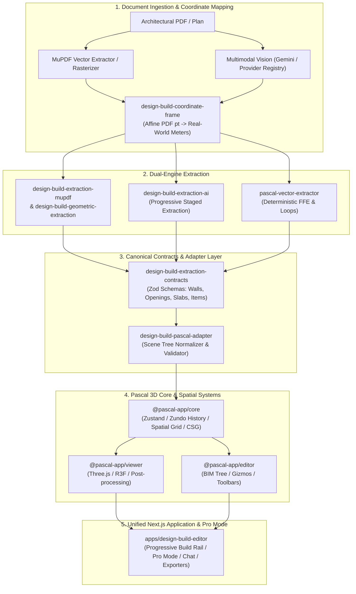

# Comprehensive File-by-File Codebase Audit & Architecture Report

## Executive Summary
This codebase represents an enterprise-grade, browser-based **Architectural CAD / BIM vector extraction and 3D modeling platform** engineered over the **Pascal 3D Engine**.
It automates the transformation of 2D architectural drawings (PDF vector drawings, scans, architectural plans) into fully-interactive, editable, parametric 3D BIM scene graphs.

The monorepo contains:
- **1 Main Next.js Application**: `apps/design-build-editor`
- **22 Workspace Packages**: `packages/*`
- **1 Standalone Extraction Engine**: `pascal-vector-extractor`
- **900+ Code and Configuration Files** totaling over 150,000 lines of source code.

---

## 1. System Architecture & High-Level Data Flow

---

## 2. Package-by-Package and File-by-File Breakdown

### Module: `root`

**Overview**: Root repository configuration, workspace orchestration (Turbo + pnpm), linter setup, and release configs.

- **File Count**: 27 files

#### Detailed File Inventory:

| File | Lines | Key Exports / Definitions | Functional Role / Implementation Details |
| :--- | :--- | :--- | :--- |
| [`.env.example`](file:///c:/Users/Mohamad60025/Desktop/Design-And-Build-Stable-5d93e63/.env.example) | - | - | File (0 KB) |
| [`biome.jsonc`](file:///c:/Users/Mohamad60025/Desktop/Design-And-Build-Stable-5d93e63/biome.jsonc) | - | - | File (3 KB) |
| [`AI-LEGACY-FREEZE-MANIFEST.json`](file:///c:/Users/Mohamad60025/Desktop/Design-And-Build-Stable-5d93e63/docs/AI-LEGACY-FREEZE-MANIFEST.json) | 175 | - | Source implementation |
| [`CLEAN-CLONE-BASELINE-INVENTORY.json`](file:///c:/Users/Mohamad60025/Desktop/Design-And-Build-Stable-5d93e63/docs/CLEAN-CLONE-BASELINE-INVENTORY.json) | 38 | - | Source implementation |
| [`CLEAN-CLONE-BUILD-RECOVERY-REPORT.json`](file:///c:/Users/Mohamad60025/Desktop/Design-And-Build-Stable-5d93e63/docs/CLEAN-CLONE-BUILD-RECOVERY-REPORT.json) | 146 | - | Source implementation |
| [`KNOWN-BASELINE-TEST-FAILURES.json`](file:///c:/Users/Mohamad60025/Desktop/Design-And-Build-Stable-5d93e63/docs/KNOWN-BASELINE-TEST-FAILURES.json) | 16 | - | Source implementation |
| [`package.json`](file:///c:/Users/Mohamad60025/Desktop/Design-And-Build-Stable-5d93e63/docs/new approach v2/package.json) | 20 | - | Source implementation |
| [`alignment.ts`](file:///c:/Users/Mohamad60025/Desktop/Design-And-Build-Stable-5d93e63/docs/new approach v2/src/alignment.ts) | 14 | `function dominantAxis` `function lineIntersection` `function alignmentFromAnchors` `function applyTransform` | Length-weighted axial circular mean: angle and angle+PI are equivalent. |
| [`catalogMatcher.ts`](file:///c:/Users/Mohamad60025/Desktop/Design-And-Build-Stable-5d93e63/docs/new approach v2/src/catalogMatcher.ts) | 42 | `interface FootprintDescriptor` `interface CatalogPrototype` `interface CatalogMatch` `function describeFootprint` `function matchCatalog` | Source implementation |
| [`flatRegistry.ts`](file:///c:/Users/Mohamad60025/Desktop/Design-And-Build-Stable-5d93e63/docs/new approach v2/src/flatRegistry.ts) | 9 | `interface RenderRecord` `class FlatRenderRegistry` | Source implementation |
| [`index.ts`](file:///c:/Users/Mohamad60025/Desktop/Design-And-Build-Stable-5d93e63/docs/new approach v2/src/index.ts) | 12 | - | Source implementation |
| [`invariantHash.ts`](file:///c:/Users/Mohamad60025/Desktop/Design-And-Build-Stable-5d93e63/docs/new approach v2/src/invariantHash.ts) | 20 | `function canonicalSignature` `function topologicalHash` | Source implementation |
| [`jsonBuilders.ts`](file:///c:/Users/Mohamad60025/Desktop/Design-And-Build-Stable-5d93e63/docs/new approach v2/src/jsonBuilders.ts) | 11 | `function matrixColumnMajor` `function wall` `function item` `function pascalScene` `function catalogMapping` | Source implementation |
| [`loopTracer.ts`](file:///c:/Users/Mohamad60025/Desktop/Design-And-Build-Stable-5d93e63/docs/new approach v2/src/loopTracer.ts) | 18 | `function traceBoundedLoops` | Source implementation |
| [`numeric.ts`](file:///c:/Users/Mohamad60025/Desktop/Design-And-Build-Stable-5d93e63/docs/new approach v2/src/numeric.ts) | 12 | `const EPS` `const q` `const key` `const sub` `const dot` | Source implementation |
| [`pascalAdapter.ts`](file:///c:/Users/Mohamad60025/Desktop/Design-And-Build-Stable-5d93e63/docs/new approach v2/src/pascalAdapter.ts) | 11 | `function toPascalNodes` | Source implementation |
| [`phasedExtractor.ts`](file:///c:/Users/Mohamad60025/Desktop/Design-And-Build-Stable-5d93e63/docs/new approach v2/src/phasedExtractor.ts) | 31 | `interface CadBlock` `interface ExtractInput` `interface WallDetection` `interface SlabDetection` `interface OpeningDetection` | Source implementation |
| [`pruning.ts`](file:///c:/Users/Mohamad60025/Desktop/Design-And-Build-Stable-5d93e63/docs/new approach v2/src/pruning.ts) | 29 | `const keepLayer` `function buildIndex` `function structuralCore` | Source implementation |
| [`types.ts`](file:///c:/Users/Mohamad60025/Desktop/Design-And-Build-Stable-5d93e63/docs/new approach v2/src/types.ts) | 14 | `type Vec2` `type Aabb` `type PrimitiveKind` `interface Segment` `interface ClosedRing` | Source implementation |
| [`catalog.test.ts`](file:///c:/Users/Mohamad60025/Desktop/Design-And-Build-Stable-5d93e63/docs/new approach v2/test/catalog.test.ts) | 4 | - | Source implementation |
| [`core.test.ts`](file:///c:/Users/Mohamad60025/Desktop/Design-And-Build-Stable-5d93e63/docs/new approach v2/test/core.test.ts) | 4 | - | Source implementation |
| [`tsconfig.json`](file:///c:/Users/Mohamad60025/Desktop/Design-And-Build-Stable-5d93e63/docs/new approach v2/tsconfig.json) | 8 | - | Source implementation |
| [`fix-names.cjs`](file:///c:/Users/Mohamad60025/Desktop/Design-And-Build-Stable-5d93e63/fix-names.cjs) | 63 | - | Fixer: convert @design-build/<name> scope to unscoped design-build-<name> / across the NEW workspace only (packages/*... |
| [`package.json`](file:///c:/Users/Mohamad60025/Desktop/Design-And-Build-Stable-5d93e63/package.json) | 43 | - | Source implementation |
| [`pnpm-workspace.yaml`](file:///c:/Users/Mohamad60025/Desktop/Design-And-Build-Stable-5d93e63/pnpm-workspace.yaml) | - | - | File (1 KB) |
| [`test-pdf2json-engine.mjs`](file:///c:/Users/Mohamad60025/Desktop/Design-And-Build-Stable-5d93e63/test-pdf2json-engine.mjs) | 76 | - | Source implementation |
| [`turbo.json`](file:///c:/Users/Mohamad60025/Desktop/Design-And-Build-Stable-5d93e63/turbo.json) | 35 | - | Source implementation |

---

### Module: `apps/design-build-editor`

**Overview**: Next.js 14+ application hosting the 3D BIM editor, progressive AI building pipeline, real-time diagnostic panel, Pro Mode UI overlay, and API endpoints.

- **Package Name**: `design-build-editor` (v0.1.0)
- **Dependencies**: `@iconify/react`, `@pascal-app/core`, `@pascal-app/editor`, `@pascal-app/nodes`, `@pascal-app/viewer`, `@react-three/fiber`, `clsx`, `design-build-attachment-service`, `design-build-conversation-core`, `design-build-coordinate-frame`, `design-build-export-services`, `design-build-extraction-ai`, `design-build-extraction-annotations`, `design-build-extraction-contracts`, `design-build-extraction-mupdf`, `design-build-geometric-extraction`, `design-build-pascal-adapter`, `design-build-provider-registry`, `design-build-render-orchestrator`, `design-build-shared-ui`, `design-build-simplified-viewer-shell`, `lucide-react`, `mupdf`, `next`, `react`, `react-dom`, `three`, `zod`, `zustand`
- **File Count**: 141 files

#### Detailed File Inventory:

| File | Lines | Key Exports / Definitions | Functional Role / Implementation Details |
| :--- | :--- | :--- | :--- |
| [`AI-LEGACY-FREEZE-MANIFEST.json`](file:///c:/Users/Mohamad60025/Desktop/Design-And-Build-Stable-5d93e63/apps/design-build-editor/docs/AI-LEGACY-FREEZE-MANIFEST.json) | 175 | - | Source implementation |
| [`next-env.d.ts`](file:///c:/Users/Mohamad60025/Desktop/Design-And-Build-Stable-5d93e63/apps/design-build-editor/next-env.d.ts) | 7 | - | / <reference types="next" /> / / <reference types="next/image-types/global" /> / / <reference path="./.next/types/rou... |
| [`next.config.mjs`](file:///c:/Users/Mohamad60025/Desktop/Design-And-Build-Stable-5d93e63/apps/design-build-editor/next.config.mjs) | 86 | - | Source implementation |
| [`package.json`](file:///c:/Users/Mohamad60025/Desktop/Design-And-Build-Stable-5d93e63/apps/design-build-editor/package.json) | 61 | - | Source implementation |
| [`postcss.config.mjs`](file:///c:/Users/Mohamad60025/Desktop/Design-And-Build-Stable-5d93e63/apps/design-build-editor/postcss.config.mjs) | 8 | - | Source implementation |
| [`ai-replay-fixture.json`](file:///c:/Users/Mohamad60025/Desktop/Design-And-Build-Stable-5d93e63/apps/design-build-editor/public/ai-replay-fixture.json) | 1 | - | Source implementation |
| [`PROVENANCE.json`](file:///c:/Users/Mohamad60025/Desktop/Design-And-Build-Stable-5d93e63/apps/design-build-editor/public/pascal-pro/icons/PROVENANCE.json) | 401 | - | Source implementation |
| [`route.ts`](file:///c:/Users/Mohamad60025/Desktop/Design-And-Build-Stable-5d93e63/apps/design-build-editor/src/app/api/extraction/ai/progressive/route.ts) | 261 | `const runtime` `const dynamic` `function POST` `function GET` | apps/design-build-editor/app/api/extraction/ai/progressive/route.ts / Progressive Pure AI V3 extraction boundary (spe... |
| [`route.ts`](file:///c:/Users/Mohamad60025/Desktop/Design-And-Build-Stable-5d93e63/apps/design-build-editor/src/app/api/extraction/ai/route.ts) | 247 | `const runtime` `const dynamic` `function POST` `function GET` | apps/design-build-editor/app/api/extraction/ai/route.ts / Clean AI (Gemini Multipass) extraction boundary (Change Set... |
| [`route.ts`](file:///c:/Users/Mohamad60025/Desktop/Design-And-Build-Stable-5d93e63/apps/design-build-editor/src/app/api/extraction/mupdf/route.ts) | 519 | `const runtime` `const dynamic` `function POST` | apps/design-build-editor/app/api/extraction/mupdf/route.ts / Dedicated clean Pure MuPDF extraction boundary (Change S... |
| [`route.ts`](file:///c:/Users/Mohamad60025/Desktop/Design-And-Build-Stable-5d93e63/apps/design-build-editor/src/app/api/extraction/windows/route.ts) | 59 | `const runtime` `const dynamic` `function POST` | apps/design-build-editor/app/api/extraction/windows/route.ts / Change Set 2 (Gate C, live): dedicated, NON-BLOCKING s... |
| [`route.ts`](file:///c:/Users/Mohamad60025/Desktop/Design-And-Build-Stable-5d93e63/apps/design-build-editor/src/app/api/harness/window-hypothesis-review/route.ts) | 77 | `function GET` | Source implementation |
| [`route.ts`](file:///c:/Users/Mohamad60025/Desktop/Design-And-Build-Stable-5d93e63/apps/design-build-editor/src/app/api/providers/route.ts) | 90 | `const runtime` `const dynamic` `function GET` `function POST` | apps/design-build-editor/app/api/providers/route.ts / Provider registry CRUD boundary (Change Set 3, §3–§7). / All re... |
| [`route.ts`](file:///c:/Users/Mohamad60025/Desktop/Design-And-Build-Stable-5d93e63/apps/design-build-editor/src/app/api/providers/select/route.ts) | 50 | `const runtime` `const dynamic` `function POST` `function GET` | apps/design-build-editor/app/api/providers/select/route.ts / Choose the active model/provider per independent slot (c... |
| [`route.ts`](file:///c:/Users/Mohamad60025/Desktop/Design-And-Build-Stable-5d93e63/apps/design-build-editor/src/app/api/providers/test/route.ts) | 55 | `const runtime` `const dynamic` `function POST` | apps/design-build-editor/app/api/providers/test/route.ts / Test Connection (Change Set 3, §5/§6). Runs server-side on... |
| [`route.ts`](file:///c:/Users/Mohamad60025/Desktop/Design-And-Build-Stable-5d93e63/apps/design-build-editor/src/app/api/providers/[id]/route.ts) | 67 | `const runtime` `const dynamic` `function PUT` `function DELETE` | apps/design-build-editor/app/api/providers/[id]/route.ts / Edit (PUT) and remove (DELETE) a provider. Masked response... |
| [`route.ts`](file:///c:/Users/Mohamad60025/Desktop/Design-And-Build-Stable-5d93e63/apps/design-build-editor/src/app/api/r132/evidence/route.ts) | 42 | `function GET` | Source implementation |
| [`route.ts`](file:///c:/Users/Mohamad60025/Desktop/Design-And-Build-Stable-5d93e63/apps/design-build-editor/src/app/api/window-review/route.ts) | 54 | `function GET` `function POST` | Source implementation |
| [`globals.css`](file:///c:/Users/Mohamad60025/Desktop/Design-And-Build-Stable-5d93e63/apps/design-build-editor/src/app/globals.css) | 621 | - | Design Build Editor — production design system. |
| [`page.tsx`](file:///c:/Users/Mohamad60025/Desktop/Design-And-Build-Stable-5d93e63/apps/design-build-editor/src/app/harness/guide-free/page.tsx) | 321 | `function GuideFreeHarness` | /harness/guide-free — FREE Guide runtime validation (no AI provider). / Upload a local PNG or JPEG; it becomes a Guid... |
| [`page.tsx`](file:///c:/Users/Mohamad60025/Desktop/Design-And-Build-Stable-5d93e63/apps/design-build-editor/src/app/harness/page.tsx) | 184 | `function HarnessPage` | /harness — Section 4 capability harness page. / loadPlugin(builtinPlugin) -> setScene(static capability scene) -> off... |
| [`page.tsx`](file:///c:/Users/Mohamad60025/Desktop/Design-And-Build-Stable-5d93e63/apps/design-build-editor/src/app/harness/window-hypothesis-review/page.tsx) | 80 | `function ReviewPage` | Source implementation |
| [`layout.tsx`](file:///c:/Users/Mohamad60025/Desktop/Design-And-Build-Stable-5d93e63/apps/design-build-editor/src/app/layout.tsx) | 13 | `const metadata` `function RootLayout` | Source implementation |
| [`page.tsx`](file:///c:/Users/Mohamad60025/Desktop/Design-And-Build-Stable-5d93e63/apps/design-build-editor/src/app/page.tsx) | 2959 | `function Home` | Home page — First Upgrade + Change Set 2 (Live Pure MuPDF Migration). / Responsibilities: / - Install ONLY the initia... |
| [`page.tsx`](file:///c:/Users/Mohamad60025/Desktop/Design-And-Build-Stable-5d93e63/apps/design-build-editor/src/app/window-review/page.tsx) | 292 | `function WindowReviewPage` | Source implementation |
| [`page.tsx`](file:///c:/Users/Mohamad60025/Desktop/Design-And-Build-Stable-5d93e63/apps/design-build-editor/src/app/window-review-r132/page.tsx) | 457 | `function BlindReviewPage` | Source implementation |
| [`page.tsx`](file:///c:/Users/Mohamad60025/Desktop/Design-And-Build-Stable-5d93e63/apps/design-build-editor/src/app/_not-found/page.tsx) | 11 | `function NotFound` | Source implementation |
| [`dynamic-project-label.ts`](file:///c:/Users/Mohamad60025/Desktop/Design-And-Build-Stable-5d93e63/apps/design-build-editor/src/components/dynamic-project-label.ts) | 8 | `function projectLabelFromFiles` | Source implementation |
| [`window-hypothesis-pilots.json`](file:///c:/Users/Mohamad60025/Desktop/Design-And-Build-Stable-5d93e63/apps/design-build-editor/src/dev-fixtures/window-hypothesis-pilots.json) | 83 | - | Source implementation |
| [`AiExtractionControls.tsx`](file:///c:/Users/Mohamad60025/Desktop/Design-And-Build-Stable-5d93e63/apps/design-build-editor/src/features/ai-extraction/components/AiExtractionControls.tsx) | 147 | `interface AiExtractionControlsProps` `function AiExtractionControls` | features/ai-extraction/components/AiExtractionControls.tsx / Compact, registry-driven AI extraction control rendered ... |
| [`index.ts`](file:///c:/Users/Mohamad60025/Desktop/Design-And-Build-Stable-5d93e63/apps/design-build-editor/src/features/ai-extraction/index.ts) | 21 | - | features/ai-extraction/index.ts / Public surface of the isolated AI extraction feature. The landing Composer / and pa... |
| [`ai-extraction-readiness.test.ts`](file:///c:/Users/Mohamad60025/Desktop/Design-And-Build-Stable-5d93e63/apps/design-build-editor/src/features/ai-extraction/provider-runtime/ai-extraction-readiness.test.ts) | 101 | - | features/ai-extraction/provider-runtime/ai-extraction-readiness.test.ts / Narrow integration tests for the AI extract... |
| [`api.ts`](file:///c:/Users/Mohamad60025/Desktop/Design-And-Build-Stable-5d93e63/apps/design-build-editor/src/features/ai-extraction/provider-runtime/api.ts) | 44 | `function fetchProviders` `function selectExtractionModel` | features/ai-extraction/provider-runtime/api.ts / Thin client for the existing provider-registry HTTP API. No server-o... |
| [`registry-client.test.ts`](file:///c:/Users/Mohamad60025/Desktop/Design-And-Build-Stable-5d93e63/apps/design-build-editor/src/features/ai-extraction/provider-runtime/registry-client.test.ts) | 185 | - | features/ai-extraction/provider-runtime/registry-client.test.ts / Focused tests for the isolated provider-registry cl... |
| [`types.ts`](file:///c:/Users/Mohamad60025/Desktop/Design-And-Build-Stable-5d93e63/apps/design-build-editor/src/features/ai-extraction/provider-runtime/types.ts) | 58 | `type ProviderType` `type ProviderKind` `type ProviderVerificationStatus` `interface ProviderSummary` `interface ModelRef` | features/ai-extraction/provider-runtime/types.ts / Frontend types derived ONLY from the GET /api/providers safe summa... |
| [`use-ai-provider-registry.ts`](file:///c:/Users/Mohamad60025/Desktop/Design-And-Build-Stable-5d93e63/apps/design-build-editor/src/features/ai-extraction/provider-runtime/use-ai-provider-registry.ts) | 181 | `function resolveActiveExtractionProvider` `function resolveAvailableModels` `interface AiReadiness` `function deriveAiExtractionReadiness` `interface UseAiProviderRegistry` | features/ai-extraction/provider-runtime/use-ai-provider-registry.ts / Hook owning AI extraction provider-registry sta... |
| [`install-live-columns.ts`](file:///c:/Users/Mohamad60025/Desktop/Design-And-Build-Stable-5d93e63/apps/design-build-editor/src/features/columns/install-live-columns.ts) | 142 | `type LiveColumnInstallResult` `type LiveColumnInstallerContext` `const COLUMN_DEFAULT_HEIGHT_M` `function installLiveColumns` | Source implementation |
| [`attachment-repository.ts`](file:///c:/Users/Mohamad60025/Desktop/Design-And-Build-Stable-5d93e63/apps/design-build-editor/src/features/conversation/attachment-repository.ts) | 30 | `const attachmentRepository` | features/conversation/attachment-repository.ts / Clean attachment repository (Change Set 2 activation, §1). / The REA... |
| [`AttachmentGallery.tsx`](file:///c:/Users/Mohamad60025/Desktop/Design-And-Build-Stable-5d93e63/apps/design-build-editor/src/features/conversation/AttachmentGallery.tsx) | 28 | `function AttachmentGallery` | features/conversation/AttachmentGallery.tsx — reference/attachment trigger. / Bytes go to the clean attachment reposi... |
| [`ChatPanel.tsx`](file:///c:/Users/Mohamad60025/Desktop/Design-And-Build-Stable-5d93e63/apps/design-build-editor/src/features/conversation/ChatPanel.tsx) | 118 | `interface ChatBuildProgress` `interface ChatPanelProps` `function ChatPanel` | features/conversation/ChatPanel.tsx / Centred landing ChatBox → compact docked command bar. MUST NOT import: MuPDF, /... |
| [`Composer.tsx`](file:///c:/Users/Mohamad60025/Desktop/Design-And-Build-Stable-5d93e63/apps/design-build-editor/src/features/conversation/Composer.tsx) | 286 | `interface ComposerProps` `function Composer` | features/conversation/Composer.tsx — landing two-card selector + compact docked bar. / Attachment bytes live in the c... |
| [`MessageBubble.tsx`](file:///c:/Users/Mohamad60025/Desktop/Design-And-Build-Stable-5d93e63/apps/design-build-editor/src/features/conversation/MessageBubble.tsx) | 12 | `function MessageBubble` | features/conversation/MessageBubble.tsx |
| [`MessageList.tsx`](file:///c:/Users/Mohamad60025/Desktop/Design-And-Build-Stable-5d93e63/apps/design-build-editor/src/features/conversation/MessageList.tsx) | 19 | `function MessageList` | features/conversation/MessageList.tsx — renders typed ChatEvents as messages. |
| [`ProviderSelector.tsx`](file:///c:/Users/Mohamad60025/Desktop/Design-And-Build-Stable-5d93e63/apps/design-build-editor/src/features/conversation/ProviderSelector.tsx) | 445 | `type ProviderType` `type ProviderKind` `interface ProviderSummaryView` `interface ActiveSelections` `interface ProviderDraft` | features/conversation/ProviderSelector.tsx / Visible dynamic provider-management workflow (Change Set 3, §3–§7). / SE... |
| [`door-boundary.test.ts`](file:///c:/Users/Mohamad60025/Desktop/Design-And-Build-Stable-5d93e63/apps/design-build-editor/src/features/door-pilot/door-boundary.test.ts) | 149 | - | Source implementation |
| [`door-boundary.ts`](file:///c:/Users/Mohamad60025/Desktop/Design-And-Build-Stable-5d93e63/apps/design-build-editor/src/features/door-pilot/door-boundary.ts) | 113 | `type BoundaryAcceptedDoor` `type BoundaryReviewRecord` `type BoundaryDoorManifest` `type RuntimeWallEntry` `type RuntimeWallMap` | Pure client-side boundary between the route door manifest and the Pascal / DoorNode installer. / This is the single s... |
| [`install-live-doors.ts`](file:///c:/Users/Mohamad60025/Desktop/Design-And-Build-Stable-5d93e63/apps/design-build-editor/src/features/door-pilot/install-live-doors.ts) | 236 | `type LiveDoorContract` `type LiveDoorInstallResult` `type LiveDoorInstallerContext` `function installLiveDoors` `function getLiveDoorInstallerStageText` | Live Pascal DoorNode installer for the verified Pure MuPDF door-extraction set. / Mirrors installLiveWindows (Change ... |
| [`action-matrix.ts`](file:///c:/Users/Mohamad60025/Desktop/Design-And-Build-Stable-5d93e63/apps/design-build-editor/src/features/pro/action-matrix.ts) | 111 | `const ACTION_FLAGS` `const CURRENT_BUILD_INFO` `type SemanticNodeType` `interface ContextualAction` `function getSemanticActionsForNode` | features/pro/action-matrix.ts / Type-safe contextual action capability matrix by semantic node type. |
| [`EditorSelectionManager.tsx`](file:///c:/Users/Mohamad60025/Desktop/Design-And-Build-Stable-5d93e63/apps/design-build-editor/src/features/pro/EditorSelectionManager.tsx) | 358 | `function EditorSelectionManager` | features/pro/EditorSelectionManager.tsx / SOURCE_FAITHFUL_HOST_ADAPTER / Source Repository: https://github.com/pascal... |
| [`FloatingActionMenu.tsx`](file:///c:/Users/Mohamad60025/Desktop/Design-And-Build-Stable-5d93e63/apps/design-build-editor/src/features/pro/FloatingActionMenu.tsx) | 10 | - | features/pro/FloatingActionMenu.tsx / Exports 3D anchor and DOM action bar cleanly separated across R3F / DOM boundary. |
| [`pascal-editor-icon-data.json`](file:///c:/Users/Mohamad60025/Desktop/Design-And-Build-Stable-5d93e63/apps/design-build-editor/src/features/pro/pascal-editor-icon-data.json) | 145 | - | Source implementation |
| [`pascal-editor-icon-manifest.ts`](file:///c:/Users/Mohamad60025/Desktop/Design-And-Build-Stable-5d93e63/apps/design-build-editor/src/features/pro/pascal-editor-icon-manifest.ts) | 55 | `const PASCAL_EDITOR_ICONS` | pascal-editor-icon-manifest.ts / The EXACT finite set of Iconify icons the installed @pascal-app/editor@0.9.2 / shell... |
| [`pascal-editor-icons.ts`](file:///c:/Users/Mohamad60025/Desktop/Design-And-Build-Stable-5d93e63/apps/design-build-editor/src/features/pro/pascal-editor-icons.ts) | 49 | `function registerPascalEditorIcons` | features/pro/pascal-editor-icons.ts / Deployment-safe Iconify registration for the embedded official / @pascal-app/ed... |
| [`pro-asset.test.ts`](file:///c:/Users/Mohamad60025/Desktop/Design-And-Build-Stable-5d93e63/apps/design-build-editor/src/features/pro/pro-asset.test.ts) | 56 | - | Focused test: the 39 official WebP assets required by the mounted / @pascal-app/editor@0.9.2 code path must be real, ... |
| [`pro-css-source.test.ts`](file:///c:/Users/Mohamad60025/Desktop/Design-And-Build-Stable-5d93e63/apps/design-build-editor/src/features/pro/pro-css-source.test.ts) | 49 | - | Focused regression test for the embedded-PRO layout root cause. / The official @pascal-app/editor@0.9.2 package ships... |
| [`pro-fail-safe-selection.test.ts`](file:///c:/Users/Mohamad60025/Desktop/Design-And-Build-Stable-5d93e63/apps/design-build-editor/src/features/pro/pro-fail-safe-selection.test.ts) | 150 | - | features/pro/pro-fail-safe-selection.test.ts / Tests for fail-safe component resolution, mode separation, and error b... |
| [`pro-final-acceptance.test.ts`](file:///c:/Users/Mohamad60025/Desktop/Design-And-Build-Stable-5d93e63/apps/design-build-editor/src/features/pro/pro-final-acceptance.test.ts) | 220 | - | features/pro/pro-final-acceptance.test.ts / Comprehensive acceptance tests for PRO Creation, Hosting, History, Safe D... |
| [`pro-integration.test.ts`](file:///c:/Users/Mohamad60025/Desktop/Design-And-Build-Stable-5d93e63/apps/design-build-editor/src/features/pro/pro-integration.test.ts) | 64 | - | Focused tests for the PRO (optional official Pascal PRO editing mode) integration. / These assert the host-side guara... |
| [`pro-leaf-selection.test.ts`](file:///c:/Users/Mohamad60025/Desktop/Design-And-Build-Stable-5d93e63/apps/design-build-editor/src/features/pro/pro-leaf-selection.test.ts) | 258 | - | features/pro/pro-leaf-selection.test.ts |
| [`pro-milestone-b.test.ts`](file:///c:/Users/Mohamad60025/Desktop/Design-And-Build-Stable-5d93e63/apps/design-build-editor/src/features/pro/pro-milestone-b.test.ts) | 162 | - | features/pro/pro-milestone-b.test.ts / Tests for Milestone B: Safe Deletion Capability Matrix & Item Workflow. |
| [`pro-transition.test.ts`](file:///c:/Users/Mohamad60025/Desktop/Design-And-Build-Stable-5d93e63/apps/design-build-editor/src/features/pro/pro-transition.test.ts) | 115 | - | Focused tests for the PRO transition machine (overlay mode over the / permanently-mounted Standard Viewer). Tests the... |
| [`pro.css`](file:///c:/Users/Mohamad60025/Desktop/Design-And-Build-Stable-5d93e63/apps/design-build-editor/src/features/pro/pro.css) | 551 | - | Pascal PRO editor theme + Tailwind v4 utilities (SCOPED to .pascal-pro-root). |
| [`ProEditorLazy.tsx`](file:///c:/Users/Mohamad60025/Desktop/Design-And-Build-Stable-5d93e63/apps/design-build-editor/src/features/pro/ProEditorLazy.tsx) | 218 | `function ProEditorLazy` | features/pro/ProEditorLazy.tsx / Optional official Pascal PRO editing mode — the PRO rendering surface. / ARCHITECTUR... |
| [`ProOverlay.tsx`](file:///c:/Users/Mohamad60025/Desktop/Design-And-Build-Stable-5d93e63/apps/design-build-editor/src/features/pro/ProOverlay.tsx) | 402 | `function getSelectionDiagnostics` `function ProOverlay` | features/pro/ProOverlay.tsx / PASCAL PRO OVERLAY MODE — High-Fidelity Official Pascal Integration / Milestone A & B: |
| [`proPreload.ts`](file:///c:/Users/Mohamad60025/Desktop/Design-And-Build-Stable-5d93e63/apps/design-build-editor/src/features/pro/proPreload.ts) | 99 | `interface ProPreloadResult` `function preparePro` | features/pro/proPreload.ts / PRO preload phase — runs WHILE STANDARD remains the only mounted Viewer. / It performs e... |
| [`safeDelete.ts`](file:///c:/Users/Mohamad60025/Desktop/Design-And-Build-Stable-5d93e63/apps/design-build-editor/src/features/pro/safeDelete.ts) | 114 | `interface DeletionCapability` `const DELETION_CAPABILITY_MATRIX` `function canSafelyDeleteNode` `function getDeleteDisabledReason` `function performSafeDelete` | features/pro/safeDelete.ts / Safe deletion capability matrix and authoritative deletion actions for PRO mode. |
| [`SafeInspector.tsx`](file:///c:/Users/Mohamad60025/Desktop/Design-And-Build-Stable-5d93e63/apps/design-build-editor/src/features/pro/SafeInspector.tsx) | 183 | `class ProPanelErrorBoundary` `function CompactPropertiesCard` `function ReadOnlyNodePanel` `function SafeInspector` | features/pro/SafeInspector.tsx / Compact, fail-safe selected-node properties presenter without empty side panel. |
| [`selection-action-store.ts`](file:///c:/Users/Mohamad60025/Desktop/Design-And-Build-Stable-5d93e63/apps/design-build-editor/src/features/pro/selection-action-store.ts) | 39 | `interface SelectionAnchorState` `const useSelectionActionStore` | features/pro/selection-action-store.ts / Lightweight store sharing screen anchor coordinates between R3F Canvas and D... |
| [`SelectionActionAnchor3D.tsx`](file:///c:/Users/Mohamad60025/Desktop/Design-And-Build-Stable-5d93e63/apps/design-build-editor/src/features/pro/SelectionActionAnchor3D.tsx) | 147 | `function SelectionActionAnchor3D` | features/pro/SelectionActionAnchor3D.tsx / R3F 3D anchor projection bridge: computes screen coordinates of selected n... |
| [`SelectionActionBarDOM.tsx`](file:///c:/Users/Mohamad60025/Desktop/Design-And-Build-Stable-5d93e63/apps/design-build-editor/src/features/pro/SelectionActionBarDOM.tsx) | 906 | `function SelectionActionBarDOM` | features/pro/SelectionActionBarDOM.tsx / Pure DOM Contextual Action Bar rendered OUTSIDE the R3F Canvas in the shared... |
| [`SelectionActionBarErrorBoundary.tsx`](file:///c:/Users/Mohamad60025/Desktop/Design-And-Build-Stable-5d93e63/apps/design-build-editor/src/features/pro/SelectionActionBarErrorBoundary.tsx) | 41 | `class SelectionActionBarErrorBoundary` | features/pro/SelectionActionBarErrorBoundary.tsx / Application-owned DOM ErrorBoundary isolating the contextual actio... |
| [`useEditorMode.ts`](file:///c:/Users/Mohamad60025/Desktop/Design-And-Build-Stable-5d93e63/apps/design-build-editor/src/features/pro/useEditorMode.ts) | 229 | `type EditorMode` `type ProStatus` `type TransitionState` `const PRO_STAGES` `type ProStage` | features/pro/useEditorMode.ts / Editor mode state for the optional official Pascal PRO editing mode. / STRATEGY (PRO ... |
| [`BuildCompletionCard.tsx`](file:///c:/Users/Mohamad60025/Desktop/Design-And-Build-Stable-5d93e63/apps/design-build-editor/src/features/progressive-build/BuildCompletionCard.tsx) | 112 | `interface CompletionProps` `function BuildCompletionCard` | features/progressive-build/BuildCompletionCard.tsx |
| [`BuildProgressRail.tsx`](file:///c:/Users/Mohamad60025/Desktop/Design-And-Build-Stable-5d93e63/apps/design-build-editor/src/features/progressive-build/BuildProgressRail.tsx) | 109 | `interface RailProps` `function BuildProgressRail` | features/progressive-build/BuildProgressRail.tsx / Real progressive-build rail. Driven by the frozen import event log... |
| [`BuildStageRow.tsx`](file:///c:/Users/Mohamad60025/Desktop/Design-And-Build-Stable-5d93e63/apps/design-build-editor/src/features/progressive-build/BuildStageRow.tsx) | 29 | `interface StageView` `function BuildStageRow` | features/progressive-build/BuildStageRow.tsx |
| [`BuildTechnicalDetails.tsx`](file:///c:/Users/Mohamad60025/Desktop/Design-And-Build-Stable-5d93e63/apps/design-build-editor/src/features/progressive-build/BuildTechnicalDetails.tsx) | 17 | `function BuildTechnicalDetails` | features/progressive-build/BuildTechnicalDetails.tsx |
| [`ChunkLoadRecovery.tsx`](file:///c:/Users/Mohamad60025/Desktop/Design-And-Build-Stable-5d93e63/apps/design-build-editor/src/features/progressive-build/ChunkLoadRecovery.tsx) | 35 | `interface ChunkLoadRecoveryProps` `function ChunkLoadRecovery` | features/progressive-build/ChunkLoadRecovery.tsx / S9: Chunk-load recovery UX. Shown ONLY when a ChunkLoadError (view... |
| [`DiagnosticPanel.tsx`](file:///c:/Users/Mohamad60025/Desktop/Design-And-Build-Stable-5d93e63/apps/design-build-editor/src/features/progressive-build/DiagnosticPanel.tsx) | 129 | `function DiagnosticPanel` | features/progressive-build/DiagnosticPanel.tsx / Editor-owned acceptance diagnostics (spec Phase 1 / Phase 21). / Bec... |
| [`guide-lifecycle.test.ts`](file:///c:/Users/Mohamad60025/Desktop/Design-And-Build-Stable-5d93e63/apps/design-build-editor/src/features/progressive-build/guide-lifecycle.test.ts) | 86 | - | Source implementation |
| [`GuideControls.tsx`](file:///c:/Users/Mohamad60025/Desktop/Design-And-Build-Stable-5d93e63/apps/design-build-editor/src/features/progressive-build/GuideControls.tsx) | 221 | `function GuideControls` | features/progressive-build/GuideControls.tsx / Compact, non-modal Guide controls: visibility toggle + opacity slider.... |
| [`ProgressiveBuildV3.tsx`](file:///c:/Users/Mohamad60025/Desktop/Design-And-Build-Stable-5d93e63/apps/design-build-editor/src/features/progressive-build/ProgressiveBuildV3.tsx) | 257 | `type StageStatus` `type GuideLifecycle` `interface StageCardState` `interface ProgressiveBuildV3Props` `type GuideReadinessSignal` | Source implementation |
| [`ExportProgress.tsx`](file:///c:/Users/Mohamad60025/Desktop/Design-And-Build-Stable-5d93e63/apps/design-build-editor/src/features/project-export/ExportProgress.tsx) | 24 | `function ExportProgress` | features/project-export/ExportProgress.tsx |
| [`ExportRail.tsx`](file:///c:/Users/Mohamad60025/Desktop/Design-And-Build-Stable-5d93e63/apps/design-build-editor/src/features/project-export/ExportRail.tsx) | 56 | `function filterCommercialNodes` `function ExportRail` | features/project-export/ExportRail.tsx / Export-suite presentation only. No real export generation in this change set... |
| [`FullSuiteExportCard.tsx`](file:///c:/Users/Mohamad60025/Desktop/Design-And-Build-Stable-5d93e63/apps/design-build-editor/src/features/project-export/FullSuiteExportCard.tsx) | 25 | `function FullSuiteExportCard` | features/project-export/FullSuiteExportCard.tsx |
| [`camera-framing-service.ts`](file:///c:/Users/Mohamad60025/Desktop/Design-And-Build-Stable-5d93e63/apps/design-build-editor/src/features/viewer-interaction/camera-framing-service.ts) | 193 | `type CameraMode` `interface Aabb` `interface CameraParams` `interface FramingSolution` `function combineAabbs` | features/viewer-interaction/camera-framing-service.ts / Reusable HOST-APP camera-framing service for the Design Build... |
| [`KeyboardElementControls.tsx`](file:///c:/Users/Mohamad60025/Desktop/Design-And-Build-Stable-5d93e63/apps/design-build-editor/src/features/viewer-interaction/KeyboardElementControls.tsx) | 115 | `function KeyboardElementControls` | features/viewer-interaction/KeyboardElementControls.tsx / Global keyboard manipulation for selected scene elements (i... |
| [`selection-context.ts`](file:///c:/Users/Mohamad60025/Desktop/Design-And-Build-Stable-5d93e63/apps/design-build-editor/src/features/viewer-interaction/selection-context.ts) | 137 | `interface SelectedNodeInfo` `function useSelectionInfo` `function selectNodes` `function clearSelection` | features/viewer-interaction/selection-context.ts / Read-only bridge to the official Pascal Viewer selection state. Th... |
| [`SelectionPropertiesPanel.tsx`](file:///c:/Users/Mohamad60025/Desktop/Design-And-Build-Stable-5d93e63/apps/design-build-editor/src/features/viewer-interaction/SelectionPropertiesPanel.tsx) | 73 | `function SelectionPropertiesPanel` | features/viewer-interaction/SelectionPropertiesPanel.tsx / Left collapsible properties panel. Hides when nothing is s... |
| [`ViewerToolbar.tsx`](file:///c:/Users/Mohamad60025/Desktop/Design-And-Build-Stable-5d93e63/apps/design-build-editor/src/features/viewer-interaction/ViewerToolbar.tsx) | 181 | `function ViewerToolbar` | features/viewer-interaction/ViewerToolbar.tsx / Floating viewer toolbar wrapping official Pascal capabilities + the h... |
| [`PascalWindowHypothesisOverlay.tsx`](file:///c:/Users/Mohamad60025/Desktop/Design-And-Build-Stable-5d93e63/apps/design-build-editor/src/features/window-hypothesis/PascalWindowHypothesisOverlay.tsx) | 296 | `function PascalWindowHypothesisOverlay` | Source implementation |
| [`install-pilot-windows.test.ts`](file:///c:/Users/Mohamad60025/Desktop/Design-And-Build-Stable-5d93e63/apps/design-build-editor/src/features/window-pilot/install-pilot-windows.test.ts) | 114 | - | features/window-pilot/install-pilot-windows.test.ts / M3 acceptance verification: 24 WindowNodes, host mappings, live... |
| [`install-pilot-windows.ts`](file:///c:/Users/Mohamad60025/Desktop/Design-And-Build-Stable-5d93e63/apps/design-build-editor/src/features/window-pilot/install-pilot-windows.ts) | 622 | `type PilotWindowInstallResult` `type PilotWindowInstallerContext` `const PILOT_MAPPING_SOURCE_HASH` `function isPilotCommercialExcluded` `function installPilotWindows` | Source implementation |
| [`catalogue.ts`](file:///c:/Users/Mohamad60025/Desktop/Design-And-Build-Stable-5d93e63/apps/design-build-editor/src/harness/ai-scene-install/catalogue.ts) | 55 | `interface ResolvedFurniture` `function lookupFurniture` `function furnitureAsset` | harness/ai-scene-install/catalogue.ts / Catalogue-constrained furniture asset resolution — shared by both installers.... |
| [`helpers.test.ts`](file:///c:/Users/Mohamad60025/Desktop/Design-And-Build-Stable-5d93e63/apps/design-build-editor/src/harness/ai-scene-install/helpers.test.ts) | 26 | - | apps/design-build-editor/src/harness/ai-scene-install/helpers.test.ts / Null-safe wall geometry reading — regression ... |
| [`helpers.ts`](file:///c:/Users/Mohamad60025/Desktop/Design-And-Build-Stable-5d93e63/apps/design-build-editor/src/harness/ai-scene-install/helpers.ts) | 215 | `const uid` `function postDebug` `function normalizeMaterial` `function computeConvexHull` `function computePolygonArea` | harness/ai-scene-install/helpers.ts / Shared Pascal 0.9.2 scene-geometry + identity helpers used by BOTH the V2 / (in... |
| [`index.ts`](file:///c:/Users/Mohamad60025/Desktop/Design-And-Build-Stable-5d93e63/apps/design-build-editor/src/harness/ai-scene-install/index.ts) | 17 | - | harness/ai-scene-install/index.ts / Shared scene-install modules used by BOTH the V2 (install-ai-extract.ts) and / V3... |
| [`install-furniture.test.ts`](file:///c:/Users/Mohamad60025/Desktop/Design-And-Build-Stable-5d93e63/apps/design-build-editor/src/harness/ai-scene-install/install-furniture.test.ts) | 128 | - | apps/design-build-editor/src/harness/ai-scene-install/install-furniture.test.ts / Furniture instance-identity + dimen... |
| [`install-furniture.ts`](file:///c:/Users/Mohamad60025/Desktop/Design-And-Build-Stable-5d93e63/apps/design-build-editor/src/harness/ai-scene-install/install-furniture.ts) | 146 | `interface InstallFurnitureOptions` `function normalizeFurnitureItem` `function installFurniture` | harness/ai-scene-install/install-furniture.ts / Shared furniture -> ItemNode installer. Handles BOTH V2 FurnitureInst... |
| [`install-guide.test.ts`](file:///c:/Users/Mohamad60025/Desktop/Design-And-Build-Stable-5d93e63/apps/design-build-editor/src/harness/ai-scene-install/install-guide.test.ts) | 170 | - | harness/ai-scene-install/install-guide.test.ts / Focused tests for the SHARED, provider-neutral AI Guide installer. /... |
| [`install-guide.ts`](file:///c:/Users/Mohamad60025/Desktop/Design-And-Build-Stable-5d93e63/apps/design-build-editor/src/harness/ai-scene-install/install-guide.ts) | 194 | `interface InstallGuideArgs` `interface InstallGuideResult` `function installGuide` `function alignGuideToBuilding` `const installGuideShared` | harness/ai-scene-install/install-guide.ts / SHARED, provider-neutral AI Guide installer used by BOTH the V2 / (instal... |
| [`install-opening.ts`](file:///c:/Users/Mohamad60025/Desktop/Design-And-Build-Stable-5d93e63/apps/design-build-editor/src/harness/ai-scene-install/install-opening.ts) | 332 | `interface OpeningHostMap` `type OpeningOutcome` `interface OpeningRecord` `interface OpeningLedger` `function installWindows` | harness/ai-scene-install/install-opening.ts / Shared window/door installer. Openings are children of their host WALL ... |
| [`install-slab.ts`](file:///c:/Users/Mohamad60025/Desktop/Design-And-Build-Stable-5d93e63/apps/design-build-editor/src/harness/ai-scene-install/install-slab.ts) | 82 | `function installSlab` | harness/ai-scene-install/install-slab.ts / Shared slab installer. Prefers the AI slab polygon (authoritative floor / ... |
| [`install-walls.ts`](file:///c:/Users/Mohamad60025/Desktop/Design-And-Build-Stable-5d93e63/apps/design-build-editor/src/harness/ai-scene-install/install-walls.ts) | 89 | `interface WallInstallEntry` `interface WallInstallResult` `function installWalls` | harness/ai-scene-install/install-walls.ts / Shared wall installer (V3 progressive stage 3). Builds 3D WallNodes from ... |
| [`opening-host.test.ts`](file:///c:/Users/Mohamad60025/Desktop/Design-And-Build-Stable-5d93e63/apps/design-build-editor/src/harness/ai-scene-install/opening-host.test.ts) | 126 | - | apps/design-build-editor/src/harness/ai-scene-install/opening-host.test.ts / Phase B: host openings through the EXPLI... |
| [`runtime-wall-map.test.ts`](file:///c:/Users/Mohamad60025/Desktop/Design-And-Build-Stable-5d93e63/apps/design-build-editor/src/harness/ai-scene-install/runtime-wall-map.test.ts) | 94 | - | apps/design-build-editor/src/harness/ai-scene-install/runtime-wall-map.test.ts / Phase B: FINALIZED AI WALL MAP — con... |
| [`runtime-wall-map.ts`](file:///c:/Users/Mohamad60025/Desktop/Design-And-Build-Stable-5d93e63/apps/design-build-editor/src/harness/ai-scene-install/runtime-wall-map.ts) | 157 | `type RuntimeWallMapStatus` `interface RuntimeWallMapEntry` `interface RuntimeWallMapDiagnostics` `interface RuntimeWallMapBuild` `function buildRuntimeWallMap` | harness/ai-scene-install/runtime-wall-map.ts / RUNTIME WALL MAP — an INSTALLATION-TIME artifact, NOT an extraction st... |
| [`schema-contract.test.ts`](file:///c:/Users/Mohamad60025/Desktop/Design-And-Build-Stable-5d93e63/apps/design-build-editor/src/harness/ai-scene-install/schema-contract.test.ts) | 45 | - | apps/design-build-editor/src/harness/ai-scene-install/schema-contract.test.ts / §2 — Real Pascal schema-contract test... |
| [`snapshot-to-pascal-replay.test.ts`](file:///c:/Users/Mohamad60025/Desktop/Design-And-Build-Stable-5d93e63/apps/design-build-editor/src/harness/ai-scene-install/snapshot-to-pascal-replay.test.ts) | 212 | - | harness/ai-scene-install/snapshot-to-pascal-replay.test.ts / Replays the ALREADY-CAPTURED, validated AI ExtractionRes... |
| [`stage-cleanup.ts`](file:///c:/Users/Mohamad60025/Desktop/Design-And-Build-Stable-5d93e63/apps/design-build-editor/src/harness/ai-scene-install/stage-cleanup.ts) | 52 | `type NewRunPolicy` `function clearRunStage` `function beginRunCleanup` `function previousRunId` | harness/ai-scene-install/stage-cleanup.ts / Idempotent clearing of progressively-installed nodes (spec §12). / clearR... |
| [`structural-validation.test.ts`](file:///c:/Users/Mohamad60025/Desktop/Design-And-Build-Stable-5d93e63/apps/design-build-editor/src/harness/ai-scene-install/structural-validation.test.ts) | 206 | - | apps/design-build-editor/src/harness/ai-scene-install/structural-validation.test.ts / Phase B §10: structural runtime... |
| [`structural-validation.ts`](file:///c:/Users/Mohamad60025/Desktop/Design-And-Build-Stable-5d93e63/apps/design-build-editor/src/harness/ai-scene-install/structural-validation.ts) | 201 | `type StructuralStatus` `interface StructuralValidationResult` `interface StructuralValidationInput` `function validateStructuralScene` | harness/ai-scene-install/structural-validation.ts / Phase B §10 — STRUCTURAL RUNTIME VALIDATION. / Validates the ACTU... |
| [`types.ts`](file:///c:/Users/Mohamad60025/Desktop/Design-And-Build-Stable-5d93e63/apps/design-build-editor/src/harness/ai-scene-install/types.ts) | 36 | `interface SceneInstallContext` `interface FurnitureItem` | harness/ai-scene-install/types.ts / Shared scene-install context + furniture item shape accepted by installFurnitureI... |
| [`v3.test.ts`](file:///c:/Users/Mohamad60025/Desktop/Design-And-Build-Stable-5d93e63/apps/design-build-editor/src/harness/ai-scene-install/v3.test.ts) | 279 | - | apps/design-build-editor/src/harness/ai-scene-install/v3.test.ts / Pure AI Progressive V3 — app-level installer tests... |
| [`build-capability-scene.ts`](file:///c:/Users/Mohamad60025/Desktop/Design-And-Build-Stable-5d93e63/apps/design-build-editor/src/harness/build-capability-scene.ts) | 124 | `interface CapabilityScene` `function buildCapabilityScene` | harness/build-capability-scene.ts / Section 4: Pascal capability harness. Builds a static scene through the / REAL Pa... |
| [`build-code06-import.ts`](file:///c:/Users/Mohamad60025/Desktop/Design-And-Build-Stable-5d93e63/apps/design-build-editor/src/harness/build-code06-import.ts) | 120 | `interface Code06Drafts` `interface InitialIds` `function prepareCode06Drafts` | harness/build-code06-import.ts / Checkpoint 2: FROZEN CODE-06 wall import. / Imports the APPROVED frozen extraction r... |
| [`build-live-import.ts`](file:///c:/Users/Mohamad60025/Desktop/Design-And-Build-Stable-5d93e63/apps/design-build-editor/src/harness/build-live-import.ts) | 151 | `interface PrepareLiveDraftsOpts` `function prepareLiveDrafts` | harness/build-live-import.ts / Change Set 2: build Pascal drafts from a LIVE neutral ExtractionResult / (produced by ... |
| [`building-frame.test.ts`](file:///c:/Users/Mohamad60025/Desktop/Design-And-Build-Stable-5d93e63/apps/design-build-editor/src/harness/building-frame.test.ts) | 95 | - | harness/building-frame.test.ts / Focused M1 tests: BuildingFrameContract, mm->m /1000, Guide/slab/walls share / one f... |
| [`building-frame.ts`](file:///c:/Users/Mohamad60025/Desktop/Design-And-Build-Stable-5d93e63/apps/design-build-editor/src/harness/building-frame.ts) | 119 | `interface BuildingFrameContract` `function computeBuildingFrame` `function frameToCoordinateFrame` `function guideWorldPlacement` | harness/building-frame.ts / One authoritative BuildingFrameContract shared by Guide AND slab AND walls. / Derived ONC... |
| [`code06-staged-import.ts`](file:///c:/Users/Mohamad60025/Desktop/Design-And-Build-Stable-5d93e63/apps/design-build-editor/src/harness/code06-staged-import.ts) | 229 | `type StagePhase` `type StageEvent` `interface StagedImportHandle` `interface StagedImportCtx` `function runStagedCode06Import` | harness/code06-staged-import.ts / Checkpoint 2, Step 5: progressive, typed stage events + batched incremental commit.... |
| [`crop-guide.ts`](file:///c:/Users/Mohamad60025/Desktop/Design-And-Build-Stable-5d93e63/apps/design-build-editor/src/harness/crop-guide.ts) | 74 | `function cropGuideToRoi` | harness/crop-guide.ts / Client-only: rasterize the uploaded PDF's first page and crop it to the / verified active bui... |
| [`extract-live-windows.ts`](file:///c:/Users/Mohamad60025/Desktop/Design-And-Build-Stable-5d93e63/apps/design-build-editor/src/harness/extract-live-windows.ts) | 206 | `interface WindowInstallSpec` `interface LiveWindowExtraction` `function extractLiveWindows` | harness/extract-live-windows.ts / Change Set 2 (Gate C, live): run the REAL design-build-geometric-extraction / windo... |
| [`finalized-wall-map.test.ts`](file:///c:/Users/Mohamad60025/Desktop/Design-And-Build-Stable-5d93e63/apps/design-build-editor/src/harness/finalized-wall-map.test.ts) | 71 | - | harness/finalized-wall-map.test.ts / M2 verification: finalized wall map topology (dup/missing/nonWall = 0). |
| [`finalized-wall-map.ts`](file:///c:/Users/Mohamad60025/Desktop/Design-And-Build-Stable-5d93e63/apps/design-build-editor/src/harness/finalized-wall-map.ts) | 174 | `interface FinalizedWallEntry` `interface WallMapVerification` `interface WallMapBuild` `interface WallDraftLike` `function buildFinalizedWallMap` | harness/finalized-wall-map.ts / M2 — FINALIZED RUNTIME WALL MAP. / Builds ONE authoritative wall map from the staged ... |
| [`frozen-code06-walls.json`](file:///c:/Users/Mohamad60025/Desktop/Design-And-Build-Stable-5d93e63/apps/design-build-editor/src/harness/frozen-code06-walls.json) | 1066 | - | Source implementation |
| [`furniture-v4.test.ts`](file:///c:/Users/Mohamad60025/Desktop/Design-And-Build-Stable-5d93e63/apps/design-build-editor/src/harness/furniture-v4.test.ts) | 109 | - | Furniture V4 — deterministic weak-model fixtures + schema/behavior tests. / Runs under the editor's vitest. No provid... |
| [`install-ai-extract.test.ts`](file:///c:/Users/Mohamad60025/Desktop/Design-And-Build-Stable-5d93e63/apps/design-build-editor/src/harness/install-ai-extract.test.ts) | 116 | - | harness/install-ai-extract.test.ts / Replays a REAL captured AI extraction result (one controlled paid Gemini run, / ... |
| [`install-ai-extract.ts`](file:///c:/Users/Mohamad60025/Desktop/Design-And-Build-Stable-5d93e63/apps/design-build-editor/src/harness/install-ai-extract.ts) | 83 | `interface AiExtractInstallerContext` `interface AiExtractInstallOptions` `interface AiExtractInstallResult` `function installAiExtract` | harness/install-ai-extract.ts / AI multipass extract -> live Pascal scene installer (V2 path; rollback for V3). / CLO... |
| [`pascal-progressive-builder.ts`](file:///c:/Users/Mohamad60025/Desktop/Design-And-Build-Stable-5d93e63/apps/design-build-editor/src/harness/pascal-progressive-builder.ts) | 204 | `interface ProgressiveInstaller` `function createProgressiveInstaller` `function applyProgressiveEvent` `type ExtractionProvider` `interface AiExtractionPlan` | harness/pascal-progressive-builder.ts / PASCAL PROGRESSIVE BUILDER — installs an ALREADY-COMPLETED, validated AI / Ex... |
| [`v3-feature-flag.test.ts`](file:///c:/Users/Mohamad60025/Desktop/Design-And-Build-Stable-5d93e63/apps/design-build-editor/src/harness/v3-feature-flag.test.ts) | 60 | - | apps/design-build-editor/src/harness/v3-feature-flag.test.ts / Pure AI Progressive V3 — feature-flag + provider-isola... |
| [`v3-pipeline.test.ts`](file:///c:/Users/Mohamad60025/Desktop/Design-And-Build-Stable-5d93e63/apps/design-build-editor/src/harness/v3-pipeline.test.ts) | 311 | - | apps/design-build-editor/src/harness/v3-pipeline.test.ts / Pure AI Progressive V3 — pipeline orchestration tests (spe... |
| [`verified-image.test.ts`](file:///c:/Users/Mohamad60025/Desktop/Design-And-Build-Stable-5d93e63/apps/design-build-editor/src/harness/verified-image.test.ts) | 101 | - | Real byte signatures (no full payloads — just the magic numbers). |
| [`verified-image.ts`](file:///c:/Users/Mohamad60025/Desktop/Design-And-Build-Stable-5d93e63/apps/design-build-editor/src/harness/verified-image.ts) | 198 | `type DetectedImage` `function detectByteType` `type VerifiedImageResult` `function createVerifiedImageDataUrl` `function autoCropDrawing` | harness/verified-image.ts / Single source of truth for creating image data URLs from raw bytes. / Detects the ACTUAL ... |
| [`pascal-core-real.ts`](file:///c:/Users/Mohamad60025/Desktop/Design-And-Build-Stable-5d93e63/apps/design-build-editor/test-stubs/pascal-core-real.ts) | 5 | - | Re-exports ONLY the Pascal schema (no React/hooks) so unit tests can exercise / the REAL installed @pascal-app/core s... |
| [`pascal-core.ts`](file:///c:/Users/Mohamad60025/Desktop/Design-And-Build-Stable-5d93e63/apps/design-build-editor/test-stubs/pascal-core.ts) | 15 | `const WallNode` `const WindowNode` `const DoorNode` `const SlabNode` `const ItemNode` | Test stub for @pascal-app/core — vitest cannot import the real package / outside the Next.js bundler (its entry impor... |
| [`code06-canonical-payloads.json`](file:///c:/Users/Mohamad60025/Desktop/Design-And-Build-Stable-5d93e63/apps/design-build-editor/tests/fixtures/code06-canonical-payloads.json) | 4142 | - | Source implementation |
| [`code06-pure-mupdf-golden.json`](file:///c:/Users/Mohamad60025/Desktop/Design-And-Build-Stable-5d93e63/apps/design-build-editor/tests/fixtures/code06-pure-mupdf-golden.json) | 3164 | - | Source implementation |
| [`node-count-reconciliation.test.ts`](file:///c:/Users/Mohamad60025/Desktop/Design-And-Build-Stable-5d93e63/apps/design-build-editor/tests/node-count-reconciliation.test.ts) | 80 | - | apps/design-build-editor/tests/node-count-reconciliation.test.ts / Neutral-result → Pascal-node reconciliation (Chang... |
| [`provider-ui-submission.test.ts`](file:///c:/Users/Mohamad60025/Desktop/Design-And-Build-Stable-5d93e63/apps/design-build-editor/tests/provider-ui-submission.test.ts) | 101 | - | apps/design-build-editor/tests/provider-ui-submission.test.ts / Provider UI-submission integration test (Change Set 3... |
| [`tsconfig.json`](file:///c:/Users/Mohamad60025/Desktop/Design-And-Build-Stable-5d93e63/apps/design-build-editor/tsconfig.json) | 79 | - | Source implementation |
| [`vitest.config.ts`](file:///c:/Users/Mohamad60025/Desktop/Design-And-Build-Stable-5d93e63/apps/design-build-editor/vitest.config.ts) | 23 | - | Source implementation |
| [`vitest.extraction-ai.config.ts`](file:///c:/Users/Mohamad60025/Desktop/Design-And-Build-Stable-5d93e63/apps/design-build-editor/vitest.extraction-ai.config.ts) | 13 | - | Source implementation |

---

### Module: `packages/attachment-service`

**Overview**: Stateful repository and converters for multi-file attachments (PDFs, images) within the AI conversation system.

- **Package Name**: `design-build-attachment-service` (v0.1.0)
- **Dependencies**: `zod`, `design-build-conversation-core`
- **File Count**: 4 files

#### Detailed File Inventory:

| File | Lines | Key Exports / Definitions | Functional Role / Implementation Details |
| :--- | :--- | :--- | :--- |
| [`package.json`](file:///c:/Users/Mohamad60025/Desktop/Design-And-Build-Stable-5d93e63/packages/attachment-service/package.json) | 17 | - | Source implementation |
| [`index.ts`](file:///c:/Users/Mohamad60025/Desktop/Design-And-Build-Stable-5d93e63/packages/attachment-service/src/index.ts) | 88 | `type AttachmentKind` `interface AttachmentReference` `interface AttachmentRepositoryState` `function createEmptyRepository` `function addAttachment` | design-build-attachment-service / §12 — attachment / reference repository. Multi-attachment support, per-item / enabl... |
| [`attachment.test.ts`](file:///c:/Users/Mohamad60025/Desktop/Design-And-Build-Stable-5d93e63/packages/attachment-service/tests/attachment.test.ts) | 51 | - | packages/attachment-service/tests/attachment.test.ts |
| [`tsconfig.json`](file:///c:/Users/Mohamad60025/Desktop/Design-And-Build-Stable-5d93e63/packages/attachment-service/tsconfig.json) | 25 | - | Source implementation |

---

### Module: `packages/conversation-core`

**Overview**: Chat state machine, command dispatch, streaming events, and LLM message data models.

- **Package Name**: `design-build-conversation-core` (v0.1.0)
- **Dependencies**: `zod`, `design-build-extraction-contracts`, `design-build-render-orchestrator`, `design-build-provider-registry`
- **File Count**: 3 files

#### Detailed File Inventory:

| File | Lines | Key Exports / Definitions | Functional Role / Implementation Details |
| :--- | :--- | :--- | :--- |
| [`package.json`](file:///c:/Users/Mohamad60025/Desktop/Design-And-Build-Stable-5d93e63/packages/conversation-core/package.json) | 19 | - | Source implementation |
| [`index.ts`](file:///c:/Users/Mohamad60025/Desktop/Design-And-Build-Stable-5d93e63/packages/conversation-core/src/index.ts) | 70 | `type ChatCommand` `type ImportStage` `type ProgressiveImportEvent` `type ChatEvent` `interface AttachmentRef` | design-build-conversation-core / Typed command/event contract between ChatPanel (UI) and services behind it. / ChatPa... |
| [`tsconfig.json`](file:///c:/Users/Mohamad60025/Desktop/Design-And-Build-Stable-5d93e63/packages/conversation-core/tsconfig.json) | 25 | - | Source implementation |

---

### Module: `packages/coordinate-frame`

**Overview**: 2D/3D affine transformation matrices for converting PDF points (top-left origin) to real-world architectural meters (bottom-left origin, Z-up).

- **Package Name**: `design-build-coordinate-frame` (v0.1.0)
- **Dependencies**: `zod`
- **File Count**: 4 files

#### Detailed File Inventory:

| File | Lines | Key Exports / Definitions | Functional Role / Implementation Details |
| :--- | :--- | :--- | :--- |
| [`package.json`](file:///c:/Users/Mohamad60025/Desktop/Design-And-Build-Stable-5d93e63/packages/coordinate-frame/package.json) | 16 | - | Source implementation |
| [`coordinate-frame.test.ts`](file:///c:/Users/Mohamad60025/Desktop/Design-And-Build-Stable-5d93e63/packages/coordinate-frame/src/coordinate-frame.test.ts) | 72 | - | design-build-coordinate-frame — round-trip + orientation tests. / Run: npx tsx packages/coordinate-frame/src/coordina... |
| [`index.ts`](file:///c:/Users/Mohamad60025/Desktop/Design-And-Build-Stable-5d93e63/packages/coordinate-frame/src/index.ts) | 62 | `type Bounds` `interface PageMetrics` `interface CoordinateFrame` `function createCoordinateFrame` | design-build-coordinate-frame / The single verified PDF<->Pascal transform. EVERY future category uses this. / HARD R... |
| [`tsconfig.json`](file:///c:/Users/Mohamad60025/Desktop/Design-And-Build-Stable-5d93e63/packages/coordinate-frame/tsconfig.json) | 25 | - | Source implementation |

---

### Module: `packages/core`

**Overview**: @pascal-app/core: Core scene graph data model, node schemas (Wall, Slab, Roof, Stair, Door, Window, Item), spatial grid indexing, undo/redo history, and CSG geometry generation.

- **Package Name**: `@pascal-app/core` (v0.6.0)
- **Dependencies**: `dedent`, `idb-keyval`, `mitt`, `nanoid`, `three-bvh-csg`, `three-mesh-bvh`, `zod`, `zundo`, `zustand`
- **File Count**: 60 files

#### Detailed File Inventory:

| File | Lines | Key Exports / Definitions | Functional Role / Implementation Details |
| :--- | :--- | :--- | :--- |
| [`package.json`](file:///c:/Users/Mohamad60025/Desktop/Design-And-Build-Stable-5d93e63/packages/core/package.json) | 69 | - | Source implementation |
| [`bus.ts`](file:///c:/Users/Mohamad60025/Desktop/Design-And-Build-Stable-5d93e63/packages/core/src/events/bus.ts) | 162 | `interface GridEvent` `interface NodeEvent` `type WallEvent` `type FenceEvent` `type ItemEvent` | Source implementation |
| [`scene-registry.ts`](file:///c:/Users/Mohamad60025/Desktop/Design-And-Build-Stable-5d93e63/packages/core/src/hooks/scene-registry/scene-registry.ts) | 63 | `const sceneRegistry` `function useRegistry` | Source implementation |
| [`spatial-grid-manager.ts`](file:///c:/Users/Mohamad60025/Desktop/Design-And-Build-Stable-5d93e63/packages/core/src/hooks/spatial-grid/spatial-grid-manager.ts) | 718 | `function pointInPolygon` `function itemOverlapsPolygon` `function wallOverlapsPolygon` `class SpatialGridManager` `const spatialGridManager` | ============================================================================ / GEOMETRY HELPERS / ===================... |
| [`spatial-grid-sync.ts`](file:///c:/Users/Mohamad60025/Desktop/Design-And-Build-Stable-5d93e63/packages/core/src/hooks/spatial-grid/spatial-grid-sync.ts) | 166 | `function resolveLevelId` `function initSpatialGridSync` | Source implementation |
| [`spatial-grid.ts`](file:///c:/Users/Mohamad60025/Desktop/Design-And-Build-Stable-5d93e63/packages/core/src/hooks/spatial-grid/spatial-grid.ts) | 198 | `class SpatialGrid` | Source implementation |
| [`use-spatial-query.ts`](file:///c:/Users/Mohamad60025/Desktop/Design-And-Build-Stable-5d93e63/packages/core/src/hooks/spatial-grid/use-spatial-query.ts) | 65 | `function useSpatialQuery` | Source implementation |
| [`wall-spatial-grid.ts`](file:///c:/Users/Mohamad60025/Desktop/Design-And-Build-Stable-5d93e63/packages/core/src/hooks/spatial-grid/wall-spatial-grid.ts) | 198 | `class WallSpatialGrid` | Source implementation |
| [`index.ts`](file:///c:/Users/Mohamad60025/Desktop/Design-And-Build-Stable-5d93e63/packages/core/src/index.ts) | 108 | - | Source implementation |
| [`asset-storage.ts`](file:///c:/Users/Mohamad60025/Desktop/Design-And-Build-Stable-5d93e63/packages/core/src/lib/asset-storage.ts) | 56 | `const ASSET_PREFIX` `function saveAsset` `function loadAssetUrl` | Source implementation |
| [`polygon-geometry.ts`](file:///c:/Users/Mohamad60025/Desktop/Design-And-Build-Stable-5d93e63/packages/core/src/lib/polygon-geometry.ts) | 135 | `function insetPolygonFromCentroid` `function simplifyClosedPolygon` | Source implementation |
| [`space-detection.ts`](file:///c:/Users/Mohamad60025/Desktop/Design-And-Build-Stable-5d93e63/packages/core/src/lib/space-detection.ts) | 956 | `type Space` `function resolveWallSurfaceSides` `function detectSpacesForLevel` `function initSpaceDetectionSync` `function wallTouchesOthers` | Source implementation |
| [`material-library.ts`](file:///c:/Users/Mohamad60025/Desktop/Design-And-Build-Stable-5d93e63/packages/core/src/material-library.ts) | 598 | `type MaterialCatalogItem` `const MATERIAL_CATEGORIES` `type MaterialCategory` `const MATERIAL_CATALOG` `function getMaterialsForCategory` | Source implementation |
| [`materials.ts`](file:///c:/Users/Mohamad60025/Desktop/Design-And-Build-Stable-5d93e63/packages/core/src/materials.ts) | 25 | `const baseMaterial` `const glassMaterial` | Shared base material for structural elements: walls, frames, slabs, roof. |
| [`base.ts`](file:///c:/Users/Mohamad60025/Desktop/Design-And-Build-Stable-5d93e63/packages/core/src/schema/base.ts) | 34 | `const Material` `const generateId` `const objectId` `const nodeType` `const BaseNode` | Source implementation |
| [`camera.ts`](file:///c:/Users/Mohamad60025/Desktop/Design-And-Build-Stable-5d93e63/packages/core/src/schema/camera.ts) | 14 | `const CameraSchema` `type Camera` | Source implementation |
| [`collections.ts`](file:///c:/Users/Mohamad60025/Desktop/Design-And-Build-Stable-5d93e63/packages/core/src/schema/collections.ts) | 15 | `type CollectionId` `type Collection` `const generateCollectionId` | Source implementation |
| [`index.ts`](file:///c:/Users/Mohamad60025/Desktop/Design-And-Build-Stable-5d93e63/packages/core/src/schema/index.ts) | 75 | - | Source implementation |
| [`material.ts`](file:///c:/Users/Mohamad60025/Desktop/Design-And-Build-Stable-5d93e63/packages/core/src/schema/material.ts) | 203 | `const MaterialPreset` `type MaterialPreset` `const MaterialProperties` `type MaterialProperties` `const MaterialSchema` | Source implementation |
| [`building.ts`](file:///c:/Users/Mohamad60025/Desktop/Design-And-Build-Stable-5d93e63/packages/core/src/schema/nodes/building.ts) | 22 | `const BuildingNode` `type BuildingNode` | Source implementation |
| [`ceiling.ts`](file:///c:/Users/Mohamad60025/Desktop/Design-And-Build-Stable-5d93e63/packages/core/src/schema/nodes/ceiling.ts) | 42 | `const CeilingNode` `type CeilingNode` | Source implementation |
| [`door.ts`](file:///c:/Users/Mohamad60025/Desktop/Design-And-Build-Stable-5d93e63/packages/core/src/schema/nodes/door.ts) | 86 | `const DoorSegment` `type DoorSegment` `const DoorNode` `type DoorNode` | Source implementation |
| [`fence.ts`](file:///c:/Users/Mohamad60025/Desktop/Design-And-Build-Stable-5d93e63/packages/core/src/schema/nodes/fence.ts) | 41 | `const FenceStyle` `const FenceBaseStyle` `const FenceNode` `type FenceNode` | Source implementation |
| [`guide.ts`](file:///c:/Users/Mohamad60025/Desktop/Design-And-Build-Stable-5d93e63/packages/core/src/schema/nodes/guide.ts) | 15 | `const GuideNode` `type GuideNode` | Source implementation |
| [`item.ts`](file:///c:/Users/Mohamad60025/Desktop/Design-And-Build-Stable-5d93e63/packages/core/src/schema/nodes/item.ts) | 143 | `type ToggleControl` `type SliderControl` `type TemperatureControl` `type Control` `type AnimationEffect` | --- Control descriptors --- |
| [`level.ts`](file:///c:/Users/Mohamad60025/Desktop/Design-And-Build-Stable-5d93e63/packages/core/src/schema/nodes/level.ts) | 43 | `const LevelNode` `type LevelNode` | Source implementation |
| [`roof-segment.ts`](file:///c:/Users/Mohamad60025/Desktop/Design-And-Build-Stable-5d93e63/packages/core/src/schema/nodes/roof-segment.ts) | 47 | `const RoofType` `type RoofType` `const RoofSegmentNode` `type RoofSegmentNode` | Source implementation |
| [`roof.ts`](file:///c:/Users/Mohamad60025/Desktop/Design-And-Build-Stable-5d93e63/packages/core/src/schema/nodes/roof.ts) | 104 | `type RoofSurfaceMaterialRole` `type RoofSurfaceMaterialSpec` `const RoofNode` `type RoofNode` `function getEffectiveRoofSurfaceMaterial` | Source implementation |
| [`scan.ts`](file:///c:/Users/Mohamad60025/Desktop/Design-And-Build-Stable-5d93e63/packages/core/src/schema/nodes/scan.ts) | 15 | `const ScanNode` `type ScanNode` | Source implementation |
| [`site.ts`](file:///c:/Users/Mohamad60025/Desktop/Design-And-Build-Stable-5d93e63/packages/core/src/schema/nodes/site.ts) | 48 | `const SiteNode` `type SiteNode` | lib/scenegraph/schema/nodes/site.ts / 2D Polygon |
| [`slab.ts`](file:///c:/Users/Mohamad60025/Desktop/Design-And-Build-Stable-5d93e63/packages/core/src/schema/nodes/slab.ts) | 39 | `const SlabNode` `type SlabNode` | Source implementation |
| [`stair-segment.ts`](file:///c:/Users/Mohamad60025/Desktop/Design-And-Build-Stable-5d93e63/packages/core/src/schema/nodes/stair-segment.ts) | 55 | `const StairSegmentType` `type StairSegmentType` `const AttachmentSide` `type AttachmentSide` `const StairSegmentNode` | Source implementation |
| [`stair.ts`](file:///c:/Users/Mohamad60025/Desktop/Design-And-Build-Stable-5d93e63/packages/core/src/schema/nodes/stair.ts) | 156 | `const StairRailingMode` `const StairType` `const StairTopLandingMode` `const StairSlabOpeningMode` `type StairRailingMode` | Source implementation |
| [`surface-hole-metadata.ts`](file:///c:/Users/Mohamad60025/Desktop/Design-And-Build-Stable-5d93e63/packages/core/src/schema/nodes/surface-hole-metadata.ts) | 9 | `const SurfaceHoleMetadata` `type SurfaceHoleMetadata` | Source implementation |
| [`wall.ts`](file:///c:/Users/Mohamad60025/Desktop/Design-And-Build-Stable-5d93e63/packages/core/src/schema/nodes/wall.ts) | 123 | `const WallNode` `type WallNode` `type WallSurfaceSide` `type WallSurfaceMaterialSpec` `function getEffectiveWallSurfaceMaterial` | Source implementation |
| [`window.ts`](file:///c:/Users/Mohamad60025/Desktop/Design-And-Build-Stable-5d93e63/packages/core/src/schema/nodes/window.ts) | 49 | `const WindowNode` `type WindowNode` | Source implementation |
| [`zone.ts`](file:///c:/Users/Mohamad60025/Desktop/Design-And-Build-Stable-5d93e63/packages/core/src/schema/nodes/zone.ts) | 28 | `const ZoneNode` `type ZoneNode` | Source implementation |
| [`types.ts`](file:///c:/Users/Mohamad60025/Desktop/Design-And-Build-Stable-5d93e63/packages/core/src/schema/types.ts) | 43 | `const AnyNode` `type AnyNode` `type AnyNodeType` `type AnyNodeId` | Source implementation |
| [`node-actions.ts`](file:///c:/Users/Mohamad60025/Desktop/Design-And-Build-Stable-5d93e63/packages/core/src/store/actions/node-actions.ts) | 453 | `const createNodesAction` `const updateNodesAction` `const deleteNodesAction` | Source implementation |
| [`history-control.ts`](file:///c:/Users/Mohamad60025/Desktop/Design-And-Build-Stable-5d93e63/packages/core/src/store/history-control.ts) | 37 | `function pauseSceneHistory` `function resumeSceneHistory` `function getSceneHistoryPauseDepth` `function resetSceneHistoryPauseDepth` | Source implementation |
| [`use-interactive.ts`](file:///c:/Users/Mohamad60025/Desktop/Design-And-Build-Stable-5d93e63/packages/core/src/store/use-interactive.ts) | 78 | `type ControlValue` `type ItemInteractiveState` `const useInteractive` | Runtime value for each control (matches discriminated union kinds) |
| [`use-live-transforms.ts`](file:///c:/Users/Mohamad60025/Desktop/Design-And-Build-Stable-5d93e63/packages/core/src/store/use-live-transforms.ts) | 39 | `type LiveTransform` | Ephemeral live transform state for nodes being actively dragged/moved. / This decouples 2D (floorplan) and 3D (viewer... |
| [`use-scene.ts`](file:///c:/Users/Mohamad60025/Desktop/Design-And-Build-Stable-5d93e63/packages/core/src/store/use-scene.ts) | 702 | `type SceneState` `function clearSceneHistory` | @ts-nocheck |
| [`auto-build-playback.ts`](file:///c:/Users/Mohamad60025/Desktop/Design-And-Build-Stable-5d93e63/packages/core/src/systems/auto-build-playback.ts) | 171 | `interface PlaybackOptions` `function executeAutoBuildPlayback` | Source implementation |
| [`ceiling-system.tsx`](file:///c:/Users/Mohamad60025/Desktop/Design-And-Build-Stable-5d93e63/packages/core/src/systems/ceiling/ceiling-system.tsx) | 124 | `const CeilingSystem` `function generateCeilingGeometry` | Source implementation |
| [`door-system.tsx`](file:///c:/Users/Mohamad60025/Desktop/Design-And-Build-Stable-5d93e63/packages/core/src/systems/door/door-system.tsx) | 302 | `const DoorSystem` | Invisible material for root mesh — used as selection hitbox only |
| [`fence-system.tsx`](file:///c:/Users/Mohamad60025/Desktop/Design-And-Build-Stable-5d93e63/packages/core/src/systems/fence/fence-system.tsx) | 284 | `const FenceSystem` | Source implementation |
| [`item-system.tsx`](file:///c:/Users/Mohamad60025/Desktop/Design-And-Build-Stable-5d93e63/packages/core/src/systems/item/item-system.tsx) | 59 | `const ItemSystem` | ============================================================================ / ITEM SYSTEM / ========================... |
| [`roof-system.tsx`](file:///c:/Users/Mohamad60025/Desktop/Design-And-Build-Stable-5d93e63/packages/core/src/systems/roof/roof-system.tsx) | 1042 | `const RoofSystem` `function getRoofSegmentBrushes` `function generateRoofSegmentGeometry` | Source implementation |
| [`slab-system.tsx`](file:///c:/Users/Mohamad60025/Desktop/Design-And-Build-Stable-5d93e63/packages/core/src/systems/slab/slab-system.tsx) | 265 | `const SlabSystem` `function generateSlabGeometry` | Source implementation |
| [`stair-opening-sync.ts`](file:///c:/Users/Mohamad60025/Desktop/Design-And-Build-Stable-5d93e63/packages/core/src/systems/stair/stair-opening-sync.ts) | 698 | `function syncAutoStairOpenings` | Source implementation |
| [`stair-system.tsx`](file:///c:/Users/Mohamad60025/Desktop/Design-And-Build-Stable-5d93e63/packages/core/src/systems/stair/stair-system.tsx) | 1123 | `const StairSystem` | Source implementation |
| [`wall-curve.ts`](file:///c:/Users/Mohamad60025/Desktop/Design-And-Build-Stable-5d93e63/packages/core/src/systems/wall/wall-curve.ts) | 231 | `function getWallStartPoint` `function getWallEndPoint` `function getWallChordLength` `function getMaxWallCurveOffset` `function getWallStraightSnapOffset` | Source implementation |
| [`wall-footprint.ts`](file:///c:/Users/Mohamad60025/Desktop/Design-And-Build-Stable-5d93e63/packages/core/src/systems/wall/wall-footprint.ts) | 80 | `const DEFAULT_WALL_THICKNESS` `const DEFAULT_WALL_HEIGHT` `function getWallThickness` `function getWallPlanFootprint` | Source implementation |
| [`wall-mitering.ts`](file:///c:/Users/Mohamad60025/Desktop/Design-And-Build-Stable-5d93e63/packages/core/src/systems/wall/wall-mitering.ts) | 420 | `interface Point2D` `interface WallMiterBoundaryPoints` `interface WallMiterData` `function calculateLevelMiters` `function getWallMiterBoundaryPoints` | ============================================================================ / ======================================... |
| [`wall-system.tsx`](file:///c:/Users/Mohamad60025/Desktop/Design-And-Build-Stable-5d93e63/packages/core/src/systems/wall/wall-system.tsx) | 631 | `const WallSystem` `function generateExtrudedWall` | Source implementation |
| [`window-system.tsx`](file:///c:/Users/Mohamad60025/Desktop/Design-And-Build-Stable-5d93e63/packages/core/src/systems/window/window-system.tsx) | 245 | `const WindowSystem` | Invisible material for root mesh — used as selection hitbox only |
| [`clone-scene-graph.ts`](file:///c:/Users/Mohamad60025/Desktop/Design-And-Build-Stable-5d93e63/packages/core/src/utils/clone-scene-graph.ts) | 299 | `type SceneGraph` `function cloneSceneGraph` `function cloneLevelSubtree` `function forkSceneGraph` | Source implementation |
| [`types.ts`](file:///c:/Users/Mohamad60025/Desktop/Design-And-Build-Stable-5d93e63/packages/core/src/utils/types.ts) | 8 | `const isObject` | Type guard to check if a value is a plain object (and not null or an array). / Useful for narrowing down Zod's generi... |
| [`tsconfig.json`](file:///c:/Users/Mohamad60025/Desktop/Design-And-Build-Stable-5d93e63/packages/core/tsconfig.json) | 13 | - | Source implementation |

---

### Module: `packages/design-build-geometric-extraction`

**Overview**: Advanced vector extraction suite for CAD geometry, wall gap bridging, door swing detection, and automatic window detection.

- **Package Name**: `design-build-geometric-extraction` (v0.4.0-cs4)
- **Dependencies**: `mupdf`, `design-build-extraction-contracts`, `design-build-coordinate-frame`
- **File Count**: 162 files

#### Detailed File Inventory:

| File | Lines | Key Exports / Definitions | Functional Role / Implementation Details |
| :--- | :--- | :--- | :--- |
| [`KNOWN-BASELINE-TEST-FAILURES.json`](file:///c:/Users/Mohamad60025/Desktop/Design-And-Build-Stable-5d93e63/packages/design-build-geometric-extraction/docs/KNOWN-BASELINE-TEST-FAILURES.json) | 16 | - | Source implementation |
| [`code06-ffe-sector-oracle.json`](file:///c:/Users/Mohamad60025/Desktop/Design-And-Build-Stable-5d93e63/packages/design-build-geometric-extraction/e2e/code06-ffe-sector-oracle.json) | 33 | - | Source implementation |
| [`baseline-verifier-result.json`](file:///c:/Users/Mohamad60025/Desktop/Design-And-Build-Stable-5d93e63/packages/design-build-geometric-extraction/evidence/code06/baseline-verifier-result.json) | 22 | - | Source implementation |
| [`code06-automatic-window-output.json`](file:///c:/Users/Mohamad60025/Desktop/Design-And-Build-Stable-5d93e63/packages/design-build-geometric-extraction/evidence/code06/blind-detector/code06-automatic-window-output.json) | - | - | File (3719 KB) |
| [`code06-b2-window-funnel-report.json`](file:///c:/Users/Mohamad60025/Desktop/Design-And-Build-Stable-5d93e63/packages/design-build-geometric-extraction/evidence/code06/blind-detector/code06-b2-window-funnel-report.json) | 645 | - | Source implementation |
| [`code06-b3-window-evidence-report.json`](file:///c:/Users/Mohamad60025/Desktop/Design-And-Build-Stable-5d93e63/packages/design-build-geometric-extraction/evidence/code06/blind-detector/code06-b3-window-evidence-report.json) | 5007 | - | Source implementation |
| [`code06-b4-contamination-audit.json`](file:///c:/Users/Mohamad60025/Desktop/Design-And-Build-Stable-5d93e63/packages/design-build-geometric-extraction/evidence/code06/blind-detector/code06-b4-contamination-audit.json) | 4492 | - | Source implementation |
| [`code06-b4-one-page-visual-audit-report.json`](file:///c:/Users/Mohamad60025/Desktop/Design-And-Build-Stable-5d93e63/packages/design-build-geometric-extraction/evidence/code06/blind-detector/code06-b4-one-page-visual-audit-report.json) | 1616 | - | Source implementation |
| [`code06-b4-visual-audit-report.json`](file:///c:/Users/Mohamad60025/Desktop/Design-And-Build-Stable-5d93e63/packages/design-build-geometric-extraction/evidence/code06/blind-detector/code06-b4-visual-audit-report.json) | 3214 | - | Source implementation |
| [`code06-ffe-final.json`](file:///c:/Users/Mohamad60025/Desktop/Design-And-Build-Stable-5d93e63/packages/design-build-geometric-extraction/evidence/code06/code06-ffe-final.json) | 45 | - | Source implementation |
| [`code06-ffe-run1-cs41.json`](file:///c:/Users/Mohamad60025/Desktop/Design-And-Build-Stable-5d93e63/packages/design-build-geometric-extraction/evidence/code06/code06-ffe-run1-cs41.json) | 1014 | - | Source implementation |
| [`code06-ffe-run1.json`](file:///c:/Users/Mohamad60025/Desktop/Design-And-Build-Stable-5d93e63/packages/design-build-geometric-extraction/evidence/code06/code06-ffe-run1.json) | 45 | - | Source implementation |
| [`code06-ffe-run2-cs41.json`](file:///c:/Users/Mohamad60025/Desktop/Design-And-Build-Stable-5d93e63/packages/design-build-geometric-extraction/evidence/code06/code06-ffe-run2-cs41.json) | 1014 | - | Source implementation |
| [`code06-ffe-run2.json`](file:///c:/Users/Mohamad60025/Desktop/Design-And-Build-Stable-5d93e63/packages/design-build-geometric-extraction/evidence/code06/code06-ffe-run2.json) | 45 | - | Source implementation |
| [`code06-ffe-verify.json`](file:///c:/Users/Mohamad60025/Desktop/Design-And-Build-Stable-5d93e63/packages/design-build-geometric-extraction/evidence/code06/code06-ffe-verify.json) | 45 | - | Source implementation |
| [`code06-ffe-run1-cs41.json`](file:///c:/Users/Mohamad60025/Desktop/Design-And-Build-Stable-5d93e63/packages/design-build-geometric-extraction/evidence/code06/cs41-final/code06-ffe-run1-cs41.json) | 944 | - | Source implementation |
| [`pre-instrumentation-baseline.json`](file:///c:/Users/Mohamad60025/Desktop/Design-And-Build-Stable-5d93e63/packages/design-build-geometric-extraction/evidence/code06/cs45/pre-instrumentation-baseline.json) | 15 | - | Source implementation |
| [`door-crop-manifest.json`](file:///c:/Users/Mohamad60025/Desktop/Design-And-Build-Stable-5d93e63/packages/design-build-geometric-extraction/evidence/code06/door-crops/door-crop-manifest.json) | 311 | - | Source implementation |
| [`door-region-classification.json`](file:///c:/Users/Mohamad60025/Desktop/Design-And-Build-Stable-5d93e63/packages/design-build-geometric-extraction/evidence/code06/door-crops/door-region-classification.json) | 394 | - | Source implementation |
| [`DT-01-manifest.json`](file:///c:/Users/Mohamad60025/Desktop/Design-And-Build-Stable-5d93e63/packages/design-build-geometric-extraction/evidence/code06/door-crops/DT-01-manifest.json) | 26 | - | Source implementation |
| [`DT-02-manifest.json`](file:///c:/Users/Mohamad60025/Desktop/Design-And-Build-Stable-5d93e63/packages/design-build-geometric-extraction/evidence/code06/door-crops/DT-02-manifest.json) | 26 | - | Source implementation |
| [`DT-03-manifest.json`](file:///c:/Users/Mohamad60025/Desktop/Design-And-Build-Stable-5d93e63/packages/design-build-geometric-extraction/evidence/code06/door-crops/DT-03-manifest.json) | 26 | - | Source implementation |
| [`DT-04-manifest.json`](file:///c:/Users/Mohamad60025/Desktop/Design-And-Build-Stable-5d93e63/packages/design-build-geometric-extraction/evidence/code06/door-crops/DT-04-manifest.json) | 26 | - | Source implementation |
| [`DT-05-manifest.json`](file:///c:/Users/Mohamad60025/Desktop/Design-And-Build-Stable-5d93e63/packages/design-build-geometric-extraction/evidence/code06/door-crops/DT-05-manifest.json) | 26 | - | Source implementation |
| [`DT-06-manifest.json`](file:///c:/Users/Mohamad60025/Desktop/Design-And-Build-Stable-5d93e63/packages/design-build-geometric-extraction/evidence/code06/door-crops/DT-06-manifest.json) | 26 | - | Source implementation |
| [`DT-07-manifest.json`](file:///c:/Users/Mohamad60025/Desktop/Design-And-Build-Stable-5d93e63/packages/design-build-geometric-extraction/evidence/code06/door-crops/DT-07-manifest.json) | 26 | - | Source implementation |
| [`DT-08-manifest.json`](file:///c:/Users/Mohamad60025/Desktop/Design-And-Build-Stable-5d93e63/packages/design-build-geometric-extraction/evidence/code06/door-crops/DT-08-manifest.json) | 26 | - | Source implementation |
| [`DT-09-manifest.json`](file:///c:/Users/Mohamad60025/Desktop/Design-And-Build-Stable-5d93e63/packages/design-build-geometric-extraction/evidence/code06/door-crops/DT-09-manifest.json) | 26 | - | Source implementation |
| [`DT-10-manifest.json`](file:///c:/Users/Mohamad60025/Desktop/Design-And-Build-Stable-5d93e63/packages/design-build-geometric-extraction/evidence/code06/door-crops/DT-10-manifest.json) | 26 | - | Source implementation |
| [`DT-11-manifest.json`](file:///c:/Users/Mohamad60025/Desktop/Design-And-Build-Stable-5d93e63/packages/design-build-geometric-extraction/evidence/code06/door-crops/DT-11-manifest.json) | 26 | - | Source implementation |
| [`DT-12-manifest.json`](file:///c:/Users/Mohamad60025/Desktop/Design-And-Build-Stable-5d93e63/packages/design-build-geometric-extraction/evidence/code06/door-crops/DT-12-manifest.json) | 26 | - | Source implementation |
| [`DT-13-manifest.json`](file:///c:/Users/Mohamad60025/Desktop/Design-And-Build-Stable-5d93e63/packages/design-build-geometric-extraction/evidence/code06/door-crops/DT-13-manifest.json) | 26 | - | Source implementation |
| [`DT-14-manifest.json`](file:///c:/Users/Mohamad60025/Desktop/Design-And-Build-Stable-5d93e63/packages/design-build-geometric-extraction/evidence/code06/door-crops/DT-14-manifest.json) | 26 | - | Source implementation |
| [`DT-15-manifest.json`](file:///c:/Users/Mohamad60025/Desktop/Design-And-Build-Stable-5d93e63/packages/design-build-geometric-extraction/evidence/code06/door-crops/DT-15-manifest.json) | 26 | - | Source implementation |
| [`DT-16-manifest.json`](file:///c:/Users/Mohamad60025/Desktop/Design-And-Build-Stable-5d93e63/packages/design-build-geometric-extraction/evidence/code06/door-crops/DT-16-manifest.json) | 26 | - | Source implementation |
| [`DT-17-manifest.json`](file:///c:/Users/Mohamad60025/Desktop/Design-And-Build-Stable-5d93e63/packages/design-build-geometric-extraction/evidence/code06/door-crops/DT-17-manifest.json) | 26 | - | Source implementation |
| [`DT-18-manifest.json`](file:///c:/Users/Mohamad60025/Desktop/Design-And-Build-Stable-5d93e63/packages/design-build-geometric-extraction/evidence/code06/door-crops/DT-18-manifest.json) | 26 | - | Source implementation |
| [`DT-19-manifest.json`](file:///c:/Users/Mohamad60025/Desktop/Design-And-Build-Stable-5d93e63/packages/design-build-geometric-extraction/evidence/code06/door-crops/DT-19-manifest.json) | 26 | - | Source implementation |
| [`DT-20-manifest.json`](file:///c:/Users/Mohamad60025/Desktop/Design-And-Build-Stable-5d93e63/packages/design-build-geometric-extraction/evidence/code06/door-crops/DT-20-manifest.json) | 26 | - | Source implementation |
| [`DT-21-manifest.json`](file:///c:/Users/Mohamad60025/Desktop/Design-And-Build-Stable-5d93e63/packages/design-build-geometric-extraction/evidence/code06/door-crops/DT-21-manifest.json) | 26 | - | Source implementation |
| [`DT-22-manifest.json`](file:///c:/Users/Mohamad60025/Desktop/Design-And-Build-Stable-5d93e63/packages/design-build-geometric-extraction/evidence/code06/door-crops/DT-22-manifest.json) | 26 | - | Source implementation |
| [`DT-23-manifest.json`](file:///c:/Users/Mohamad60025/Desktop/Design-And-Build-Stable-5d93e63/packages/design-build-geometric-extraction/evidence/code06/door-crops/DT-23-manifest.json) | 26 | - | Source implementation |
| [`DT-24-manifest.json`](file:///c:/Users/Mohamad60025/Desktop/Design-And-Build-Stable-5d93e63/packages/design-build-geometric-extraction/evidence/code06/door-crops/DT-24-manifest.json) | 26 | - | Source implementation |
| [`DT-25-manifest.json`](file:///c:/Users/Mohamad60025/Desktop/Design-And-Build-Stable-5d93e63/packages/design-build-geometric-extraction/evidence/code06/door-crops/DT-25-manifest.json) | 26 | - | Source implementation |
| [`door-pre-pass-report.json`](file:///c:/Users/Mohamad60025/Desktop/Design-And-Build-Stable-5d93e63/packages/design-build-geometric-extraction/evidence/code06/door-pre-pass/door-pre-pass-report.json) | 980 | - | Source implementation |
| [`door-style-capture.json`](file:///c:/Users/Mohamad60025/Desktop/Design-And-Build-Stable-5d93e63/packages/design-build-geometric-extraction/evidence/code06/door-style-capture.json) | 40 | - | Source implementation |
| [`anonymized-manifest.json`](file:///c:/Users/Mohamad60025/Desktop/Design-And-Build-Stable-5d93e63/packages/design-build-geometric-extraction/evidence/code06/human-window-review/anonymized-manifest.json) | 1391 | - | Source implementation |
| [`code06-window-closeups-summary.json`](file:///c:/Users/Mohamad60025/Desktop/Design-And-Build-Stable-5d93e63/packages/design-build-geometric-extraction/evidence/code06/overlays/code06-window-closeups-summary.json) | 83 | - | Source implementation |
| [`code06-window-provenance-bridge.json`](file:///c:/Users/Mohamad60025/Desktop/Design-And-Build-Stable-5d93e63/packages/design-build-geometric-extraction/evidence/code06/overlays/code06-window-provenance-bridge.json) | 5091 | - | Source implementation |
| [`code06-window-provenance-report.json`](file:///c:/Users/Mohamad60025/Desktop/Design-And-Build-Stable-5d93e63/packages/design-build-geometric-extraction/evidence/code06/overlays/code06-window-provenance-report.json) | 123 | - | Source implementation |
| [`sample-list.json`](file:///c:/Users/Mohamad60025/Desktop/Design-And-Build-Stable-5d93e63/packages/design-build-geometric-extraction/evidence/code06/phase-b-clean/blind/closeups/sample-list.json) | 32 | - | Source implementation |
| [`code06-automatic-window-output.json`](file:///c:/Users/Mohamad60025/Desktop/Design-And-Build-Stable-5d93e63/packages/design-build-geometric-extraction/evidence/code06/phase-b-clean/blind/code06-automatic-window-output.json) | - | - | File (3911 KB) |
| [`assignments-reconciliation.json`](file:///c:/Users/Mohamad60025/Desktop/Design-And-Build-Stable-5d93e63/packages/design-build-geometric-extraction/evidence/code06/phase-b-clean/blind-grammar-v1/assignments-reconciliation.json) | 851 | - | Source implementation |
| [`sample-list.json`](file:///c:/Users/Mohamad60025/Desktop/Design-And-Build-Stable-5d93e63/packages/design-build-geometric-extraction/evidence/code06/phase-b-clean/blind-grammar-v1/closeups/sample-list.json) | 80 | - | Source implementation |
| [`code06-automatic-window-output.json`](file:///c:/Users/Mohamad60025/Desktop/Design-And-Build-Stable-5d93e63/packages/design-build-geometric-extraction/evidence/code06/phase-b-clean/blind-grammar-v1/code06-automatic-window-output.json) | - | - | File (487721 KB) |
| [`host-uniqueness-audit.json`](file:///c:/Users/Mohamad60025/Desktop/Design-And-Build-Stable-5d93e63/packages/design-build-geometric-extraction/evidence/code06/phase-b-clean/blind-grammar-v1/host-uniqueness-audit.json) | - | - | File (3374 KB) |
| [`r1.3-validation-report.json`](file:///c:/Users/Mohamad60025/Desktop/Design-And-Build-Stable-5d93e63/packages/design-build-geometric-extraction/evidence/code06/phase-b-clean/blind-grammar-v1/r1.3-validation-report.json) | 79 | - | Source implementation |
| [`visual-evidence-generation-log.json`](file:///c:/Users/Mohamad60025/Desktop/Design-And-Build-Stable-5d93e63/packages/design-build-geometric-extraction/evidence/code06/phase-b-clean/blind-grammar-v1/visual-evidence-generation-log.json) | 9 | - | Source implementation |
| [`visual-evidence-manifest.json`](file:///c:/Users/Mohamad60025/Desktop/Design-And-Build-Stable-5d93e63/packages/design-build-geometric-extraction/evidence/code06/phase-b-clean/blind-grammar-v1/visual-evidence-r1.3/visual-evidence-manifest.json) | 5937 | - | Source implementation |
| [`assignments-reconciliation.json`](file:///c:/Users/Mohamad60025/Desktop/Design-And-Build-Stable-5d93e63/packages/design-build-geometric-extraction/evidence/code06/phase-b-clean/blind-r1.3.1/assignments-reconciliation.json) | 851 | - | Source implementation |
| [`sample-list.json`](file:///c:/Users/Mohamad60025/Desktop/Design-And-Build-Stable-5d93e63/packages/design-build-geometric-extraction/evidence/code06/phase-b-clean/blind-r1.3.1/closeups/sample-list.json) | 80 | - | Source implementation |
| [`code06-automatic-window-output.json`](file:///c:/Users/Mohamad60025/Desktop/Design-And-Build-Stable-5d93e63/packages/design-build-geometric-extraction/evidence/code06/phase-b-clean/blind-r1.3.1/code06-automatic-window-output.json) | - | - | File (487721 KB) |
| [`group-evidence-manifest.json`](file:///c:/Users/Mohamad60025/Desktop/Design-And-Build-Stable-5d93e63/packages/design-build-geometric-extraction/evidence/code06/phase-b-clean/blind-r1.3.1/group-evidence/group-evidence-manifest.json) | 37 | - | Source implementation |
| [`host-uniqueness-audit.json`](file:///c:/Users/Mohamad60025/Desktop/Design-And-Build-Stable-5d93e63/packages/design-build-geometric-extraction/evidence/code06/phase-b-clean/blind-r1.3.1/host-uniqueness-audit.json) | 1669 | - | Source implementation |
| [`r1.3-validation-report.json`](file:///c:/Users/Mohamad60025/Desktop/Design-And-Build-Stable-5d93e63/packages/design-build-geometric-extraction/evidence/code06/phase-b-clean/blind-r1.3.1/r1.3-validation-report.json) | 79 | - | Source implementation |
| [`r13.1-accounting-report.json`](file:///c:/Users/Mohamad60025/Desktop/Design-And-Build-Stable-5d93e63/packages/design-build-geometric-extraction/evidence/code06/phase-b-clean/blind-r1.3.1/r13.1-accounting-report.json) | - | - | File (2357 KB) |
| [`visual-evidence-manifest.json`](file:///c:/Users/Mohamad60025/Desktop/Design-And-Build-Stable-5d93e63/packages/design-build-geometric-extraction/evidence/code06/phase-b-clean/blind-r1.3.1/visual-evidence-r1.3/visual-evidence-manifest.json) | 5937 | - | Source implementation |
| [`blind-review-manifest.json`](file:///c:/Users/Mohamad60025/Desktop/Design-And-Build-Stable-5d93e63/packages/design-build-geometric-extraction/evidence/code06/phase-b-clean/blind-r1.3.2/blind-review-manifest.json) | - | - | File (380 KB) |
| [`browser-save-reload-proof.json`](file:///c:/Users/Mohamad60025/Desktop/Design-And-Build-Stable-5d93e63/packages/design-build-geometric-extraction/evidence/code06/phase-b-clean/blind-r1.3.2/browser-save-reload-proof.json) | 11 | - | Source implementation |
| [`cs50-gate-b-mapping.json`](file:///c:/Users/Mohamad60025/Desktop/Design-And-Build-Stable-5d93e63/packages/design-build-geometric-extraction/evidence/code06/phase-b-clean/blind-r1.3.2/cs50-gate-b-mapping.json) | 851 | - | Source implementation |
| [`cs50-gate-b-mapping.superseded-unit-error.json`](file:///c:/Users/Mohamad60025/Desktop/Design-And-Build-Stable-5d93e63/packages/design-build-geometric-extraction/evidence/code06/phase-b-clean/blind-r1.3.2/cs50-gate-b-mapping.superseded-unit-error.json) | 851 | - | Source implementation |
| [`cs50-gate-b1-unit-corrected-mapping.json`](file:///c:/Users/Mohamad60025/Desktop/Design-And-Build-Stable-5d93e63/packages/design-build-geometric-extraction/evidence/code06/phase-b-clean/blind-r1.3.2/cs50-gate-b1-unit-corrected-mapping.json) | 994 | - | Source implementation |
| [`cs50-runtime-pascal-wall-manifest.json`](file:///c:/Users/Mohamad60025/Desktop/Design-And-Build-Stable-5d93e63/packages/design-build-geometric-extraction/evidence/code06/phase-b-clean/blind-r1.3.2/cs50-runtime-pascal-wall-manifest.json) | 3229 | - | Source implementation |
| [`cs50-runtime-wall-mapping.json`](file:///c:/Users/Mohamad60025/Desktop/Design-And-Build-Stable-5d93e63/packages/design-build-geometric-extraction/evidence/code06/phase-b-clean/blind-r1.3.2/cs50-runtime-wall-mapping.json) | 998 | - | Source implementation |
| [`frozen-artifact-hashes.json`](file:///c:/Users/Mohamad60025/Desktop/Design-And-Build-Stable-5d93e63/packages/design-build-geometric-extraction/evidence/code06/phase-b-clean/blind-r1.3.2/frozen-artifact-hashes.json) | 68 | - | Source implementation |
| [`diagnostic-manifest.json`](file:///c:/Users/Mohamad60025/Desktop/Design-And-Build-Stable-5d93e63/packages/design-build-geometric-extraction/evidence/code06/phase-b-clean/blind-r1.3.2/gate-c-route-diagnostics/diagnostic-manifest.json) | 50 | - | Source implementation |
| [`layout.tsx`](file:///c:/Users/Mohamad60025/Desktop/Design-And-Build-Stable-5d93e63/packages/design-build-geometric-extraction/evidence/code06/phase-b-clean/blind-r1.3.2/gate-c-route-diagnostics/layout.tsx) | 13 | `const metadata` `function RootLayout` | Source implementation |
| [`page.tsx`](file:///c:/Users/Mohamad60025/Desktop/Design-And-Build-Stable-5d93e63/packages/design-build-geometric-extraction/evidence/code06/phase-b-clean/blind-r1.3.2/gate-c-route-diagnostics/page.tsx) | 11 | `function NotFound` | Source implementation |
| [`route.ts`](file:///c:/Users/Mohamad60025/Desktop/Design-And-Build-Stable-5d93e63/packages/design-build-geometric-extraction/evidence/code06/phase-b-clean/blind-r1.3.2/gate-c-route-diagnostics/route.ts) | 71 | `function GET` | Source implementation |
| [`r132-frozen-artifacts-report.json`](file:///c:/Users/Mohamad60025/Desktop/Design-And-Build-Stable-5d93e63/packages/design-build-geometric-extraction/evidence/code06/phase-b-clean/blind-r1.3.2/r132-frozen-artifacts-report.json) | 84 | - | Source implementation |
| [`r132-structural-audit.json`](file:///c:/Users/Mohamad60025/Desktop/Design-And-Build-Stable-5d93e63/packages/design-build-geometric-extraction/evidence/code06/phase-b-clean/blind-r1.3.2/r132-structural-audit.json) | 549 | - | Source implementation |
| [`r132-validate-report.json`](file:///c:/Users/Mohamad60025/Desktop/Design-And-Build-Stable-5d93e63/packages/design-build-geometric-extraction/evidence/code06/phase-b-clean/blind-r1.3.2/r132-validate-report.json) | 16 | - | Source implementation |
| [`visual-asset-validation.json`](file:///c:/Users/Mohamad60025/Desktop/Design-And-Build-Stable-5d93e63/packages/design-build-geometric-extraction/evidence/code06/phase-b-clean/blind-r1.3.2/visual-asset-validation.json) | 14 | - | Source implementation |
| [`lineage-determinism-report.json`](file:///c:/Users/Mohamad60025/Desktop/Design-And-Build-Stable-5d93e63/packages/design-build-geometric-extraction/evidence/code06/vector-lineage/lineage-determinism-report.json) | 41 | - | Source implementation |
| [`parity-report.json`](file:///c:/Users/Mohamad60025/Desktop/Design-And-Build-Stable-5d93e63/packages/design-build-geometric-extraction/evidence/code06/vector-lineage/parity-report.json) | 30 | - | Source implementation |
| [`performance-report.json`](file:///c:/Users/Mohamad60025/Desktop/Design-And-Build-Stable-5d93e63/packages/design-build-geometric-extraction/evidence/code06/vector-lineage/performance-report.json) | 13 | - | Source implementation |
| [`post-instrumentation-lineage-run1.json`](file:///c:/Users/Mohamad60025/Desktop/Design-And-Build-Stable-5d93e63/packages/design-build-geometric-extraction/evidence/code06/vector-lineage/post-instrumentation-lineage-run1.json) | - | - | File (189614 KB) |
| [`post-instrumentation-lineage-run2.json`](file:///c:/Users/Mohamad60025/Desktop/Design-And-Build-Stable-5d93e63/packages/design-build-geometric-extraction/evidence/code06/vector-lineage/post-instrumentation-lineage-run2.json) | - | - | File (189614 KB) |
| [`post-instrumentation-run1.json`](file:///c:/Users/Mohamad60025/Desktop/Design-And-Build-Stable-5d93e63/packages/design-build-geometric-extraction/evidence/code06/vector-lineage/post-instrumentation-run1.json) | 40 | - | Source implementation |
| [`post-instrumentation-run2.json`](file:///c:/Users/Mohamad60025/Desktop/Design-And-Build-Stable-5d93e63/packages/design-build-geometric-extraction/evidence/code06/vector-lineage/post-instrumentation-run2.json) | 40 | - | Source implementation |
| [`pre-instrumentation-baseline-2.json`](file:///c:/Users/Mohamad60025/Desktop/Design-And-Build-Stable-5d93e63/packages/design-build-geometric-extraction/evidence/code06/vector-lineage/pre-instrumentation-baseline-2.json) | 40 | - | Source implementation |
| [`pre-instrumentation-baseline-lock.json`](file:///c:/Users/Mohamad60025/Desktop/Design-And-Build-Stable-5d93e63/packages/design-build-geometric-extraction/evidence/code06/vector-lineage/pre-instrumentation-baseline-lock.json) | 40 | - | Source implementation |
| [`pre-instrumentation-baseline.json`](file:///c:/Users/Mohamad60025/Desktop/Design-And-Build-Stable-5d93e63/packages/design-build-geometric-extraction/evidence/code06/vector-lineage/pre-instrumentation-baseline.json) | 40 | - | Source implementation |
| [`vector-provenance.json`](file:///c:/Users/Mohamad60025/Desktop/Design-And-Build-Stable-5d93e63/packages/design-build-geometric-extraction/evidence/code06/vector-provenance/vector-provenance.json) | - | - | File (54365 KB) |
| [`code06-wa-reconciliation-report.json`](file:///c:/Users/Mohamad60025/Desktop/Design-And-Build-Stable-5d93e63/packages/design-build-geometric-extraction/evidence/code06/wa-audit/code06-wa-reconciliation-report.json) | 259 | - | Source implementation |
| [`pascal-required-assets.json`](file:///c:/Users/Mohamad60025/Desktop/Design-And-Build-Stable-5d93e63/packages/design-build-geometric-extraction/evidence/pascal-required-assets.json) | 26 | - | Source implementation |
| [`residential-kitchen.json`](file:///c:/Users/Mohamad60025/Desktop/Design-And-Build-Stable-5d93e63/packages/design-build-geometric-extraction/fixtures/sectors/residential-kitchen.json) | 1263 | - | Source implementation |
| [`workplace.json`](file:///c:/Users/Mohamad60025/Desktop/Design-And-Build-Stable-5d93e63/packages/design-build-geometric-extraction/fixtures/sectors/workplace.json) | 1669 | - | Source implementation |
| [`package.json`](file:///c:/Users/Mohamad60025/Desktop/Design-And-Build-Stable-5d93e63/packages/design-build-geometric-extraction/package.json) | 16 | - | Source implementation |
| [`door-extractor.ts`](file:///c:/Users/Mohamad60025/Desktop/Design-And-Build-Stable-5d93e63/packages/design-build-geometric-extraction/src/door/door-extractor.ts) | 309 | `interface DoorSwing` `interface DoorCandidate` `interface DoorOptions` `const DOOR_DEFAULTS` `function extractDoorCandidates` | Change Set 4 — evidence-only DOOR candidate extractor (isolated). / A door candidate exists ONLY when the drawing sho... |
| [`family-extractor.ts`](file:///c:/Users/Mohamad60025/Desktop/Design-And-Build-Stable-5d93e63/packages/design-build-geometric-extraction/src/furniture/family-extractor.ts) | 143 | `type Vec2` `type Bounds` `interface SourceRef` `interface Component` `type Verdict` | CS4 recurrence-first furniture family extractor (isolated — self-contained contracts). / Signature is rotation-invari... |
| [`reconciliation.ts`](file:///c:/Users/Mohamad60025/Desktop/Design-And-Build-Stable-5d93e63/packages/design-build-geometric-extraction/src/furniture/reconciliation.ts) | 82 | `type ReconciliationVerdict` `interface AiFurnitureProposal` `interface ReconciledInstance` `function reconcileFamily` | CS4 geometric ↔ AI reconciliation. AI proposals are advisory evidence, never oracle truth. |
| [`sector-classifier.ts`](file:///c:/Users/Mohamad60025/Desktop/Design-And-Build-Stable-5d93e63/packages/design-build-geometric-extraction/src/furniture/sector-classifier.ts) | 103 | `interface ContextEvidence` `interface ClassifyOptions` `interface ClassifiedFamily` `function classifyFamily` | CS4 sector classifier — maps geometric families onto sector product priors. |
| [`sector-dictionary.ts`](file:///c:/Users/Mohamad60025/Desktop/Design-And-Build-Stable-5d93e63/packages/design-build-geometric-extraction/src/furniture/sector-dictionary.ts) | 132 | `interface SpaceProfile` `interface ProductPrior` `interface SectorProfile` `const WORKPLACE` `const RESIDENTIAL` | CS4 sector dictionary — sector/space/product priors. Dimensions are in METERS. |
| [`taxonomy.ts`](file:///c:/Users/Mohamad60025/Desktop/Design-And-Build-Stable-5d93e63/packages/design-build-geometric-extraction/src/furniture/taxonomy.ts) | 51 | `type SectorId` `type ScopeClass` `type FfeCategory` `type ProductType` `interface TaxonomyAssignment` | CS4 FF&E sector taxonomy (isolated — no production imports). |
| [`workspace.ts`](file:///c:/Users/Mohamad60025/Desktop/Design-And-Build-Stable-5d93e63/packages/design-build-geometric-extraction/src/furniture/workspace.ts) | 41 | `type WorkspaceView` `interface WorkspaceGroup` `function buildWorkspace` | CS4 FF&E review workspace grouping. |
| [`component-store.ts`](file:///c:/Users/Mohamad60025/Desktop/Design-And-Build-Stable-5d93e63/packages/design-build-geometric-extraction/src/shared/component-store.ts) | 167 | `type Bounds` `interface TopologySignature` `interface NormalizedComponent` `type Component` `function buildComponent` | Normalized vector component store (Change Set 4, §9). / Built on the ACTIVATED extraction-mupdf `collectPageVectors` ... |
| [`contracts.ts`](file:///c:/Users/Mohamad60025/Desktop/Design-And-Build-Stable-5d93e63/packages/design-build-geometric-extraction/src/shared/contracts.ts) | 64 | `type Vec2` `type Bounds` `type Segment` `interface SourceRef` `interface PhysicalWall` | Change Set 4 — evidence-only geometric extraction contracts (isolated). / These types are self-contained for the wind... |
| [`geometry.ts`](file:///c:/Users/Mohamad60025/Desktop/Design-And-Build-Stable-5d93e63/packages/design-build-geometric-extraction/src/shared/geometry.ts) | 61 | `const len` `const angle` `function angleDiff` `function pointLineDistance` `function project` | Change Set 4 — shared 2D helpers for the evidence-only extractors. / Relative imports only; no production package dep... |
| [`automatic-detector-clean.ts`](file:///c:/Users/Mohamad60025/Desktop/Design-And-Build-Stable-5d93e63/packages/design-build-geometric-extraction/src/window/automatic-detector-clean.ts) | 817 | `class AutomaticDetectorClean` | Clean Blind Automatic Window Detector - R1.3 corrected. / Blind to target counts, WA data, manual bounds, and prior v... |
| [`automatic-detector.ts`](file:///c:/Users/Mohamad60025/Desktop/Design-And-Build-Stable-5d93e63/packages/design-build-geometric-extraction/src/window/automatic-detector.ts) | 595 | `interface ExclusionRecord` `interface GateTransition` `interface AutomaticFeature` `interface AutomaticCandidate` `interface PhysicalWindowAssembly` | Automatic Window Detector pipeline for CODE-06. / Runs blind to manual bounds and WA annotation content. |
| [`clean-detector-config.ts`](file:///c:/Users/Mohamad60025/Desktop/Design-And-Build-Stable-5d93e63/packages/design-build-geometric-extraction/src/window/clean-detector-config.ts) | 28 | `const CLEAN_DETECTOR_CONFIG` | Clean Detector Configuration. / Free of any target count influences or WA dependency structures. |
| [`clean-detector-contracts.ts`](file:///c:/Users/Mohamad60025/Desktop/Design-And-Build-Stable-5d93e63/packages/design-build-geometric-extraction/src/window/clean-detector-contracts.ts) | 192 | `type FinalDecision` `type HostStatus` `interface ExclusionRecord` `interface GateTransition` `interface IntervalValidationResult` | Clean Window Detector Contracts - R1.3 corrected. / Blind to WA labels, target counts, manual bounds, and prior verdi... |
| [`coordinate-adapter.ts`](file:///c:/Users/Mohamad60025/Desktop/Design-And-Build-Stable-5d93e63/packages/design-build-geometric-extraction/src/window/coordinate-adapter.ts) | 85 | `interface TransformValidationReport` `class CoordinateAdapter` | CoordinateAdapter utility to translate points and bounds between / Instrument Page Space and Stage A Transformed Spac... |
| [`window-extractor.ts`](file:///c:/Users/Mohamad60025/Desktop/Design-And-Build-Stable-5d93e63/packages/design-build-geometric-extraction/src/window/window-extractor.ts) | 231 | `interface WindowCandidate` `interface WindowOptions` `const WINDOW_DEFAULTS` `function extractWindowCandidates` | Change Set 4 — evidence-only WINDOW candidate extractor (isolated). / A window candidate exists ONLY when the drawing... |
| [`automatic-detector-clean.test.mjs`](file:///c:/Users/Mohamad60025/Desktop/Design-And-Build-Stable-5d93e63/packages/design-build-geometric-extraction/tests/automatic-detector-clean.test.mjs) | 818 | - | Source implementation |
| [`automatic-detector.test.mjs`](file:///c:/Users/Mohamad60025/Desktop/Design-And-Build-Stable-5d93e63/packages/design-build-geometric-extraction/tests/automatic-detector.test.mjs) | 95 | - | Source implementation |
| [`candidate-accounting.test.mjs`](file:///c:/Users/Mohamad60025/Desktop/Design-And-Build-Stable-5d93e63/packages/design-build-geometric-extraction/tests/candidate-accounting.test.mjs) | 98 | - | Portable root: resolved relative to this test file (tests/ -> package root) |
| [`cs50-gate-b.test.mjs`](file:///c:/Users/Mohamad60025/Desktop/Design-And-Build-Stable-5d93e63/packages/design-build-geometric-extraction/tests/cs50-gate-b.test.mjs) | 69 | - | CS5.0 Gate B focused tests. / Run: node --test tests/cs50-gate-b.test.mjs |
| [`cs50-gate-b1.test.mjs`](file:///c:/Users/Mohamad60025/Desktop/Design-And-Build-Stable-5d93e63/packages/design-build-geometric-extraction/tests/cs50-gate-b1.test.mjs) | 75 | - | CS5.0 Gate B.1 corrected tests. / Run: node --test tests/cs50-gate-b1.test.mjs |
| [`cs50-gate-c-proof.test.mjs`](file:///c:/Users/Mohamad60025/Desktop/Design-And-Build-Stable-5d93e63/packages/design-build-geometric-extraction/tests/cs50-gate-c-proof.test.mjs) | 34 | - | Gate C proof tests: source identity, runtime wall build, no-scene-mutation. |
| [`ffe-sector.test.mjs`](file:///c:/Users/Mohamad60025/Desktop/Design-And-Build-Stable-5d93e63/packages/design-build-geometric-extraction/tests/ffe-sector.test.mjs) | 187 | - | CS4 FF&E sector tests — Node 24 native TypeScript type-stripping imports. |
| [`human-review-package.test.mjs`](file:///c:/Users/Mohamad60025/Desktop/Design-And-Build-Stable-5d93e63/packages/design-build-geometric-extraction/tests/human-review-package.test.mjs) | 52 | - | Portable root: resolved relative to this test file (tests/ -> package root) |
| [`isolation-boundary.test.mjs`](file:///c:/Users/Mohamad60025/Desktop/Design-And-Build-Stable-5d93e63/packages/design-build-geometric-extraction/tests/isolation-boundary.test.mjs) | 26 | - | Source implementation |
| [`quarantine-isolation.test.mjs`](file:///c:/Users/Mohamad60025/Desktop/Design-And-Build-Stable-5d93e63/packages/design-build-geometric-extraction/tests/quarantine-isolation.test.mjs) | 28 | - | Source implementation |
| [`stage-b-feature-bridge.test.mjs`](file:///c:/Users/Mohamad60025/Desktop/Design-And-Build-Stable-5d93e63/packages/design-build-geometric-extraction/tests/stage-b-feature-bridge.test.mjs) | 382 | - | Stage B feature-bridge and topology tests. / Tests the internal logic of connect-window-lineage.mjs (extracted as pur... |
| [`window-door-furniture.test.mjs`](file:///c:/Users/Mohamad60025/Desktop/Design-And-Build-Stable-5d93e63/packages/design-build-geometric-extraction/tests/window-door-furniture.test.mjs) | 143 | - | Change Set 4 — window/door/furniture evidence tests (isolated package). / Runs on Node >= 23.6 / 24 (native TypeScrip... |
| [`audit-host-uniqueness.ts`](file:///c:/Users/Mohamad60025/Desktop/Design-And-Build-Stable-5d93e63/packages/design-build-geometric-extraction/tools/audit-host-uniqueness.ts) | 69 | - | Script to audit host wall uniqueness and competitor scores for all 126 candidates. / Completely blind to WA expected ... |
| [`build-review-package.ts`](file:///c:/Users/Mohamad60025/Desktop/Design-And-Build-Stable-5d93e63/packages/design-build-geometric-extraction/tools/build-review-package.ts) | 60 | - | Stage B.5 - Human Review Package builder |
| [`check-region-positions.mjs`](file:///c:/Users/Mohamad60025/Desktop/Design-And-Build-Stable-5d93e63/packages/design-build-geometric-extraction/tools/check-region-positions.mjs) | 46 | - | Source implementation |
| [`classify-door-regions.mjs`](file:///c:/Users/Mohamad60025/Desktop/Design-And-Build-Stable-5d93e63/packages/design-build-geometric-extraction/tools/classify-door-regions.mjs) | 156 | - | CS4.3: classify all 25 door regions visually from standard image artifacts. / Reads generated PNGs and produces a cla... |
| [`convert-door-pngs.mjs`](file:///c:/Users/Mohamad60025/Desktop/Design-And-Build-Stable-5d93e63/packages/design-build-geometric-extraction/tools/convert-door-pngs.mjs) | 139 | - | CS4.3 door-region standard image generator. / Converts 25 raw door buffers to standard PNG images using MuPDF getPixe... |
| [`cs42-verify.sh`](file:///c:/Users/Mohamad60025/Desktop/Design-And-Build-Stable-5d93e63/packages/design-build-geometric-extraction/tools/cs42-verify.sh) | 88 | - | Source implementation |
| [`cs50-gate-b.mjs`](file:///c:/Users/Mohamad60025/Desktop/Design-And-Build-Stable-5d93e63/packages/design-build-geometric-extraction/tools/cs50-gate-b.mjs) | 288 | - | CS5.0 Gate B: exact coordinate/wall mapping for all 25 frozen review regions. / Unit provenance: / - rawIntervalUnion... |
| [`cs50-gate-b1.mjs`](file:///c:/Users/Mohamad60025/Desktop/Design-And-Build-Stable-5d93e63/packages/design-build-geometric-extraction/tools/cs50-gate-b1.mjs) | 374 | - | CS5.0 Gate B.1: corrected coordinate/wall mapping for all 25 frozen review regions. / Unit correction: / - rawInterva... |
| [`cs50-runtime-wall-manifest.mjs`](file:///c:/Users/Mohamad60025/Desktop/Design-And-Build-Stable-5d93e63/packages/design-build-geometric-extraction/tools/cs50-runtime-wall-manifest.mjs) | 132 | - | Live-exported runtime Pascal wall manifest from the actual design-build-editor app. / This file is generated by the l... |
| [`door-analysis.mjs`](file:///c:/Users/Mohamad60025/Desktop/Design-And-Build-Stable-5d93e63/packages/design-build-geometric-extraction/tools/door-analysis.mjs) | 233 | - | CS4.2 door-analysis: inspect raw MuPDF operations in 25 DT audit / regions, run colour/stroke clustering, and produce... |
| [`door-crops.mjs`](file:///c:/Users/Mohamad60025/Desktop/Design-And-Build-Stable-5d93e63/packages/design-build-geometric-extraction/tools/door-crops.mjs) | 168 | - | CS4.2: render registered door-region raster crops from CODE_06.pdf. / Strategy (MuPDF API compatible with this node b... |
| [`generate-anonymous-structural-sample.ts`](file:///c:/Users/Mohamad60025/Desktop/Design-And-Build-Stable-5d93e63/packages/design-build-geometric-extraction/tools/generate-anonymous-structural-sample.ts) | 97 | - | Generates anonymized source-registered SVG close-ups for structural inspection of grammar results. / Completely free ... |
| [`generate-door-evidence-images.mjs`](file:///c:/Users/Mohamad60025/Desktop/Design-And-Build-Stable-5d93e63/packages/design-build-geometric-extraction/tools/generate-door-evidence-images.mjs) | 231 | - | Source implementation |
| [`generate-r1.3-validation-report.mjs`](file:///c:/Users/Mohamad60025/Desktop/Design-And-Build-Stable-5d93e63/packages/design-build-geometric-extraction/tools/generate-r1.3-validation-report.mjs) | 211 | - | R1.3 Validation Report Generator / Reads the blind output JSON and produces all required metrics for the checkpoint. |
| [`generate-r1.3-visual-evidence.mjs`](file:///c:/Users/Mohamad60025/Desktop/Design-And-Build-Stable-5d93e63/packages/design-build-geometric-extraction/tools/generate-r1.3-visual-evidence.mjs) | 117 | - | Generate blind visual evidence SVGs for R1.3 RETAIN and sampled REVIEW/REJECT candidates. / Does NOT show WA labels, ... |
| [`generate-r13.1-group-evidence.mjs`](file:///c:/Users/Mohamad60025/Desktop/Design-And-Build-Stable-5d93e63/packages/design-build-geometric-extraction/tools/generate-r13.1-group-evidence.mjs) | 233 | - | R1.3.1 Group-Level Visual Evidence Generator / Reads the R1.3.1 accounting report and produces: / - groups-overview.svg |
| [`generate-r132-review-assets.mjs`](file:///c:/Users/Mohamad60025/Desktop/Design-And-Build-Stable-5d93e63/packages/design-build-geometric-extraction/tools/generate-r132-review-assets.mjs) | 340 | - | Source implementation |
| [`generate-window-overlays.mjs`](file:///c:/Users/Mohamad60025/Desktop/Design-And-Build-Stable-5d93e63/packages/design-build-geometric-extraction/tools/generate-window-overlays.mjs) | 245 | - | CS4.2: generate six window close-up SVGs for the provisional candidates. / Each close-up shows source PDF graphics, c... |
| [`instrument-header.mjs`](file:///c:/Users/Mohamad60025/Desktop/Design-And-Build-Stable-5d93e63/packages/design-build-geometric-extraction/tools/instrument-header.mjs) | 16 | - | CS4.4: instrument vector operations with stable source identity + path bounds. / Diagnostic wrapper — does not change... |
| [`instrument-vector-ops.mjs`](file:///c:/Users/Mohamad60025/Desktop/Design-And-Build-Stable-5d93e63/packages/design-build-geometric-extraction/tools/instrument-vector-ops.mjs) | 221 | - | CS4.4: instrument vector operations with stable source identity + path bounds. / Diagnostic wrapper — does not change... |
| [`r13.1-accounting.mjs`](file:///c:/Users/Mohamad60025/Desktop/Design-And-Build-Stable-5d93e63/packages/design-build-geometric-extraction/tools/r13.1-accounting.mjs) | 491 | - | Source implementation |
| [`r132-structural-audit.mjs`](file:///c:/Users/Mohamad60025/Desktop/Design-And-Build-Stable-5d93e63/packages/design-build-geometric-extraction/tools/r132-structural-audit.mjs) | 110 | - | R1.3.2 structural over-merge audit. / Read-only analysis from frozen R1.3.1 outputs. / Writes: evidence/code06/phase-... |
| [`r132-validate-and-package.mjs`](file:///c:/Users/Mohamad60025/Desktop/Design-And-Build-Stable-5d93e63/packages/design-build-geometric-extraction/tools/r132-validate-and-package.mjs) | 204 | - | R1.3.2 validation and review-manifest generator. / Read-only analysis from frozen R1.3.1 outputs. / Writes: evidence/... |
| [`reconcile-segments.ts`](file:///c:/Users/Mohamad60025/Desktop/Design-And-Build-Stable-5d93e63/packages/design-build-geometric-extraction/tools/reconcile-segments.ts) | 137 | - | Highly optimized reconciliation script to audit segment-to-wall corridor assignments. / Completely blind to WA expect... |
| [`render-full-page-test.mjs`](file:///c:/Users/Mohamad60025/Desktop/Design-And-Build-Stable-5d93e63/packages/design-build-geometric-extraction/tools/render-full-page-test.mjs) | 32 | - | Source implementation |
| [`run-automatic-detector-clean.ts`](file:///c:/Users/Mohamad60025/Desktop/Design-And-Build-Stable-5d93e63/packages/design-build-geometric-extraction/tools/run-automatic-detector-clean.ts) | 84 | - | Runner for the clean blind automatic window detector with opening-specific window grammar. / Free of any target count... |
| [`run-automatic-detector.ts`](file:///c:/Users/Mohamad60025/Desktop/Design-And-Build-Stable-5d93e63/packages/design-build-geometric-extraction/tools/run-automatic-detector.ts) | 300 | - | Runner for automatic window detector and full population analysis |
| [`run-code06-cs41.mjs`](file:///c:/Users/Mohamad60025/Desktop/Design-And-Build-Stable-5d93e63/packages/design-build-geometric-extraction/tools/run-code06-cs41.mjs) | 212 | - | CS4.1 deterministic evidence runner (ES module, --experimental-strip-types bypassed) / Re-exports: deterministic hash... |
| [`run-code06.ts`](file:///c:/Users/Mohamad60025/Desktop/Design-And-Build-Stable-5d93e63/packages/design-build-geometric-extraction/tools/run-code06.ts) | 191 | - | CS4 CODE-06 FF&E geometric extraction runner (deterministic). / Uses the ACTIVATED extraction-mupdf collectPageVector... |
| [`scale-preflight.mjs`](file:///c:/Users/Mohamad60025/Desktop/Design-And-Build-Stable-5d93e63/packages/design-build-geometric-extraction/tools/scale-preflight.mjs) | 25 | - | Print all text elements |
| [`test-render-ar19.mjs`](file:///c:/Users/Mohamad60025/Desktop/Design-And-Build-Stable-5d93e63/packages/design-build-geometric-extraction/tools/test-render-ar19.mjs) | 81 | - | Source implementation |
| [`test-render-mediabox.mjs`](file:///c:/Users/Mohamad60025/Desktop/Design-And-Build-Stable-5d93e63/packages/design-build-geometric-extraction/tools/test-render-mediabox.mjs) | 29 | - | Source implementation |
| [`validate-all-25-assets.mjs`](file:///c:/Users/Mohamad60025/Desktop/Design-And-Build-Stable-5d93e63/packages/design-build-geometric-extraction/tools/validate-all-25-assets.mjs) | 83 | - | Source implementation |
| [`verify-baseline-failures.mjs`](file:///c:/Users/Mohamad60025/Desktop/Design-And-Build-Stable-5d93e63/packages/design-build-geometric-extraction/tools/verify-baseline-failures.mjs) | 115 | - | CS4.2 baseline-failure verifier. / Reads docs/KNOWN-BASELINE-TEST-FAILURES.json and runs the / identified failing tes... |
| [`tsconfig.json`](file:///c:/Users/Mohamad60025/Desktop/Design-And-Build-Stable-5d93e63/packages/design-build-geometric-extraction/tsconfig.json) | 20 | - | Source implementation |

---

### Module: `packages/deterministic-engine`

**Overview**: Deterministic spatial layout rules, wall centerline tracing, topological loop closure, and constraint solvers.

- **Package Name**: `@pascal-app/deterministic-engine` (v0.1.0)
- **Dependencies**: `@pascal-app/layout-intelligence`, `zod`
- **File Count**: 28 files

#### Detailed File Inventory:

| File | Lines | Key Exports / Definitions | Functional Role / Implementation Details |
| :--- | :--- | :--- | :--- |
| [`package.json`](file:///c:/Users/Mohamad60025/Desktop/Design-And-Build-Stable-5d93e63/packages/deterministic-engine/package.json) | 30 | - | Source implementation |
| [`auto-build-engine.ts`](file:///c:/Users/Mohamad60025/Desktop/Design-And-Build-Stable-5d93e63/packages/deterministic-engine/src/auto-build-engine.ts) | 1128 | `interface RawVectorStream` `interface AutoBuildWall` `interface AutoBuildSlab` `interface AutoBuildFurniture` `interface AutoBuildOpening` | ─── Interfaces & Schemas ───────────────────────────────────────────────────── |
| [`comfyui.ts`](file:///c:/Users/Mohamad60025/Desktop/Design-And-Build-Stable-5d93e63/packages/deterministic-engine/src/comfyui.ts) | 251 | `interface ComfyUIRequest` `class ComfyUIRenderBridge` | Source implementation |
| [`compiler.ts`](file:///c:/Users/Mohamad60025/Desktop/Design-And-Build-Stable-5d93e63/packages/deterministic-engine/src/compiler.ts) | 956 | `interface WallPrimitive` `interface ColumnPrimitive` `interface FixedFixturePrimitive` `interface LooseFurniturePrimitive` `interface LegacyPascalPayload` | ─── Schema Interfaces ─────────────────────────────────────────────────────── |
| [`auto-build-engine-upgraded.ts`](file:///c:/Users/Mohamad60025/Desktop/Design-And-Build-Stable-5d93e63/packages/deterministic-engine/src/guide-trace/auto-build-engine-upgraded.ts) | 104 | `interface AutoBuildWall` `interface AutoBuildOpening` `interface AutoBuildSlab` `interface TraceBuildInput` `interface TraceBuildOutput` | Source implementation |
| [`breakthrough-upgrade.synthetic-test.ts`](file:///c:/Users/Mohamad60025/Desktop/Design-And-Build-Stable-5d93e63/packages/deterministic-engine/src/guide-trace/breakthrough-upgrade.synthetic-test.ts) | 26 | - | Source implementation |
| [`camera-focus.ts`](file:///c:/Users/Mohamad60025/Desktop/Design-And-Build-Stable-5d93e63/packages/deterministic-engine/src/guide-trace/camera-focus.ts) | 127 | `interface FocusSample` `interface FocusResult` `interface CameraFocusOptions` `function runCameraFocus` | Camera Focus Test — Phase 3 of the 2.5D stamping pipeline. / Before matching signatures, PROVE that parsed PDF geomet... |
| [`drawing-exposure.ts`](file:///c:/Users/Mohamad60025/Desktop/Design-And-Build-Stable-5d93e63/packages/deterministic-engine/src/guide-trace/drawing-exposure.ts) | 179 | `type YAxisDirection` `interface Matrix2D` `const identityMatrix` `function applyMatrix` `type ScaleStatus` | DrawingExposure — Phase 1 of the 2.5D camera-like stamping pipeline. / ONE immutable coordinate exposure shared by: /... |
| [`guide-trace-types.ts`](file:///c:/Users/Mohamad60025/Desktop/Design-And-Build-Stable-5d93e63/packages/deterministic-engine/src/guide-trace/guide-trace-types.ts) | 87 | `type Axis` `type TraceStatus` `type VectorClass` `interface WorldTransform` `interface RawMaximalLine` | Source implementation |
| [`hosted-opening-evidence.ts`](file:///c:/Users/Mohamad60025/Desktop/Design-And-Build-Stable-5d93e63/packages/deterministic-engine/src/guide-trace/hosted-opening-evidence.ts) | 189 | `interface RawPrimitiveEvidence` `interface GapPrimitiveAudit` `interface LocalGapEvidenceResult` `function runLocalGapEvidence` | PRESERVE LOCAL NON-WALL VECTOR EVIDENCE (next task after hosted-opening core). / The 56 matched walls and the 41 host... |
| [`hosted-openings.ts`](file:///c:/Users/Mohamad60025/Desktop/Design-And-Build-Stable-5d93e63/packages/deterministic-engine/src/guide-trace/hosted-openings.ts) | 285 | `type OpeningSignature` `interface HostedWall` `interface RawStroke` `type DoorSymbol` `interface WindowSymbol` | Hosted Opening Signatures — NEXT TASK after camera-like wall stamping. / The 56 matched walls are the ONLY permitted ... |
| [`index.ts`](file:///c:/Users/Mohamad60025/Desktop/Design-And-Build-Stable-5d93e63/packages/deterministic-engine/src/guide-trace/index.ts) | 10 | - | Source implementation |
| [`integrate.ts`](file:///c:/Users/Mohamad60025/Desktop/Design-And-Build-Stable-5d93e63/packages/deterministic-engine/src/guide-trace/integrate.ts) | 700 | `interface GraphDiagnostics` `interface BuildGraphOptions` `function buildGraphFaces` `function buildGraphDebug` `interface TraceDiagnostics` | Guide-Trace ↔ Deterministic Engine Integration / ------------------------------------------------- / Bridges the brea... |
| [`maximal-line-guide-tracer.ts`](file:///c:/Users/Mohamad60025/Desktop/Design-And-Build-Stable-5d93e63/packages/deterministic-engine/src/guide-trace/maximal-line-guide-tracer.ts) | 271 | `interface TraceBuildOptions` `function buildGuideTraceGraph` | Source implementation |
| [`pascal-stamping.ts`](file:///c:/Users/Mohamad60025/Desktop/Design-And-Build-Stable-5d93e63/packages/deterministic-engine/src/guide-trace/pascal-stamping.ts) | 297 | `type MatchStatus` `type SignatureType` `const DIAGNOSTIC_COLORS` `interface PascalWall` `interface PascalOpening` | Pascal Semantic 2.5D Stamping — Phases 4-7 of the camera-like stamping pipeline. / The drawing already exists. We do ... |
| [`pdf-vector-parser-upgraded.ts`](file:///c:/Users/Mohamad60025/Desktop/Design-And-Build-Stable-5d93e63/packages/deterministic-engine/src/guide-trace/pdf-vector-parser-upgraded.ts) | 79 | `interface PdfVectorSegment` `interface PdfTextEvidence` `interface PdfEvidenceResult` `function vectorsToMaximalLineEvidence` `function computeImmutableTransform` | Source implementation |
| [`space-topology-validator-upgraded.ts`](file:///c:/Users/Mohamad60025/Desktop/Design-And-Build-Stable-5d93e63/packages/deterministic-engine/src/guide-trace/space-topology-validator-upgraded.ts) | 74 | `interface RoomSeed` `interface GraphFace` `interface SpaceValidationResult` `function pointInPolygon` `function validateGraphFaces` | Source implementation |
| [`stamping-pipeline.ts`](file:///c:/Users/Mohamad60025/Desktop/Design-And-Build-Stable-5d93e63/packages/deterministic-engine/src/guide-trace/stamping-pipeline.ts) | 70 | `interface StampingPipelineInput` `interface StampingPipelineResult` `function runStampingPipeline` | 2.5D Stamping Pipeline orchestrator — ties the phases together. / DrawingExposure (Phase 1/2) / -> Camera Focus Test ... |
| [`index.ts`](file:///c:/Users/Mohamad60025/Desktop/Design-And-Build-Stable-5d93e63/packages/deterministic-engine/src/index.ts) | 14 | - | Source implementation |
| [`lightweight-pdf-parser.ts`](file:///c:/Users/Mohamad60025/Desktop/Design-And-Build-Stable-5d93e63/packages/deterministic-engine/src/lightweight-pdf-parser.ts) | 423 | `function parsePdfLightweight` | Source implementation |
| [`router.ts`](file:///c:/Users/Mohamad60025/Desktop/Design-And-Build-Stable-5d93e63/packages/deterministic-engine/src/router.ts) | 184 | `interface VectorPrimitive` `interface DetectedSymbol` `interface ScheduleTable` `interface IngestionResult` `class PolymorphicRouter` | Source implementation |
| [`semantic-validator.ts`](file:///c:/Users/Mohamad60025/Desktop/Design-And-Build-Stable-5d93e63/packages/deterministic-engine/src/semantic-validator.ts) | 15 | `class SemanticValidator` | Source implementation |
| [`test-auto-build.test.ts`](file:///c:/Users/Mohamad60025/Desktop/Design-And-Build-Stable-5d93e63/packages/deterministic-engine/src/test-auto-build.test.ts) | 72 | - | Source implementation |
| [`test-deterministic.ts`](file:///c:/Users/Mohamad60025/Desktop/Design-And-Build-Stable-5d93e63/packages/deterministic-engine/src/test-deterministic.ts) | 179 | - | Source implementation |
| [`test-guide-trace.test.ts`](file:///c:/Users/Mohamad60025/Desktop/Design-And-Build-Stable-5d93e63/packages/deterministic-engine/src/test-guide-trace.test.ts) | 105 | - | Build a clean rectangular room from maximal lines across 3 detector configs: / - H walls at y=0 and y=3.2  (length 0.... |
| [`test-hosted-openings.test.ts`](file:///c:/Users/Mohamad60025/Desktop/Design-And-Build-Stable-5d93e63/packages/deterministic-engine/src/test-hosted-openings.test.ts) | 150 | - | Source implementation |
| [`test-stamping-pipeline.test.ts`](file:///c:/Users/Mohamad60025/Desktop/Design-And-Build-Stable-5d93e63/packages/deterministic-engine/src/test-stamping-pipeline.test.ts) | 133 | - | Source implementation |
| [`tsconfig.json`](file:///c:/Users/Mohamad60025/Desktop/Design-And-Build-Stable-5d93e63/packages/deterministic-engine/tsconfig.json) | 14 | - | Source implementation |

---

### Module: `packages/editor`

**Overview**: @pascal-app/editor: Full-featured architectural editor UI component library (tree view, inspector, material palette, audio/SFX, keyboard shortcuts, gizmos).

- **Package Name**: `@pascal-app/editor` (v0.6.0)
- **Dependencies**: `@iconify/react`, `@number-flow/react`, `@radix-ui/react-alert-dialog`, `@radix-ui/react-context-menu`, `@radix-ui/react-dialog`, `@radix-ui/react-dropdown-menu`, `@radix-ui/react-popover`, `@radix-ui/react-select`, `@radix-ui/react-separator`, `@radix-ui/react-slider`, `@radix-ui/react-slot`, `@radix-ui/react-switch`, `@radix-ui/react-tabs`, `@radix-ui/react-tooltip`, `@react-three/uikit-lucide`, `@visual-json/react`, `class-variance-authority`, `clsx`, `cmdk`, `howler`, `lucide-react`, `mitt`, `motion`, `nanoid`, `tailwind-merge`, `zod`, `zustand`
- **File Count**: 185 files

#### Detailed File Inventory:

| File | Lines | Key Exports / Definitions | Functional Role / Implementation Details |
| :--- | :--- | :--- | :--- |
| [`package.json`](file:///c:/Users/Mohamad60025/Desktop/Design-And-Build-Stable-5d93e63/packages/editor/package.json) | 64 | - | Source implementation |
| [`custom-camera-controls.tsx`](file:///c:/Users/Mohamad60025/Desktop/Design-And-Build-Stable-5d93e63/packages/editor/src/components/editor/custom-camera-controls.tsx) | 388 | `const CustomCameraControls` | Source implementation |
| [`editor-layout-v2.tsx`](file:///c:/Users/Mohamad60025/Desktop/Design-And-Build-Stable-5d93e63/packages/editor/src/components/editor/editor-layout-v2.tsx) | 252 | `interface EditorLayoutV2Props` `function EditorLayoutV2` | Source implementation |
| [`export-manager.tsx`](file:///c:/Users/Mohamad60025/Desktop/Design-And-Build-Stable-5d93e63/packages/editor/src/components/editor/export-manager.tsx) | 79 | `function ExportManager` | Source implementation |
| [`first-person-controls.tsx`](file:///c:/Users/Mohamad60025/Desktop/Design-And-Build-Stable-5d93e63/packages/editor/src/components/editor/first-person-controls.tsx) | 250 | `const FirstPersonControls` `const FirstPersonOverlay` | Average human eye height in meters |
| [`floating-action-menu.tsx`](file:///c:/Users/Mohamad60025/Desktop/Design-And-Build-Stable-5d93e63/packages/editor/src/components/editor/floating-action-menu.tsx) | 572 | `function FloatingActionMenu` | Source implementation |
| [`floating-building-action-menu.tsx`](file:///c:/Users/Mohamad60025/Desktop/Design-And-Build-Stable-5d93e63/packages/editor/src/components/editor/floating-building-action-menu.tsx) | 71 | `function FloatingBuildingActionMenu` | Source implementation |
| [`floorplan-panel.tsx`](file:///c:/Users/Mohamad60025/Desktop/Design-And-Build-Stable-5d93e63/packages/editor/src/components/editor/floorplan-panel.tsx) | - | - | File (324 KB) |
| [`grid.tsx`](file:///c:/Users/Mohamad60025/Desktop/Design-And-Build-Stable-5d93e63/packages/editor/src/components/editor/grid.tsx) | 162 | `const Grid` | Source implementation |
| [`index.tsx`](file:///c:/Users/Mohamad60025/Desktop/Design-And-Build-Stable-5d93e63/packages/editor/src/components/editor/index.tsx) | 1276 | `interface EditorProps` `function Editor` | Source implementation |
| [`node-action-menu.tsx`](file:///c:/Users/Mohamad60025/Desktop/Design-And-Build-Stable-5d93e63/packages/editor/src/components/editor/node-action-menu.tsx) | 135 | `function NodeActionMenu` | Source implementation |
| [`preset-thumbnail-generator.tsx`](file:///c:/Users/Mohamad60025/Desktop/Design-And-Build-Stable-5d93e63/packages/editor/src/components/editor/preset-thumbnail-generator.tsx) | 126 | `const PresetThumbnailGenerator` | Source implementation |
| [`selection-manager.tsx`](file:///c:/Users/Mohamad60025/Desktop/Design-And-Build-Stable-5d93e63/packages/editor/src/components/editor/selection-manager.tsx) | 1645 | `const resolveBuildingId` `const SelectionManager` | Source implementation |
| [`site-edge-labels.tsx`](file:///c:/Users/Mohamad60025/Desktop/Design-And-Build-Stable-5d93e63/packages/editor/src/components/editor/site-edge-labels.tsx) | 97 | `function SiteEdgeLabels` | Source implementation |
| [`thumbnail-generator.tsx`](file:///c:/Users/Mohamad60025/Desktop/Design-And-Build-Stable-5d93e63/packages/editor/src/components/editor/thumbnail-generator.tsx) | 513 | `interface SnapshotCameraData` `const ThumbnailGenerator` | @ts-ignore / @ts-ignore / @ts-ignore |
| [`wall-measurement-label.tsx`](file:///c:/Users/Mohamad60025/Desktop/Design-And-Build-Stable-5d93e63/packages/editor/src/components/editor/wall-measurement-label.tsx) | 347 | `function WallMeasurementLabel` | Source implementation |
| [`feedback-dialog.tsx`](file:///c:/Users/Mohamad60025/Desktop/Design-And-Build-Stable-5d93e63/packages/editor/src/components/feedback-dialog.tsx) | 266 | `function FeedbackDialog` | Source implementation |
| [`pascal-radio.tsx`](file:///c:/Users/Mohamad60025/Desktop/Design-And-Build-Stable-5d93e63/packages/editor/src/components/pascal-radio.tsx) | 281 | `function PascalRadio` | Source implementation |
| [`preview-button.tsx`](file:///c:/Users/Mohamad60025/Desktop/Design-And-Build-Stable-5d93e63/packages/editor/src/components/preview-button.tsx) | 17 | `function PreviewButton` | Source implementation |
| [`ceiling-selection-affordance-system.tsx`](file:///c:/Users/Mohamad60025/Desktop/Design-And-Build-Stable-5d93e63/packages/editor/src/components/systems/ceiling/ceiling-selection-affordance-system.tsx) | 273 | `const CeilingSelectionAffordanceSystem` | Source implementation |
| [`ceiling-system.tsx`](file:///c:/Users/Mohamad60025/Desktop/Design-And-Build-Stable-5d93e63/packages/editor/src/components/systems/ceiling/ceiling-system.tsx) | 78 | `const CeilingSystem` | Source implementation |
| [`roof-edit-system.tsx`](file:///c:/Users/Mohamad60025/Desktop/Design-And-Build-Stable-5d93e63/packages/editor/src/components/systems/roof/roof-edit-system.tsx) | 70 | `const RoofEditSystem` | Imperatively toggles the Three.js visibility of roof objects based on the / editor selection — without causing React ... |
| [`stair-edit-system.tsx`](file:///c:/Users/Mohamad60025/Desktop/Design-And-Build-Stable-5d93e63/packages/editor/src/components/systems/stair/stair-edit-system.tsx) | 92 | `const StairEditSystem` | Imperatively toggles the Three.js visibility of stair objects based on the / editor selection — without causing React... |
| [`zone-label-editor-system.tsx`](file:///c:/Users/Mohamad60025/Desktop/Design-And-Build-Stable-5d93e63/packages/editor/src/components/systems/zone/zone-label-editor-system.tsx) | 321 | `function ZoneLabelEditorSystem` | ─── Per-zone label editor ──────────────────────────────────────────────────── |
| [`zone-system.tsx`](file:///c:/Users/Mohamad60025/Desktop/Design-And-Build-Stable-5d93e63/packages/editor/src/components/systems/zone/zone-system.tsx) | 88 | `const ZoneSystem` | Disable raycasting on zone geometry so clicks pass through to items underneath. / Zone selection in the editor is han... |
| [`move-building-tool.tsx`](file:///c:/Users/Mohamad60025/Desktop/Design-And-Build-Stable-5d93e63/packages/editor/src/components/tools/building/move-building-tool.tsx) | 158 | `function MoveBuildingContent` | Source implementation |
| [`ceiling-boundary-editor.tsx`](file:///c:/Users/Mohamad60025/Desktop/Design-And-Build-Stable-5d93e63/packages/editor/src/components/tools/ceiling/ceiling-boundary-editor.tsx) | 43 | `const CeilingBoundaryEditor` | Source implementation |
| [`ceiling-hole-editor.tsx`](file:///c:/Users/Mohamad60025/Desktop/Design-And-Build-Stable-5d93e63/packages/editor/src/components/tools/ceiling/ceiling-hole-editor.tsx) | 49 | `const CeilingHoleEditor` | Source implementation |
| [`ceiling-tool.tsx`](file:///c:/Users/Mohamad60025/Desktop/Design-And-Build-Stable-5d93e63/packages/editor/src/components/tools/ceiling/ceiling-tool.tsx) | 466 | `const CeilingTool` | Source implementation |
| [`move-ceiling-tool.tsx`](file:///c:/Users/Mohamad60025/Desktop/Design-And-Build-Stable-5d93e63/packages/editor/src/components/tools/ceiling/move-ceiling-tool.tsx) | 259 | `const MoveCeilingTool` | Source implementation |
| [`door-math.ts`](file:///c:/Users/Mohamad60025/Desktop/Design-And-Build-Stable-5d93e63/packages/editor/src/components/tools/door/door-math.ts) | 111 | `function wallLocalToWorld` `function clampToWall` `function hasWallChildOverlap` | Source implementation |
| [`door-tool.tsx`](file:///c:/Users/Mohamad60025/Desktop/Design-And-Build-Stable-5d93e63/packages/editor/src/components/tools/door/door-tool.tsx) | 318 | `const DoorTool` | Source implementation |
| [`move-door-tool.tsx`](file:///c:/Users/Mohamad60025/Desktop/Design-And-Build-Stable-5d93e63/packages/editor/src/components/tools/door/move-door-tool.tsx) | 393 | `const MoveDoorTool` | Source implementation |
| [`curve-fence-tool.tsx`](file:///c:/Users/Mohamad60025/Desktop/Design-And-Build-Stable-5d93e63/packages/editor/src/components/tools/fence/curve-fence-tool.tsx) | 180 | `const CurveFenceTool` | Source implementation |
| [`fence-drafting.ts`](file:///c:/Users/Mohamad60025/Desktop/Design-And-Build-Stable-5d93e63/packages/editor/src/components/tools/fence/fence-drafting.ts) | 138 | `type FencePlanPoint` `function snapFenceDraftPoint` `function createFenceOnCurrentLevel` | Source implementation |
| [`fence-tool.tsx`](file:///c:/Users/Mohamad60025/Desktop/Design-And-Build-Stable-5d93e63/packages/editor/src/components/tools/fence/fence-tool.tsx) | 191 | `const FenceTool` | Source implementation |
| [`move-fence-endpoint-tool.tsx`](file:///c:/Users/Mohamad60025/Desktop/Design-And-Build-Stable-5d93e63/packages/editor/src/components/tools/fence/move-fence-endpoint-tool.tsx) | 328 | `const MoveFenceEndpointTool` | Source implementation |
| [`move-fence-tool.tsx`](file:///c:/Users/Mohamad60025/Desktop/Design-And-Build-Stable-5d93e63/packages/editor/src/components/tools/fence/move-fence-tool.tsx) | 232 | `const MoveFenceTool` | Source implementation |
| [`item-tool.tsx`](file:///c:/Users/Mohamad60025/Desktop/Design-And-Build-Stable-5d93e63/packages/editor/src/components/tools/item/item-tool.tsx) | 27 | `const ItemTool` | Source implementation |
| [`move-tool.tsx`](file:///c:/Users/Mohamad60025/Desktop/Design-And-Build-Stable-5d93e63/packages/editor/src/components/tools/item/move-tool.tsx) | 107 | `const MoveTool` | Source implementation |
| [`placement-math.ts`](file:///c:/Users/Mohamad60025/Desktop/Design-And-Build-Stable-5d93e63/packages/editor/src/components/tools/item/placement-math.ts) | 94 | `function snapToGrid` `function snapToHalf` `function calculateCursorRotation` `function calculateItemRotation` `function getSideFromNormal` | Source implementation |
| [`placement-strategies.ts`](file:///c:/Users/Mohamad60025/Desktop/Design-And-Build-Stable-5d93e63/packages/editor/src/components/tools/item/placement-strategies.ts) | 565 | `const floorStrategy` `const wallStrategy` `const ceilingStrategy` `const itemSurfaceStrategy` `function checkCanPlace` | Source implementation |
| [`placement-types.ts`](file:///c:/Users/Mohamad60025/Desktop/Design-And-Build-Stable-5d93e63/packages/editor/src/components/tools/item/placement-types.ts) | 118 | `type SurfaceType` `interface PlacementState` `interface PlacementContext` `interface PlacementResult` `interface TransitionResult` | Source implementation |
| [`use-draft-node.ts`](file:///c:/Users/Mohamad60025/Desktop/Design-And-Build-Stable-5d93e63/packages/editor/src/components/tools/item/use-draft-node.ts) | 228 | `interface DraftNodeHandle` `function useDraftNode` | Source implementation |
| [`use-placement-coordinator.tsx`](file:///c:/Users/Mohamad60025/Desktop/Design-And-Build-Stable-5d93e63/packages/editor/src/components/tools/item/use-placement-coordinator.tsx) | 985 | `interface PlacementCoordinatorConfig` `function usePlacementCoordinator` | Source implementation |
| [`move-roof-tool.tsx`](file:///c:/Users/Mohamad60025/Desktop/Design-And-Build-Stable-5d93e63/packages/editor/src/components/tools/roof/move-roof-tool.tsx) | 353 | `const MoveRoofTool` | Source implementation |
| [`roof-tool.tsx`](file:///c:/Users/Mohamad60025/Desktop/Design-And-Build-Stable-5d93e63/packages/editor/src/components/tools/roof/roof-tool.tsx) | 319 | `const RoofTool` | Source implementation |
| [`box-select-tool.tsx`](file:///c:/Users/Mohamad60025/Desktop/Design-And-Build-Stable-5d93e63/packages/editor/src/components/tools/select/box-select-tool.tsx) | 627 | `let boxSelectHandled` `const BoxSelectTool` | Source implementation |
| [`cursor-sphere.tsx`](file:///c:/Users/Mohamad60025/Desktop/Design-And-Build-Stable-5d93e63/packages/editor/src/components/tools/shared/cursor-sphere.tsx) | 120 | `const CursorSphere` | Source implementation |
| [`polygon-editor.tsx`](file:///c:/Users/Mohamad60025/Desktop/Design-And-Build-Stable-5d93e63/packages/editor/src/components/tools/shared/polygon-editor.tsx) | 454 | `interface PolygonEditorProps` `const PolygonEditor` | Source implementation |
| [`site-boundary-editor.tsx`](file:///c:/Users/Mohamad60025/Desktop/Design-And-Build-Stable-5d93e63/packages/editor/src/components/tools/site/site-boundary-editor.tsx) | 43 | `const SiteBoundaryEditor` | Site boundary editor - allows editing site polygon when in site phase / Uses the generic PolygonEditor component |
| [`move-slab-tool.tsx`](file:///c:/Users/Mohamad60025/Desktop/Design-And-Build-Stable-5d93e63/packages/editor/src/components/tools/slab/move-slab-tool.tsx) | 183 | `const MoveSlabTool` | Source implementation |
| [`slab-boundary-editor.tsx`](file:///c:/Users/Mohamad60025/Desktop/Design-And-Build-Stable-5d93e63/packages/editor/src/components/tools/slab/slab-boundary-editor.tsx) | 43 | `const SlabBoundaryEditor` | Source implementation |
| [`slab-hole-editor.tsx`](file:///c:/Users/Mohamad60025/Desktop/Design-And-Build-Stable-5d93e63/packages/editor/src/components/tools/slab/slab-hole-editor.tsx) | 49 | `const SlabHoleEditor` | Source implementation |
| [`slab-tool.tsx`](file:///c:/Users/Mohamad60025/Desktop/Design-And-Build-Stable-5d93e63/packages/editor/src/components/tools/slab/slab-tool.tsx) | 323 | `const SlabTool` | Source implementation |
| [`stair-defaults.ts`](file:///c:/Users/Mohamad60025/Desktop/Design-And-Build-Stable-5d93e63/packages/editor/src/components/tools/stair/stair-defaults.ts) | 18 | `const DEFAULT_STAIR_TYPE` `const DEFAULT_STAIR_WIDTH` `const DEFAULT_STAIR_LENGTH` `const DEFAULT_STAIR_HEIGHT` `const DEFAULT_STAIR_STEP_COUNT` | Source implementation |
| [`stair-tool.tsx`](file:///c:/Users/Mohamad60025/Desktop/Design-And-Build-Stable-5d93e63/packages/editor/src/components/tools/stair/stair-tool.tsx) | 226 | `const StairTool` | Source implementation |
| [`tool-manager.tsx`](file:///c:/Users/Mohamad60025/Desktop/Design-And-Build-Stable-5d93e63/packages/editor/src/components/tools/tool-manager.tsx) | 161 | `const ToolManager` | Source implementation |
| [`curve-wall-tool.tsx`](file:///c:/Users/Mohamad60025/Desktop/Design-And-Build-Stable-5d93e63/packages/editor/src/components/tools/wall/curve-wall-tool.tsx) | 177 | `const CurveWallTool` | Source implementation |
| [`move-wall-endpoint-tool.tsx`](file:///c:/Users/Mohamad60025/Desktop/Design-And-Build-Stable-5d93e63/packages/editor/src/components/tools/wall/move-wall-endpoint-tool.tsx) | 323 | `const MoveWallEndpointTool` | Source implementation |
| [`move-wall-tool.tsx`](file:///c:/Users/Mohamad60025/Desktop/Design-And-Build-Stable-5d93e63/packages/editor/src/components/tools/wall/move-wall-tool.tsx) | 357 | `const MoveWallTool` | Source implementation |
| [`wall-drafting.ts`](file:///c:/Users/Mohamad60025/Desktop/Design-And-Build-Stable-5d93e63/packages/editor/src/components/tools/wall/wall-drafting.ts) | 463 | `type WallPlanPoint` `const WALL_GRID_STEP` `const WALL_JOIN_SNAP_RADIUS` `const WALL_MIN_LENGTH` `function getWallGridStep` | Source implementation |
| [`wall-tool.tsx`](file:///c:/Users/Mohamad60025/Desktop/Design-And-Build-Stable-5d93e63/packages/editor/src/components/tools/wall/wall-tool.tsx) | 201 | `const WallTool` | Source implementation |
| [`move-window-tool.tsx`](file:///c:/Users/Mohamad60025/Desktop/Design-And-Build-Stable-5d93e63/packages/editor/src/components/tools/window/move-window-tool.tsx) | 430 | `const MoveWindowTool` | Source implementation |
| [`window-math.ts`](file:///c:/Users/Mohamad60025/Desktop/Design-And-Build-Stable-5d93e63/packages/editor/src/components/tools/window/window-math.ts) | 118 | `function wallLocalToWorld` `function clampToWall` `function hasWallChildOverlap` | Source implementation |
| [`window-tool.tsx`](file:///c:/Users/Mohamad60025/Desktop/Design-And-Build-Stable-5d93e63/packages/editor/src/components/tools/window/window-tool.tsx) | 328 | `const WindowTool` | Source implementation |
| [`zone-boundary-editor.tsx`](file:///c:/Users/Mohamad60025/Desktop/Design-And-Build-Stable-5d93e63/packages/editor/src/components/tools/zone/zone-boundary-editor.tsx) | 40 | `const ZoneBoundaryEditor` | Source implementation |
| [`zone-tool.tsx`](file:///c:/Users/Mohamad60025/Desktop/Design-And-Build-Stable-5d93e63/packages/editor/src/components/tools/zone/zone-tool.tsx) | 365 | `const ZoneTool` | Source implementation |
| [`action-button.tsx`](file:///c:/Users/Mohamad60025/Desktop/Design-And-Build-Stable-5d93e63/packages/editor/src/components/ui/action-menu/action-button.tsx) | 60 | `const ActionButton` | Source implementation |
| [`camera-actions.tsx`](file:///c:/Users/Mohamad60025/Desktop/Design-And-Build-Stable-5d93e63/packages/editor/src/components/ui/action-menu/camera-actions.tsx) | 75 | `function CameraActions` | Source implementation |
| [`control-modes.tsx`](file:///c:/Users/Mohamad60025/Desktop/Design-And-Build-Stable-5d93e63/packages/editor/src/components/ui/action-menu/control-modes.tsx) | 273 | `function ControlModes` | Source implementation |
| [`furnish-tools.tsx`](file:///c:/Users/Mohamad60025/Desktop/Design-And-Build-Stable-5d93e63/packages/editor/src/components/ui/action-menu/furnish-tools.tsx) | 103 | `type FurnishToolConfig` `const furnishTools` `function FurnishTools` | Source implementation |
| [`index.tsx`](file:///c:/Users/Mohamad60025/Desktop/Design-And-Build-Stable-5d93e63/packages/editor/src/components/ui/action-menu/index.tsx) | 227 | `function ActionMenu` | Source implementation |
| [`structure-tools.tsx`](file:///c:/Users/Mohamad60025/Desktop/Design-And-Build-Stable-5d93e63/packages/editor/src/components/ui/action-menu/structure-tools.tsx) | 102 | `type ToolConfig` `const tools` `function StructureTools` | Source implementation |
| [`view-toggles.tsx`](file:///c:/Users/Mohamad60025/Desktop/Design-And-Build-Stable-5d93e63/packages/editor/src/components/ui/action-menu/view-toggles.tsx) | 530 | `function ViewToggles` | Source implementation |
| [`editor-commands.tsx`](file:///c:/Users/Mohamad60025/Desktop/Design-And-Build-Stable-5d93e63/packages/editor/src/components/ui/command-palette/editor-commands.tsx) | 419 | `function EditorCommands` | Source implementation |
| [`index.tsx`](file:///c:/Users/Mohamad60025/Desktop/Design-And-Build-Stable-5d93e63/packages/editor/src/components/ui/command-palette/index.tsx) | 730 | `const useCommandPalette` `interface CommandPaletteEmptyAction` `function CommandPalette` | --------------------------------------------------------------------------- / Open + navigation state store / -------... |
| [`action-button.tsx`](file:///c:/Users/Mohamad60025/Desktop/Design-And-Build-Stable-5d93e63/packages/editor/src/components/ui/controls/action-button.tsx) | 34 | `function ActionButton` `function ActionGroup` | Source implementation |
| [`material-picker.tsx`](file:///c:/Users/Mohamad60025/Desktop/Design-And-Build-Stable-5d93e63/packages/editor/src/components/ui/controls/material-picker.tsx) | 215 | `function MaterialPicker` | Source implementation |
| [`metric-control.tsx`](file:///c:/Users/Mohamad60025/Desktop/Design-And-Build-Stable-5d93e63/packages/editor/src/components/ui/controls/metric-control.tsx) | 263 | `function MetricControl` | Source implementation |
| [`panel-section.tsx`](file:///c:/Users/Mohamad60025/Desktop/Design-And-Build-Stable-5d93e63/packages/editor/src/components/ui/controls/panel-section.tsx) | 66 | `function PanelSection` | Source implementation |
| [`segmented-control.tsx`](file:///c:/Users/Mohamad60025/Desktop/Design-And-Build-Stable-5d93e63/packages/editor/src/components/ui/controls/segmented-control.tsx) | 46 | `function SegmentedControl` | Source implementation |
| [`slider-control.tsx`](file:///c:/Users/Mohamad60025/Desktop/Design-And-Build-Stable-5d93e63/packages/editor/src/components/ui/controls/slider-control.tsx) | 260 | `function SliderControl` | Source implementation |
| [`toggle-control.tsx`](file:///c:/Users/Mohamad60025/Desktop/Design-And-Build-Stable-5d93e63/packages/editor/src/components/ui/controls/toggle-control.tsx) | 39 | `function ToggleControl` | Source implementation |
| [`floating-level-selector.tsx`](file:///c:/Users/Mohamad60025/Desktop/Design-And-Build-Stable-5d93e63/packages/editor/src/components/ui/floating-level-selector.tsx) | 356 | `function FloatingLevelSelector` | Source implementation |
| [`building-helper.tsx`](file:///c:/Users/Mohamad60025/Desktop/Design-And-Build-Stable-5d93e63/packages/editor/src/components/ui/helpers/building-helper.tsx) | 33 | `function BuildingHelper` | Source implementation |
| [`ceiling-helper.tsx`](file:///c:/Users/Mohamad60025/Desktop/Design-And-Build-Stable-5d93e63/packages/editor/src/components/ui/helpers/ceiling-helper.tsx) | 21 | `function CeilingHelper` | Source implementation |
| [`helper-manager.tsx`](file:///c:/Users/Mohamad60025/Desktop/Design-And-Build-Stable-5d93e63/packages/editor/src/components/ui/helpers/helper-manager.tsx) | 36 | `function HelperManager` | Source implementation |
| [`item-helper.tsx`](file:///c:/Users/Mohamad60025/Desktop/Design-And-Build-Stable-5d93e63/packages/editor/src/components/ui/helpers/item-helper.tsx) | 41 | `function ItemHelper` | Source implementation |
| [`roof-helper.tsx`](file:///c:/Users/Mohamad60025/Desktop/Design-And-Build-Stable-5d93e63/packages/editor/src/components/ui/helpers/roof-helper.tsx) | 17 | `function RoofHelper` | Source implementation |
| [`slab-helper.tsx`](file:///c:/Users/Mohamad60025/Desktop/Design-And-Build-Stable-5d93e63/packages/editor/src/components/ui/helpers/slab-helper.tsx) | 21 | `function SlabHelper` | Source implementation |
| [`wall-helper.tsx`](file:///c:/Users/Mohamad60025/Desktop/Design-And-Build-Stable-5d93e63/packages/editor/src/components/ui/helpers/wall-helper.tsx) | 21 | `function WallHelper` | Source implementation |
| [`catalog-items.tsx`](file:///c:/Users/Mohamad60025/Desktop/Design-And-Build-Stable-5d93e63/packages/editor/src/components/ui/item-catalog/catalog-items.tsx) | 1586 | `const CATALOG_ITEMS` `function getDefaultCatalogItem` | Source implementation |
| [`item-catalog.tsx`](file:///c:/Users/Mohamad60025/Desktop/Design-And-Build-Stable-5d93e63/packages/editor/src/components/ui/item-catalog/item-catalog.tsx) | 220 | `function ItemCatalog` | Source implementation |
| [`ceiling-panel.tsx`](file:///c:/Users/Mohamad60025/Desktop/Design-And-Build-Stable-5d93e63/packages/editor/src/components/ui/panels/ceiling-panel.tsx) | 251 | `function CeilingPanel` | Source implementation |
| [`collections-popover.tsx`](file:///c:/Users/Mohamad60025/Desktop/Design-And-Build-Stable-5d93e63/packages/editor/src/components/ui/panels/collections/collections-popover.tsx) | 357 | `function CollectionsPopover` | Source implementation |
| [`door-panel.tsx`](file:///c:/Users/Mohamad60025/Desktop/Design-And-Build-Stable-5d93e63/packages/editor/src/components/ui/panels/door-panel.tsx) | 590 | `function DoorPanel` | Source implementation |
| [`fence-panel.tsx`](file:///c:/Users/Mohamad60025/Desktop/Design-And-Build-Stable-5d93e63/packages/editor/src/components/ui/panels/fence-panel.tsx) | 228 | `function FencePanel` | Source implementation |
| [`item-panel.tsx`](file:///c:/Users/Mohamad60025/Desktop/Design-And-Build-Stable-5d93e63/packages/editor/src/components/ui/panels/item-panel.tsx) | 307 | `function ItemPanel` | Source implementation |
| [`paint-panel.tsx`](file:///c:/Users/Mohamad60025/Desktop/Design-And-Build-Stable-5d93e63/packages/editor/src/components/ui/panels/paint-panel.tsx) | 164 | `function PaintPanel` | Source implementation |
| [`panel-manager.tsx`](file:///c:/Users/Mohamad60025/Desktop/Design-And-Build-Stable-5d93e63/packages/editor/src/components/ui/panels/panel-manager.tsx) | 78 | `function PanelManager` | Source implementation |
| [`panel-wrapper.tsx`](file:///c:/Users/Mohamad60025/Desktop/Design-And-Build-Stable-5d93e63/packages/editor/src/components/ui/panels/panel-wrapper.tsx) | 81 | `function PanelWrapper` | Source implementation |
| [`presets-popover.tsx`](file:///c:/Users/Mohamad60025/Desktop/Design-And-Build-Stable-5d93e63/packages/editor/src/components/ui/panels/presets/presets-popover.tsx) | 512 | `type PresetType` `interface PresetData` `function PresetsPopover` | Source implementation |
| [`reference-panel.tsx`](file:///c:/Users/Mohamad60025/Desktop/Design-And-Build-Stable-5d93e63/packages/editor/src/components/ui/panels/reference-panel.tsx) | 179 | `function ReferencePanel` | Source implementation |
| [`roof-panel.tsx`](file:///c:/Users/Mohamad60025/Desktop/Design-And-Build-Stable-5d93e63/packages/editor/src/components/ui/panels/roof-panel.tsx) | 258 | `function RoofPanel` | Source implementation |
| [`roof-segment-panel.tsx`](file:///c:/Users/Mohamad60025/Desktop/Design-And-Build-Stable-5d93e63/packages/editor/src/components/ui/panels/roof-segment-panel.tsx) | 312 | `function RoofSegmentPanel` | Source implementation |
| [`slab-panel.tsx`](file:///c:/Users/Mohamad60025/Desktop/Design-And-Build-Stable-5d93e63/packages/editor/src/components/ui/panels/slab-panel.tsx) | 251 | `function SlabPanel` | Source implementation |
| [`stair-panel.tsx`](file:///c:/Users/Mohamad60025/Desktop/Design-And-Build-Stable-5d93e63/packages/editor/src/components/ui/panels/stair-panel.tsx) | 558 | `function StairPanel` | Source implementation |
| [`stair-segment-panel.tsx`](file:///c:/Users/Mohamad60025/Desktop/Design-And-Build-Stable-5d93e63/packages/editor/src/components/ui/panels/stair-segment-panel.tsx) | 326 | `function StairSegmentPanel` | Source implementation |
| [`wall-panel.tsx`](file:///c:/Users/Mohamad60025/Desktop/Design-And-Build-Stable-5d93e63/packages/editor/src/components/ui/panels/wall-panel.tsx) | 178 | `function WallPanel` | Source implementation |
| [`window-panel.tsx`](file:///c:/Users/Mohamad60025/Desktop/Design-And-Build-Stable-5d93e63/packages/editor/src/components/ui/panels/window-panel.tsx) | 428 | `function WindowPanel` | Source implementation |
| [`button.tsx`](file:///c:/Users/Mohamad60025/Desktop/Design-And-Build-Stable-5d93e63/packages/editor/src/components/ui/primitives/button.tsx) | 70 | - | Source implementation |
| [`card.tsx`](file:///c:/Users/Mohamad60025/Desktop/Design-And-Build-Stable-5d93e63/packages/editor/src/components/ui/primitives/card.tsx) | 76 | - | Source implementation |
| [`color-dot.tsx`](file:///c:/Users/Mohamad60025/Desktop/Design-And-Build-Stable-5d93e63/packages/editor/src/components/ui/primitives/color-dot.tsx) | 62 | `const PALETTE_COLORS` `function ColorDot` | Source implementation |
| [`context-menu.tsx`](file:///c:/Users/Mohamad60025/Desktop/Design-And-Build-Stable-5d93e63/packages/editor/src/components/ui/primitives/context-menu.tsx) | 228 | - | Source implementation |
| [`dialog.tsx`](file:///c:/Users/Mohamad60025/Desktop/Design-And-Build-Stable-5d93e63/packages/editor/src/components/ui/primitives/dialog.tsx) | 130 | - | Source implementation |
| [`dropdown-menu.tsx`](file:///c:/Users/Mohamad60025/Desktop/Design-And-Build-Stable-5d93e63/packages/editor/src/components/ui/primitives/dropdown-menu.tsx) | 229 | - | Source implementation |
| [`error-boundary.tsx`](file:///c:/Users/Mohamad60025/Desktop/Design-And-Build-Stable-5d93e63/packages/editor/src/components/ui/primitives/error-boundary.tsx) | 53 | `class ErrorBoundary` | Source implementation |
| [`input.tsx`](file:///c:/Users/Mohamad60025/Desktop/Design-And-Build-Stable-5d93e63/packages/editor/src/components/ui/primitives/input.tsx) | 22 | - | Source implementation |
| [`number-input.tsx`](file:///c:/Users/Mohamad60025/Desktop/Design-And-Build-Stable-5d93e63/packages/editor/src/components/ui/primitives/number-input.tsx) | 188 | `function NumberInput` | Source implementation |
| [`opacity-control.tsx`](file:///c:/Users/Mohamad60025/Desktop/Design-And-Build-Stable-5d93e63/packages/editor/src/components/ui/primitives/opacity-control.tsx) | 80 | `function OpacityControl` | Source implementation |
| [`popover.tsx`](file:///c:/Users/Mohamad60025/Desktop/Design-And-Build-Stable-5d93e63/packages/editor/src/components/ui/primitives/popover.tsx) | 43 | - | Source implementation |
| [`separator.tsx`](file:///c:/Users/Mohamad60025/Desktop/Design-And-Build-Stable-5d93e63/packages/editor/src/components/ui/primitives/separator.tsx) | 29 | - | Source implementation |
| [`sheet.tsx`](file:///c:/Users/Mohamad60025/Desktop/Design-And-Build-Stable-5d93e63/packages/editor/src/components/ui/primitives/sheet.tsx) | 131 | - | Source implementation |
| [`shortcut-token.tsx`](file:///c:/Users/Mohamad60025/Desktop/Design-And-Build-Stable-5d93e63/packages/editor/src/components/ui/primitives/shortcut-token.tsx) | 65 | - | Source implementation |
| [`sidebar.tsx`](file:///c:/Users/Mohamad60025/Desktop/Design-And-Build-Stable-5d93e63/packages/editor/src/components/ui/primitives/sidebar.tsx) | 856 | `const useSidebarStore` | Source implementation |
| [`skeleton.tsx`](file:///c:/Users/Mohamad60025/Desktop/Design-And-Build-Stable-5d93e63/packages/editor/src/components/ui/primitives/skeleton.tsx) | 14 | - | Source implementation |
| [`slider.tsx`](file:///c:/Users/Mohamad60025/Desktop/Design-And-Build-Stable-5d93e63/packages/editor/src/components/ui/primitives/slider.tsx) | 59 | - | Source implementation |
| [`switch.tsx`](file:///c:/Users/Mohamad60025/Desktop/Design-And-Build-Stable-5d93e63/packages/editor/src/components/ui/primitives/switch.tsx) | 30 | - | Source implementation |
| [`tooltip.tsx`](file:///c:/Users/Mohamad60025/Desktop/Design-And-Build-Stable-5d93e63/packages/editor/src/components/ui/primitives/tooltip.tsx) | 58 | - | Source implementation |
| [`scene-loader.tsx`](file:///c:/Users/Mohamad60025/Desktop/Design-And-Build-Stable-5d93e63/packages/editor/src/components/ui/scene-loader.tsx) | 41 | `function SceneLoader` | Source implementation |
| [`app-sidebar.tsx`](file:///c:/Users/Mohamad60025/Desktop/Design-And-Build-Stable-5d93e63/packages/editor/src/components/ui/sidebar/app-sidebar.tsx) | 104 | `function AppSidebar` | Source implementation |
| [`icon-rail.tsx`](file:///c:/Users/Mohamad60025/Desktop/Design-And-Build-Stable-5d93e63/packages/editor/src/components/ui/sidebar/icon-rail.tsx) | 148 | `type PanelId` `type ExtraPanel` `function IconRail` | Source implementation |
| [`audio-settings-dialog.tsx`](file:///c:/Users/Mohamad60025/Desktop/Design-And-Build-Stable-5d93e63/packages/editor/src/components/ui/sidebar/panels/settings-panel/audio-settings-dialog.tsx) | 101 | `function AudioSettingsDialog` | Source implementation |
| [`index.tsx`](file:///c:/Users/Mohamad60025/Desktop/Design-And-Build-Stable-5d93e63/packages/editor/src/components/ui/sidebar/panels/settings-panel/index.tsx) | 439 | `interface ProjectVisibility` `interface SettingsPanelProps` `function SettingsPanel` | Source implementation |
| [`keyboard-shortcuts-dialog.tsx`](file:///c:/Users/Mohamad60025/Desktop/Design-And-Build-Stable-5d93e63/packages/editor/src/components/ui/sidebar/panels/settings-panel/keyboard-shortcuts-dialog.tsx) | 189 | `function KeyboardShortcutsDialog` | Source implementation |
| [`building-tree-node.tsx`](file:///c:/Users/Mohamad60025/Desktop/Design-And-Build-Stable-5d93e63/packages/editor/src/components/ui/sidebar/panels/site-panel/building-tree-node.tsx) | 92 | `const BuildingTreeNode` | Source implementation |
| [`ceiling-tree-node.tsx`](file:///c:/Users/Mohamad60025/Desktop/Design-And-Build-Stable-5d93e63/packages/editor/src/components/ui/sidebar/panels/site-panel/ceiling-tree-node.tsx) | 143 | `const CeilingTreeNode` | Source implementation |
| [`door-tree-node.tsx`](file:///c:/Users/Mohamad60025/Desktop/Design-And-Build-Stable-5d93e63/packages/editor/src/components/ui/sidebar/panels/site-panel/door-tree-node.tsx) | 80 | `const DoorTreeNode` | Source implementation |
| [`fence-tree-node.tsx`](file:///c:/Users/Mohamad60025/Desktop/Design-And-Build-Stable-5d93e63/packages/editor/src/components/ui/sidebar/panels/site-panel/fence-tree-node.tsx) | 70 | `const FenceTreeNode` | Source implementation |
| [`index.tsx`](file:///c:/Users/Mohamad60025/Desktop/Design-And-Build-Stable-5d93e63/packages/editor/src/components/ui/sidebar/panels/site-panel/index.tsx) | 1563 | `interface SitePanelProps` `function SitePanel` | Source implementation |
| [`inline-rename-input.tsx`](file:///c:/Users/Mohamad60025/Desktop/Design-And-Build-Stable-5d93e63/packages/editor/src/components/ui/sidebar/panels/site-panel/inline-rename-input.tsx) | 100 | `const InlineRenameInput` | Source implementation |
| [`item-tree-node.tsx`](file:///c:/Users/Mohamad60025/Desktop/Design-And-Build-Stable-5d93e63/packages/editor/src/components/ui/sidebar/panels/site-panel/item-tree-node.tsx) | 129 | `const ItemTreeNode` | Source implementation |
| [`level-tree-node.tsx`](file:///c:/Users/Mohamad60025/Desktop/Design-And-Build-Stable-5d93e63/packages/editor/src/components/ui/sidebar/panels/site-panel/level-tree-node.tsx) | 75 | `const LevelTreeNode` | Source implementation |
| [`roof-tree-node.tsx`](file:///c:/Users/Mohamad60025/Desktop/Design-And-Build-Stable-5d93e63/packages/editor/src/components/ui/sidebar/panels/site-panel/roof-tree-node.tsx) | 236 | `const RoofTreeNode` | Source implementation |
| [`slab-tree-node.tsx`](file:///c:/Users/Mohamad60025/Desktop/Design-And-Build-Stable-5d93e63/packages/editor/src/components/ui/sidebar/panels/site-panel/slab-tree-node.tsx) | 104 | `const SlabTreeNode` | Source implementation |
| [`stair-tree-node.tsx`](file:///c:/Users/Mohamad60025/Desktop/Design-And-Build-Stable-5d93e63/packages/editor/src/components/ui/sidebar/panels/site-panel/stair-tree-node.tsx) | 238 | `const StairTreeNode` | Source implementation |
| [`tree-node-actions.tsx`](file:///c:/Users/Mohamad60025/Desktop/Design-And-Build-Stable-5d93e63/packages/editor/src/components/ui/sidebar/panels/site-panel/tree-node-actions.tsx) | 116 | `const TreeNodeActions` | Source implementation |
| [`tree-node-drag.tsx`](file:///c:/Users/Mohamad60025/Desktop/Design-And-Build-Stable-5d93e63/packages/editor/src/components/ui/sidebar/panels/site-panel/tree-node-drag.tsx) | 343 | `function canDrag` `function canDrop` `const useTreeNodeDrag` `function TreeNodeDragProvider` `function DropIndicatorLine` | Source implementation |
| [`tree-node.tsx`](file:///c:/Users/Mohamad60025/Desktop/Design-And-Build-Stable-5d93e63/packages/editor/src/components/ui/sidebar/panels/site-panel/tree-node.tsx) | 275 | `function handleTreeSelection` `function focusTreeNode` `const TreeNode` `const TreeNodeWrapper` | Source implementation |
| [`wall-tree-node.tsx`](file:///c:/Users/Mohamad60025/Desktop/Design-And-Build-Stable-5d93e63/packages/editor/src/components/ui/sidebar/panels/site-panel/wall-tree-node.tsx) | 115 | `const WallTreeNode` | Source implementation |
| [`window-tree-node.tsx`](file:///c:/Users/Mohamad60025/Desktop/Design-And-Build-Stable-5d93e63/packages/editor/src/components/ui/sidebar/panels/site-panel/window-tree-node.tsx) | 80 | `const WindowTreeNode` | Source implementation |
| [`zone-tree-node.tsx`](file:///c:/Users/Mohamad60025/Desktop/Design-And-Build-Stable-5d93e63/packages/editor/src/components/ui/sidebar/panels/site-panel/zone-tree-node.tsx) | 91 | `const ZoneTreeNode` | Source implementation |
| [`index.tsx`](file:///c:/Users/Mohamad60025/Desktop/Design-And-Build-Stable-5d93e63/packages/editor/src/components/ui/sidebar/panels/zone-panel/index.tsx) | 168 | `function ZonePanel` | Source implementation |
| [`tab-bar.tsx`](file:///c:/Users/Mohamad60025/Desktop/Design-And-Build-Stable-5d93e63/packages/editor/src/components/ui/sidebar/tab-bar.tsx) | 40 | `type SidebarTab` `function TabBar` | Source implementation |
| [`slider-demo.tsx`](file:///c:/Users/Mohamad60025/Desktop/Design-And-Build-Stable-5d93e63/packages/editor/src/components/ui/slider-demo.tsx) | 37 | `function SliderDemo` | Source implementation |
| [`slider.tsx`](file:///c:/Users/Mohamad60025/Desktop/Design-And-Build-Stable-5d93e63/packages/editor/src/components/ui/slider.tsx) | 82 | - | Source implementation |
| [`viewer-toolbar.tsx`](file:///c:/Users/Mohamad60025/Desktop/Design-And-Build-Stable-5d93e63/packages/editor/src/components/ui/viewer-toolbar.tsx) | 396 | `function ViewerToolbarLeft` `function ViewerToolbarRight` | Source implementation |
| [`viewer-overlay.tsx`](file:///c:/Users/Mohamad60025/Desktop/Design-And-Build-Stable-5d93e63/packages/editor/src/components/viewer-overlay.tsx) | 527 | `const ViewerOverlay` | Source implementation |
| [`viewer-zone-system.tsx`](file:///c:/Users/Mohamad60025/Desktop/Design-And-Build-Stable-5d93e63/packages/editor/src/components/viewer-zone-system.tsx) | 49 | `const ViewerZoneSystem` | Source implementation |
| [`presets-context.tsx`](file:///c:/Users/Mohamad60025/Desktop/Design-And-Build-Stable-5d93e63/packages/editor/src/contexts/presets-context.tsx) | 122 | `type PresetsTab` `interface PresetsAdapter` `const localStoragePresetsAdapter` `function PresetsProvider` `function usePresetsAdapter` | Source implementation |
| [`use-ai-receiver.ts`](file:///c:/Users/Mohamad60025/Desktop/Design-And-Build-Stable-5d93e63/packages/editor/src/hooks/use-ai-receiver.ts) | 564 | `function useAiReceiver` | ─── Types ──────────────────────────────────────────────────── / These match the StructuralSchema from DBV2/src/lib/a... |
| [`use-auto-save.ts`](file:///c:/Users/Mohamad60025/Desktop/Design-And-Build-Stable-5d93e63/packages/editor/src/hooks/use-auto-save.ts) | 192 | `type SaveStatus` `function useAutoSave` | Source implementation |
| [`use-contextual-tools.ts`](file:///c:/Users/Mohamad60025/Desktop/Design-And-Build-Stable-5d93e63/packages/editor/src/hooks/use-contextual-tools.ts) | 62 | `function useContextualTools` | Source implementation |
| [`use-grid-events.ts`](file:///c:/Users/Mohamad60025/Desktop/Design-And-Build-Stable-5d93e63/packages/editor/src/hooks/use-grid-events.ts) | 119 | `function useGridEvents` | Source implementation |
| [`use-keyboard.ts`](file:///c:/Users/Mohamad60025/Desktop/Design-And-Build-Stable-5d93e63/packages/editor/src/hooks/use-keyboard.ts) | 227 | `const markToolCancelConsumed` `const useKeyboard` | Tools call this in their onCancel handler when they have an active mid-action to cancel, / so that the global Escape ... |
| [`use-mobile.ts`](file:///c:/Users/Mohamad60025/Desktop/Design-And-Build-Stable-5d93e63/packages/editor/src/hooks/use-mobile.ts) | 20 | `function useIsMobile` | Source implementation |
| [`use-reduced-motion.ts`](file:///c:/Users/Mohamad60025/Desktop/Design-And-Build-Stable-5d93e63/packages/editor/src/hooks/use-reduced-motion.ts) | 21 | `function useReducedMotion` | Returns true when the user has requested reduced motion via OS settings. / Useful for disabling animations (WCAG 2.3.3). |
| [`index.tsx`](file:///c:/Users/Mohamad60025/Desktop/Design-And-Build-Stable-5d93e63/packages/editor/src/index.tsx) | 45 | - | Source implementation |
| [`constants.ts`](file:///c:/Users/Mohamad60025/Desktop/Design-And-Build-Stable-5d93e63/packages/editor/src/lib/constants.ts) | 4 | `const EDITOR_LAYER` | Three.js layer used for editor-only objects (helpers, grid, polygon editors). / The thumbnail camera renders only lay... |
| [`history.ts`](file:///c:/Users/Mohamad60025/Desktop/Design-And-Build-Stable-5d93e63/packages/editor/src/lib/history.ts) | 21 | `function runUndo` `function runRedo` | Source implementation |
| [`level-selection.ts`](file:///c:/Users/Mohamad60025/Desktop/Design-And-Build-Stable-5d93e63/packages/editor/src/lib/level-selection.ts) | 32 | `function deleteLevelWithFallbackSelection` | Source implementation |
| [`material-paint.ts`](file:///c:/Users/Mohamad60025/Desktop/Design-And-Build-Stable-5d93e63/packages/editor/src/lib/material-paint.ts) | 280 | `type PaintableMaterialTarget` `type SingleSurfaceMaterialRole` `type ActivePaintMaterial` `function hasActivePaintMaterial` `function getActivePaintMaterialLabel` | Source implementation |
| [`scene.ts`](file:///c:/Users/Mohamad60025/Desktop/Design-And-Build-Stable-5d93e63/packages/editor/src/lib/scene.ts) | 397 | `type SceneGraph` `function writePersistedSelection` `function syncEditorSelectionFromCurrentScene` `function applySceneGraphToEditor` `function saveSceneToLocalStorage` | Source implementation |
| [`index.ts`](file:///c:/Users/Mohamad60025/Desktop/Design-And-Build-Stable-5d93e63/packages/editor/src/lib/sfx/index.ts) | 3 | - | Source implementation |
| [`sfx-bus.ts`](file:///c:/Users/Mohamad60025/Desktop/Design-And-Build-Stable-5d93e63/packages/editor/src/lib/sfx-bus.ts) | 50 | `const sfxEmitter` `function initSFXBus` `function triggerSFX` | SFX-specific events that tools can trigger |
| [`sfx-player.ts`](file:///c:/Users/Mohamad60025/Desktop/Design-And-Build-Stable-5d93e63/packages/editor/src/lib/sfx-player.ts) | 146 | `const SFX` `type SFXName` `function playSFX` `function updateSFXVolumes` | Per-sound variation config. Playback rate also shifts pitch (one semitone ≈ 1.0595×), / so a rate range of ~0.88–1.12... |
| [`utils.ts`](file:///c:/Users/Mohamad60025/Desktop/Design-And-Build-Stable-5d93e63/packages/editor/src/lib/utils.ts) | 44 | `function cn` `const isDevelopment` `const isProduction` `const isPreview` `const BASE_URL` | Source implementation |
| [`use-audio.tsx`](file:///c:/Users/Mohamad60025/Desktop/Design-And-Build-Stable-5d93e63/packages/editor/src/store/use-audio.tsx) | 46 | - | Source implementation |
| [`use-command-registry.ts`](file:///c:/Users/Mohamad60025/Desktop/Design-And-Build-Stable-5d93e63/packages/editor/src/store/use-command-registry.ts) | 37 | `type CommandAction` `const useCommandRegistry` | Source implementation |
| [`use-editor.tsx`](file:///c:/Users/Mohamad60025/Desktop/Design-And-Build-Stable-5d93e63/packages/editor/src/store/use-editor.tsx) | 703 | `type ViewMode` `type SplitOrientation` `type Phase` `type Mode` `type StructureTool` | Source implementation |
| [`use-palette-view-registry.ts`](file:///c:/Users/Mohamad60025/Desktop/Design-And-Build-Stable-5d93e63/packages/editor/src/store/use-palette-view-registry.ts) | 46 | `type PaletteViewProps` `type PaletteView` `const usePaletteViewRegistry` | Source implementation |
| [`use-upload.ts`](file:///c:/Users/Mohamad60025/Desktop/Design-And-Build-Stable-5d93e63/packages/editor/src/store/use-upload.ts) | 91 | `type UploadStatus` `interface UploadEntry` `type UploadHandler` `const useUploadStore` | Source implementation |
| [`three-types.ts`](file:///c:/Users/Mohamad60025/Desktop/Design-And-Build-Stable-5d93e63/packages/editor/src/three-types.ts) | 4 | - | Pull in React Three Fiber JSX type augmentations (mesh, group, etc.) / This import triggers R3F's module augmentation... |
| [`tsconfig.json`](file:///c:/Users/Mohamad60025/Desktop/Design-And-Build-Stable-5d93e63/packages/editor/tsconfig.json) | 10 | - | Source implementation |

---

### Module: `packages/evidence`

**Overview**: Validation ledger and evidence capture for automated regression testing.

- **Package Name**: `packages/evidence` (v0.1.0)
- **Dependencies**: None
- **File Count**: 1 files

#### Detailed File Inventory:

| File | Lines | Key Exports / Definitions | Functional Role / Implementation Details |
| :--- | :--- | :--- | :--- |
| [`baseline-verifier-result.json`](file:///c:/Users/Mohamad60025/Desktop/Design-And-Build-Stable-5d93e63/packages/evidence/code06/baseline-verifier-result.json) | 21 | - | Source implementation |

---

### Module: `packages/export-services`

**Overview**: Export pipelines for packaging architectural models into IFC, DXF, OBJ, JSON, and SVG formats.

- **Package Name**: `design-build-export-services` (v0.1.0)
- **Dependencies**: `zod`, `file-saver`, `jszip`, `design-build-extraction-contracts`
- **File Count**: 3 files

#### Detailed File Inventory:

| File | Lines | Key Exports / Definitions | Functional Role / Implementation Details |
| :--- | :--- | :--- | :--- |
| [`package.json`](file:///c:/Users/Mohamad60025/Desktop/Design-And-Build-Stable-5d93e63/packages/export-services/package.json) | 19 | - | Source implementation |
| [`index.ts`](file:///c:/Users/Mohamad60025/Desktop/Design-And-Build-Stable-5d93e63/packages/export-services/src/index.ts) | 3 | `const PACKAGE_NAME` | design-build-export-services |
| [`tsconfig.json`](file:///c:/Users/Mohamad60025/Desktop/Design-And-Build-Stable-5d93e63/packages/export-services/tsconfig.json) | 25 | - | Source implementation |

---

### Module: `packages/extraction-ai`

**Overview**: Multimodal LLM extraction client, progressive prompt pipelines (Slab, Walls, Columns, Openings, Furniture), normalization, and spatial validation.

- **Package Name**: `design-build-extraction-ai` (v0.1.0)
- **Dependencies**: `zod`, `@google/genai`, `design-build-extraction-contracts`, `design-build-coordinate-frame`
- **File Count**: 45 files

#### Detailed File Inventory:

| File | Lines | Key Exports / Definitions | Functional Role / Implementation Details |
| :--- | :--- | :--- | :--- |
| [`package.json`](file:///c:/Users/Mohamad60025/Desktop/Design-And-Build-Stable-5d93e63/packages/extraction-ai/package.json) | 23 | - | Source implementation |
| [`coordinate-validator.ts`](file:///c:/Users/Mohamad60025/Desktop/Design-And-Build-Stable-5d93e63/packages/extraction-ai/src/coordinate-validator.ts) | 500 | `const AI_COORDINATE_VALIDATION_V2` `type SourceSpaceType` `type ScaleBasisType` `type SourceOriginType` `type SourceYAxisType` | design-build-extraction-ai / CAP-01: AI_COORDINATE_VALIDATION_V2 (Observation-Only) / Pure, non-mutating coordinate &... |
| [`furniture-dimensions.ts`](file:///c:/Users/Mohamad60025/Desktop/Design-And-Build-Stable-5d93e63/packages/extraction-ai/src/furniture-dimensions.ts) | 73 | `type DimensionSource` `interface ResolvedFurnitureDimensions` `function resolveFurnitureDimensions` | packages/extraction-ai/src/furniture-dimensions.ts / Furniture dimension source priority and provenance resolution. |
| [`furniture-spatial.ts`](file:///c:/Users/Mohamad60025/Desktop/Design-And-Build-Stable-5d93e63/packages/extraction-ai/src/furniture-spatial.ts) | 145 | `type P2` `interface ZoneLike` `interface FurnitureLike` `function assignZone` `function sanitizeFurniture` | Source implementation |
| [`index.ts`](file:///c:/Users/Mohamad60025/Desktop/Design-And-Build-Stable-5d93e63/packages/extraction-ai/src/index.ts) | 226 | - | design-build-extraction-ai / Clean migration of the ACTIVE legacy Gemini Multipass pipeline / (apps/editor gemini-pip... |
| [`model-runtime.ts`](file:///c:/Users/Mohamad60025/Desktop/Design-And-Build-Stable-5d93e63/packages/extraction-ai/src/model-runtime.ts) | 162 | `interface ModelRequest` `interface ModelResponse` `interface AiModelRuntime` `interface ProviderRuntime` `class AiConfigurationError` | packages/extraction-ai/src/model-runtime.ts / §8 — ONE clean internal interface with two provider adapters. / Request... |
| [`multipass-controller.ts`](file:///c:/Users/Mohamad60025/Desktop/Design-And-Build-Stable-5d93e63/packages/extraction-ai/src/multipass-controller.ts) | 245 | `const AI_WINDOWS_V4` `const AI_FURNITURE_V4` `type PassId` `interface MultipassRequest` `type MultipassEventType` | packages/extraction-ai/src/multipass-controller.ts / §4 — the ACTIVE legacy pass topology, preserved as-is from / Cha... |
| [`opening-intelligence.ts`](file:///c:/Users/Mohamad60025/Desktop/Design-And-Build-Stable-5d93e63/packages/extraction-ai/src/opening-intelligence.ts) | 348 | `const AI_OPENING_ALIASES_V2` `const AI_OPENING_HOSTING_V2` `const AI_OPENING_GAP_EVIDENCE_V2` `type DoorSubtype` `type WindowSubtype` | design-build-extraction-ai / CAP-04 & CAP-05: AI Opening Intelligence V2 / - AI_OPENING_ALIASES_V2 (Controlled Openin... |
| [`opening-normalizer.ts`](file:///c:/Users/Mohamad60025/Desktop/Design-And-Build-Stable-5d93e63/packages/extraction-ai/src/opening-normalizer.ts) | 540 | `type CanonicalOpeningType` `type OpeningOutcome` `interface ParsedOpening` `interface NormalizedWall` `interface OpeningNormalizerInput` | packages/extraction-ai/src/opening-normalizer.ts / Broadened canonical opening alias resolver & 2-stage normalizer. /... |
| [`parser.ts`](file:///c:/Users/Mohamad60025/Desktop/Design-And-Build-Stable-5d93e63/packages/extraction-ai/src/parser.ts) | 86 | `function parseAIResponse` | packages/extraction-ai/src/parser.ts / VERBATIM PRESERVATION of parseAIResponse from / apps/editor/src/lib/orchestrat... |
| [`pascal-furniture-catalog.ts`](file:///c:/Users/Mohamad60025/Desktop/Design-And-Build-Stable-5d93e63/packages/extraction-ai/src/pascal-furniture-catalog.ts) | 631 | `type FurnitureCategory` `type PlacementClass` `interface CanonicalFurnitureFamily` `const CANONICAL_FURNITURE_FAMILIES` `interface FurnitureResolutionResult` | packages/extraction-ai/src/pascal-furniture-catalog.ts / Canonical Furniture Ontology & Pascal Asset Resolution. |
| [`phase-context.ts`](file:///c:/Users/Mohamad60025/Desktop/Design-And-Build-Stable-5d93e63/packages/extraction-ai/src/phase-context.ts) | 99 | `interface CompactStructuralContext` `function compileStructuralContext` | packages/extraction-ai/src/phase-context.ts / Compact deterministic structural context for Fit-out and Loose FF&E pas... |
| [`progressive-controller.ts`](file:///c:/Users/Mohamad60025/Desktop/Design-And-Build-Stable-5d93e63/packages/extraction-ai/src/progressive-controller.ts) | 62 | `interface ProgressiveRequest` `function runProgressivePureAI` | Source implementation |
| [`progressive-types.ts`](file:///c:/Users/Mohamad60025/Desktop/Design-And-Build-Stable-5d93e63/packages/extraction-ai/src/progressive-types.ts) | 136 | `type BuildStage` `type ProgressiveEventClass` `interface RunStartedEvent` `interface StageReadyEvent` `interface FurnitureDetectedEvent` | packages/extraction-ai/src/progressive-types.ts / Progressive build event contract (spec §3, §7). Discriminated union... |
| [`prompts-furniture-v2.ts`](file:///c:/Users/Mohamad60025/Desktop/Design-And-Build-Stable-5d93e63/packages/extraction-ai/src/prompts-furniture-v2.ts) | 23 | `function getFurnitureDetectionPrompt` `function getFurnitureVerificationPrompt` | Source implementation |
| [`prompts-furniture-v4-constants.ts`](file:///c:/Users/Mohamad60025/Desktop/Design-And-Build-Stable-5d93e63/packages/extraction-ai/src/prompts-furniture-v4-constants.ts) | 24 | `const FURNITURE_CANDIDATE_DETECTION_V4` `const FURNITURE_CLASSIFICATION_V4` `const FURNITURE_PATTERN_V4` `const FURNITURE_JOINERY_V4` `const FURNITURE_VERIFICATION_ORIENTATION_V4` | Furniture V4 — prompt ID string constants (referenced by adapters/tests without / pulling the full prompt text). Kept... |
| [`prompts-furniture-v4.ts`](file:///c:/Users/Mohamad60025/Desktop/Design-And-Build-Stable-5d93e63/packages/extraction-ai/src/prompts-furniture-v4.ts) | 143 | `interface FurniturePromptV4` `const FURNITURE_PROMPTS_V4` `function getFurniturePromptV4` | Furniture V4 — versioned, strict multipass prompt set. / Each prompt is immutable (promptId + version). V3 (prompts-f... |
| [`prompts-window-v4.ts`](file:///c:/Users/Mohamad60025/Desktop/Design-And-Build-Stable-5d93e63/packages/extraction-ai/src/prompts-window-v4.ts) | 103 | `const WINDOW_DETECTION_V4_VERSION` `function getWindowDetectionPromptV4` `const WINDOW_V4_CATALOG_SLUGS` | packages/extraction-ai/src/prompts-window-v4.ts / VERSIONED Window-detection pass: STRUCTURAL_WINDOW_DETECTION_V4. / ... |
| [`prompts.ts`](file:///c:/Users/Mohamad60025/Desktop/Design-And-Build-Stable-5d93e63/packages/extraction-ai/src/prompts.ts) | 84 | `const CATALOG_SLUGS` `const MATERIALS` `function getShellPrompt` `function getCorePrompt` `function getFitoutPrompt` | packages/extraction-ai/src/prompts.ts / VERBATIM PRESERVATION from apps/editor/src/lib/orchestration/gemini-pipeline.... |
| [`result-adapter.ts`](file:///c:/Users/Mohamad60025/Desktop/Design-And-Build-Stable-5d93e63/packages/extraction-ai/src/result-adapter.ts) | 455 | `const AI_OPENING_ALIASES_V2` `const AI_OPENING_HOSTING_V2` `const AI_WALL_TOPOLOGY_V2` `const AI_FURNITURE_CATALOG_V2` `const AI_FURNITURE_SPATIAL_V2` | packages/extraction-ai/src/result-adapter.ts / Converts legacy multipass AI result into neutral ExtractionResult with... |
| [`room-furniture-intelligence.ts`](file:///c:/Users/Mohamad60025/Desktop/Design-And-Build-Stable-5d93e63/packages/extraction-ai/src/room-furniture-intelligence.ts) | 315 | `const AI_ROOM_CONTEXT_V2` `const AI_FURNITURE_CATALOG_V2` `const AI_FURNITURE_REPETITION_V2` `const AI_JOINERY_CONTEXT_V2` `type RoomCategory` | design-build-extraction-ai / CAP-07 through CAP-10: Room, Furniture & Joinery Intelligence V2 / - AI_ROOM_CONTEXT_V2 ... |
| [`scene-diff.ts`](file:///c:/Users/Mohamad60025/Desktop/Design-And-Build-Stable-5d93e63/packages/extraction-ai/src/scene-diff.ts) | 239 | `const AI_SCENE_DIFF_V2` `interface DiffableNode` `interface UserEditConflictRecord` `interface SceneDiffPlan` `interface SceneDiffInput` | design-build-extraction-ai / CAP-02: AI_SCENE_DIFF_V2 (AI Scene Diffing with User-Edit Protection) / Pure, non-destru... |
| [`schema-furniture-v3.ts`](file:///c:/Users/Mohamad60025/Desktop/Design-And-Build-Stable-5d93e63/packages/extraction-ai/src/schema-furniture-v3.ts) | 18 | `const FurnitureEvidenceSchema` `const FurniturePassSchema` | Source implementation |
| [`schema-furniture-v4.ts`](file:///c:/Users/Mohamad60025/Desktop/Design-And-Build-Stable-5d93e63/packages/extraction-ai/src/schema-furniture-v4.ts) | 197 | `const VISUAL_CLASS` `const FIXED_JOINERY` `const PASCAL_FAMILY` `const FurnitureCandidateSchema` `const Pass1Schema` | Furniture V4 — strict runtime schemas for the progressive multipass furniture / pipeline (Requirement: FURNITURE_PROG... |
| [`schema.ts`](file:///c:/Users/Mohamad60025/Desktop/Design-And-Build-Stable-5d93e63/packages/extraction-ai/src/schema.ts) | 58 | `const StructuralSchema` `type StructuralSchemaType` | packages/extraction-ai/src/schema.ts / VERBATIM PRESERVATION of StructuralSchema (Zod) from / apps/editor/src/lib/orc... |
| [`staggered-installer.ts`](file:///c:/Users/Mohamad60025/Desktop/Design-And-Build-Stable-5d93e63/packages/extraction-ai/src/staggered-installer.ts) | 131 | `const AI_STAGGERED_INSTALL_V2` `const NODE_TYPE_INSTALL_ORDER` `interface StaggeredBatchOptions` `interface NodeBatch` `interface StaggeredInstallationPlan` | design-build-extraction-ai / CAP-03: AI_STAGGERED_INSTALL_V2 (Staggered Node Installation & Batch Invalidation) / Pur... |
| [`structural-adapter.ts`](file:///c:/Users/Mohamad60025/Desktop/Design-And-Build-Stable-5d93e63/packages/extraction-ai/src/structural-adapter.ts) | 81 | `interface SourceFrame` `interface StructuralAdapterOptions` `function structuralStagesFromResult` `function makeEvent` | packages/extraction-ai/src/structural-adapter.ts / Pure adapter: converts the existing V2 ExtractionResult into progr... |
| [`wall-snapping.ts`](file:///c:/Users/Mohamad60025/Desktop/Design-And-Build-Stable-5d93e63/packages/extraction-ai/src/wall-snapping.ts) | 241 | `type JunctionType` `interface WallTopologyConfig` `const DEFAULT_WALL_TOPOLOGY_CONFIG` `interface WallRepairRecord` `interface WallTopologyAnalysisResult` | packages/extraction-ai/src/wall-snapping.ts / Conservative Wall Topology Analysis & Junction Repair. / Separates raw ... |
| [`wall-topology.ts`](file:///c:/Users/Mohamad60025/Desktop/Design-And-Build-Stable-5d93e63/packages/extraction-ai/src/wall-topology.ts) | 205 | `const AI_WALL_TOPOLOGY_V2` `interface TopologyWall` `interface WallTopologyOptions` `interface WallTopologyResult` `function repairWallTopology` | design-build-extraction-ai / CAP-06: AI_WALL_TOPOLOGY_V2 (Conservative Wall Topology Improvements) / Pure, conservati... |
| [`ai-benchmark.test.ts`](file:///c:/Users/Mohamad60025/Desktop/Design-And-Build-Stable-5d93e63/packages/extraction-ai/tests/ai-benchmark.test.ts) | 261 | - | packages/extraction-ai/tests/ai-benchmark.test.ts / Offline AI Replay Benchmark & Comprehensive Test Suite. / Covers ... |
| [`coordinate-validator.test.ts`](file:///c:/Users/Mohamad60025/Desktop/Design-And-Build-Stable-5d93e63/packages/extraction-ai/tests/coordinate-validator.test.ts) | 419 | - | Source implementation |
| [`golden-a-pdf-code06-1room.json`](file:///c:/Users/Mohamad60025/Desktop/Design-And-Build-Stable-5d93e63/packages/extraction-ai/tests/fixtures/golden-a-pdf-code06-1room.json) | 2193 | - | Source implementation |
| [`golden-b-png-floorplan.json`](file:///c:/Users/Mohamad60025/Desktop/Design-And-Build-Stable-5d93e63/packages/extraction-ai/tests/fixtures/golden-b-png-floorplan.json) | 1397 | - | Source implementation |
| [`golden-c-jpeg-code06-1room.json`](file:///c:/Users/Mohamad60025/Desktop/Design-And-Build-Stable-5d93e63/packages/extraction-ai/tests/fixtures/golden-c-jpeg-code06-1room.json) | 1815 | - | Source implementation |
| [`opening-adapter-gap.test.ts`](file:///c:/Users/Mohamad60025/Desktop/Design-And-Build-Stable-5d93e63/packages/extraction-ai/tests/opening-adapter-gap.test.ts) | 125 | - | packages/extraction-ai/tests/opening-adapter-gap.test.ts / Step 10 (checkpoint): FREE local adapter dry-run — lock th... |
| [`opening-intelligence.test.ts`](file:///c:/Users/Mohamad60025/Desktop/Design-And-Build-Stable-5d93e63/packages/extraction-ai/tests/opening-intelligence.test.ts) | 90 | - | Source implementation |
| [`opening-normalizer.test.ts`](file:///c:/Users/Mohamad60025/Desktop/Design-And-Build-Stable-5d93e63/packages/extraction-ai/tests/opening-normalizer.test.ts) | 220 | - | packages/extraction-ai/tests/opening-normalizer.test.ts / Opening normalizer test matrix (checkpoint Step 13). Pure g... |
| [`parity.captured.test.ts`](file:///c:/Users/Mohamad60025/Desktop/Design-And-Build-Stable-5d93e63/packages/extraction-ai/tests/parity.captured.test.ts) | 108 | - | packages/extraction-ai/tests/parity.captured.test.ts / §9-A Deterministic captured-response test. No live provider ca... |
| [`room-furniture-intelligence.test.ts`](file:///c:/Users/Mohamad60025/Desktop/Design-And-Build-Stable-5d93e63/packages/extraction-ai/tests/room-furniture-intelligence.test.ts) | 106 | - | Source implementation |
| [`scene-diff.test.ts`](file:///c:/Users/Mohamad60025/Desktop/Design-And-Build-Stable-5d93e63/packages/extraction-ai/tests/scene-diff.test.ts) | 216 | - | Source implementation |
| [`staggered-installer.test.ts`](file:///c:/Users/Mohamad60025/Desktop/Design-And-Build-Stable-5d93e63/packages/extraction-ai/tests/staggered-installer.test.ts) | 67 | - | Source implementation |
| [`v3-event-contract.test.ts`](file:///c:/Users/Mohamad60025/Desktop/Design-And-Build-Stable-5d93e63/packages/extraction-ai/tests/v3-event-contract.test.ts) | 186 | - | packages/extraction-ai/tests/v3-event-contract.test.ts / Pure AI Progressive V3 — event contract (spec §3) + stage or... |
| [`wall-topology.test.ts`](file:///c:/Users/Mohamad60025/Desktop/Design-And-Build-Stable-5d93e63/packages/extraction-ai/tests/wall-topology.test.ts) | 59 | - | Source implementation |
| [`tsconfig.json`](file:///c:/Users/Mohamad60025/Desktop/Design-And-Build-Stable-5d93e63/packages/extraction-ai/tsconfig.json) | 25 | - | Source implementation |
| [`vitest.config.ts`](file:///c:/Users/Mohamad60025/Desktop/Design-And-Build-Stable-5d93e63/packages/extraction-ai/vitest.config.ts) | 13 | - | Source implementation |

---

### Module: `packages/extraction-annotations`

**Overview**: OCR text layer parser, door tag extraction, dimension lines, and architectural callout resolution.

- **Package Name**: `design-build-extraction-annotations` (v0.1.0)
- **Dependencies**: `mupdf`, `design-build-extraction-contracts`
- **File Count**: 9 files

#### Detailed File Inventory:

| File | Lines | Key Exports / Definitions | Functional Role / Implementation Details |
| :--- | :--- | :--- | :--- |
| [`package.json`](file:///c:/Users/Mohamad60025/Desktop/Design-And-Build-Stable-5d93e63/packages/extraction-annotations/package.json) | 17 | - | Source implementation |
| [`contracts.ts`](file:///c:/Users/Mohamad60025/Desktop/Design-And-Build-Stable-5d93e63/packages/extraction-annotations/src/contracts.ts) | 96 | `type AnnotationKind` `type AnnotationConfidence` `interface RecoveredAnnotation` `interface AnnotationCaptureOptions` `const DEFAULT_ANNOTATION_OPTIONS` | Shared contracts for the read-only programmatic annotation sidecar. / This package captures PDF text, annotation obje... |
| [`index.ts`](file:///c:/Users/Mohamad60025/Desktop/Design-And-Build-Stable-5d93e63/packages/extraction-annotations/src/index.ts) | 98 | `interface AnnotationCaptureResult` `function captureDoorAnnotations` | Public entry point for the annotation sidecar. Captures door-tag annotations / during the SAME single PDF pass as the... |
| [`pdf-annotations.ts`](file:///c:/Users/Mohamad60025/Desktop/Design-And-Build-Stable-5d93e63/packages/extraction-annotations/src/pdf-annotations.ts) | 64 | `function extractAnnotationsFromObjects` | PDF annotation-object enumeration (FreeText / Text / Stamp etc.). CODE-06 stores / DT labels as real text, but this m... |
| [`pdf-text.ts`](file:///c:/Users/Mohamad60025/Desktop/Design-And-Build-Stable-5d93e63/packages/extraction-annotations/src/pdf-text.ts) | 117 | `function extractDoorTagsFromText` `function extractDoorTagsFromStructuredText` | Direct PDF text extraction (preferred). Uses MuPDF page.search for door tags / and falls back to structured-text walk... |
| [`spatial-index.ts`](file:///c:/Users/Mohamad60025/Desktop/Design-And-Build-Stable-5d93e63/packages/extraction-annotations/src/spatial-index.ts) | 68 | `class AnnotationSpatialIndex` `function buildAnnotationSpatialIndex` | Lightweight spatial index over recovered annotations (PDF space). Supports / radius queries used to anchor local door... |
| [`vector-labels.ts`](file:///c:/Users/Mohamad60025/Desktop/Design-And-Build-Stable-5d93e63/packages/extraction-annotations/src/vector-labels.ts) | 43 | `interface MuVector` `interface VectorGlyphProbe` `function probeVectorGlyphCluster` | Vector-glyph fallback. When a door tag is unavailable as PDF text or an / annotation object, a localized cluster of s... |
| [`annotation.test.ts`](file:///c:/Users/Mohamad60025/Desktop/Design-And-Build-Stable-5d93e63/packages/extraction-annotations/tests/annotation.test.ts) | 78 | - | Source implementation |
| [`tsconfig.json`](file:///c:/Users/Mohamad60025/Desktop/Design-And-Build-Stable-5d93e63/packages/extraction-annotations/tsconfig.json) | 19 | - | Source implementation |

---

### Module: `packages/extraction-columns`

**Overview**: Structural column detector, grid alignment heuristics, and polygonal/circular column geometry extraction.

- **Package Name**: `design-build-extraction-columns` (v0.1.0)
- **Dependencies**: None
- **File Count**: 21 files

#### Detailed File Inventory:

| File | Lines | Key Exports / Definitions | Functional Role / Implementation Details |
| :--- | :--- | :--- | :--- |
| [`accepted-column-manifest.json`](file:///c:/Users/Mohamad60025/Desktop/Design-And-Build-Stable-5d93e63/packages/extraction-columns/evidence/accepted-column-manifest.json) | 1710 | - | Source implementation |
| [`accepted-manifest-summary.json`](file:///c:/Users/Mohamad60025/Desktop/Design-And-Build-Stable-5d93e63/packages/extraction-columns/evidence/accepted-manifest-summary.json) | 6 | - | Source implementation |
| [`accepted-manifest.json`](file:///c:/Users/Mohamad60025/Desktop/Design-And-Build-Stable-5d93e63/packages/extraction-columns/evidence/accepted-manifest.json) | 1659 | - | Source implementation |
| [`column-review-manifest.json`](file:///c:/Users/Mohamad60025/Desktop/Design-And-Build-Stable-5d93e63/packages/extraction-columns/evidence/column-review-manifest.json) | 1710 | - | Source implementation |
| [`fn-resolution.json`](file:///c:/Users/Mohamad60025/Desktop/Design-And-Build-Stable-5d93e63/packages/extraction-columns/evidence/fn-resolution.json) | 781 | - | Source implementation |
| [`fn-sweep.json`](file:///c:/Users/Mohamad60025/Desktop/Design-And-Build-Stable-5d93e63/packages/extraction-columns/evidence/fn-sweep.json) | 497 | - | Source implementation |
| [`mismatch-ledger.json`](file:///c:/Users/Mohamad60025/Desktop/Design-And-Build-Stable-5d93e63/packages/extraction-columns/evidence/mismatch-ledger.json) | 8 | - | Source implementation |
| [`output-hashes.json`](file:///c:/Users/Mohamad60025/Desktop/Design-And-Build-Stable-5d93e63/packages/extraction-columns/evidence/output-hashes.json) | 10 | - | Source implementation |
| [`performance.json`](file:///c:/Users/Mohamad60025/Desktop/Design-And-Build-Stable-5d93e63/packages/extraction-columns/evidence/performance.json) | - | - | File (343 KB) |
| [`pixel-audit.json`](file:///c:/Users/Mohamad60025/Desktop/Design-And-Build-Stable-5d93e63/packages/extraction-columns/evidence/pixel-audit.json) | 1555 | - | Source implementation |
| [`render-meta.json`](file:///c:/Users/Mohamad60025/Desktop/Design-And-Build-Stable-5d93e63/packages/extraction-columns/evidence/render-meta.json) | 12 | - | Source implementation |
| [`review-manifest.json`](file:///c:/Users/Mohamad60025/Desktop/Design-And-Build-Stable-5d93e63/packages/extraction-columns/evidence/review-manifest.json) | 5619 | - | Source implementation |
| [`unmatched-cavity-classification.json`](file:///c:/Users/Mohamad60025/Desktop/Design-And-Build-Stable-5d93e63/packages/extraction-columns/evidence/unmatched-cavity-classification.json) | 652 | - | Source implementation |
| [`visual-oracle.json`](file:///c:/Users/Mohamad60025/Desktop/Design-And-Build-Stable-5d93e63/packages/extraction-columns/evidence/visual-oracle.json) | - | - | File (489 KB) |
| [`package.json`](file:///c:/Users/Mohamad60025/Desktop/Design-And-Build-Stable-5d93e63/packages/extraction-columns/package.json) | 14 | - | Source implementation |
| [`columns.ts`](file:///c:/Users/Mohamad60025/Desktop/Design-And-Build-Stable-5d93e63/packages/extraction-columns/src/columns.ts) | 656 | `type ColumnFootprint` `type PascalColumnShape` `interface PhysicalColumn` `interface RejectedCandidate` `interface ColumnExtractionReport` | Column extraction for the CODE-06 secondary pipeline. / SCOPE / OWNERSHIP / Consumes ONLY unclaimed captured vectors ... |
| [`contracts.ts`](file:///c:/Users/Mohamad60025/Desktop/Design-And-Build-Stable-5d93e63/packages/extraction-columns/src/contracts.ts) | 44 | `type Point` `type Bounds` `type Segment` `type CubicCurve` `type CapturedGeometry` | Source implementation |
| [`fixture.ts`](file:///c:/Users/Mohamad60025/Desktop/Design-And-Build-Stable-5d93e63/packages/extraction-columns/src/fixture.ts) | 80 | `interface CapturedGeometry` `interface SecondaryFixture` `function loadFixture` `interface StructuralEnvelope` `function loadStructuralEnvelope` | IMMUTABLE shared captured-vector fixture loader. / READ-ONLY. Specialists MUST NOT reopen the PDF or depend on expect... |
| [`geometry.ts`](file:///c:/Users/Mohamad60025/Desktop/Design-And-Build-Stable-5d93e63/packages/extraction-columns/src/geometry.ts) | 471 | `interface CanonicalEdge` `interface Ring` `interface BranchComponent` `interface ComponentSet` `const sub` | Geometry normalisation + topology utilities for column extraction. / IMPORTANT INVARIANTS / * No oracle/audit JSON is... |
| [`index.ts`](file:///c:/Users/Mohamad60025/Desktop/Design-And-Build-Stable-5d93e63/packages/extraction-columns/src/index.ts) | 4 | - | Source implementation |
| [`tsconfig.json`](file:///c:/Users/Mohamad60025/Desktop/Design-And-Build-Stable-5d93e63/packages/extraction-columns/tsconfig.json) | 15 | - | Source implementation |

---

### Module: `packages/extraction-contracts`

**Overview**: Shared canonical Zod schemas and TypeScript type definitions for all architectural entities across all extraction subsystems.

- **Package Name**: `design-build-extraction-contracts` (v0.1.0)
- **Dependencies**: `zod`
- **File Count**: 3 files

#### Detailed File Inventory:

| File | Lines | Key Exports / Definitions | Functional Role / Implementation Details |
| :--- | :--- | :--- | :--- |
| [`package.json`](file:///c:/Users/Mohamad60025/Desktop/Design-And-Build-Stable-5d93e63/packages/extraction-contracts/package.json) | 16 | - | Source implementation |
| [`index.ts`](file:///c:/Users/Mohamad60025/Desktop/Design-And-Build-Stable-5d93e63/packages/extraction-contracts/src/index.ts) | 179 | `type Vec2` `type Vec3` `interface DocumentFrame` `interface Provenance` `interface SlabContract` | design-build-extraction-contracts / Neutral, serializable extraction result contracts. / HARD RULE: this package must... |
| [`tsconfig.json`](file:///c:/Users/Mohamad60025/Desktop/Design-And-Build-Stable-5d93e63/packages/extraction-contracts/tsconfig.json) | 25 | - | Source implementation |

---

### Module: `packages/extraction-furniture`

**Overview**: FFE (Furniture, Fixtures & Equipment) component clustering, bounding-box estimation, and symbol catalog matching.

- **Package Name**: `design-build-extraction-furniture` (v0.1.0)
- **Dependencies**: None
- **File Count**: 16 files

#### Detailed File Inventory:

| File | Lines | Key Exports / Definitions | Functional Role / Implementation Details |
| :--- | :--- | :--- | :--- |
| [`package.json`](file:///c:/Users/Mohamad60025/Desktop/Design-And-Build-Stable-5d93e63/packages/extraction-furniture/package.json) | 14 | - | Source implementation |
| [`a1-stats.mjs`](file:///c:/Users/Mohamad60025/Desktop/Design-And-Build-Stable-5d93e63/packages/extraction-furniture/scripts/a1-stats.mjs) | 38 | - | Exploratory: basic statistics of the unclaimed geometry (read-only). |
| [`a2-components.mjs`](file:///c:/Users/Mohamad60025/Desktop/Design-And-Build-Stable-5d93e63/packages/extraction-furniture/scripts/a2-components.mjs) | 72 | - | Exploratory: connected components + repeated-shape signatures (read-only). |
| [`a3-dedupe-cc.mjs`](file:///c:/Users/Mohamad60025/Desktop/Design-And-Build-Stable-5d93e63/packages/extraction-furniture/scripts/a3-dedupe-cc.mjs) | 72 | - | Exploratory: dedupe, component structure, big-component inspection (read-only). |
| [`a4-opruns.mjs`](file:///c:/Users/Mohamad60025/Desktop/Design-And-Build-Stable-5d93e63/packages/extraction-furniture/scripts/a4-opruns.mjs) | 71 | - | Exploratory: op-run clustering (CAD blocks are emitted as contiguous operation runs). |
| [`a5-ascii.mjs`](file:///c:/Users/Mohamad60025/Desktop/Design-And-Build-Stable-5d93e63/packages/extraction-furniture/scripts/a5-ascii.mjs) | 25 | - | ASCII render of a region of the captured vectors, so shapes can be inspected without a vision model. |
| [`a6-inspect.mjs`](file:///c:/Users/Mohamad60025/Desktop/Design-And-Build-Stable-5d93e63/packages/extraction-furniture/scripts/a6-inspect.mjs) | 63 | `function buildRuns` `function asciiRun` | Build op-runs and inspect an individual run's own geometry (isolated ASCII). |
| [`a7-assemblies.mjs`](file:///c:/Users/Mohamad60025/Desktop/Design-And-Build-Stable-5d93e63/packages/extraction-furniture/scripts/a7-assemblies.mjs) | 56 | - | Exploratory: op-runs -> nested-assembly merge -> signature survey. |
| [`a8-sweep.mjs`](file:///c:/Users/Mohamad60025/Desktop/Design-And-Build-Stable-5d93e63/packages/extraction-furniture/scripts/a8-sweep.mjs) | 38 | - | Parameter sweep: how (opGap, near) affect recovery of canonical block signatures. |
| [`raster.mjs`](file:///c:/Users/Mohamad60025/Desktop/Design-And-Build-Stable-5d93e63/packages/extraction-furniture/scripts/raster.mjs) | 107 | `class Canvas` `function text` | Dependency-free PNG rasteriser (RGB, filter 0) for vector overlays. |
| [`render.mjs`](file:///c:/Users/Mohamad60025/Desktop/Design-And-Build-Stable-5d93e63/packages/extraction-furniture/scripts/render.mjs) | 62 | `function loadSegments` `function renderSvg` `function writeSvg` | Renders captured vectors + optional highlight boxes to a standalone SVG/HTML. / Used to build the evidence overlays. ... |
| [`contracts.ts`](file:///c:/Users/Mohamad60025/Desktop/Design-And-Build-Stable-5d93e63/packages/extraction-furniture/src/contracts.ts) | 44 | `type Point` `type Bounds` `type Segment` `type CubicCurve` `type CapturedGeometry` | Source implementation |
| [`fixture.ts`](file:///c:/Users/Mohamad60025/Desktop/Design-And-Build-Stable-5d93e63/packages/extraction-furniture/src/fixture.ts) | 41 | `interface CapturedGeometry` `interface SecondaryFixture` `function loadFixture` `function loadUnclaimedGeometry` | IMMUTABLE shared captured-vector fixture loader. / READ-ONLY. Specialists MUST NOT reopen the PDF or depend on expect... |
| [`furniture.ts`](file:///c:/Users/Mohamad60025/Desktop/Design-And-Build-Stable-5d93e63/packages/extraction-furniture/src/furniture.ts) | 10 | `type FurnitureCategory` `type FurnitureSubtype` `type FurnitureAssembly` `type FurnitureOptions` `const FURNITURE_DEFAULTS` | Source implementation |
| [`index.ts`](file:///c:/Users/Mohamad60025/Desktop/Design-And-Build-Stable-5d93e63/packages/extraction-furniture/src/index.ts) | 3 | - | Source implementation |
| [`tsconfig.json`](file:///c:/Users/Mohamad60025/Desktop/Design-And-Build-Stable-5d93e63/packages/extraction-furniture/tsconfig.json) | 15 | - | Source implementation |

---

### Module: `packages/extraction-mupdf`

**Overview**: MuPDF WebAssembly / native vector parser, stroke classification, arc/circle resolution, and geometric reconstruction.

- **Package Name**: `design-build-extraction-mupdf` (v0.1.0)
- **Dependencies**: `zod`, `mupdf`, `design-build-extraction-contracts`, `design-build-coordinate-frame`, `design-build-extraction-annotations`, `design-build-extraction-columns`
- **File Count**: 27 files

#### Detailed File Inventory:

| File | Lines | Key Exports / Definitions | Functional Role / Implementation Details |
| :--- | :--- | :--- | :--- |
| [`package.json`](file:///c:/Users/Mohamad60025/Desktop/Design-And-Build-Stable-5d93e63/packages/extraction-mupdf/package.json) | 26 | - | Source implementation |
| [`ledger.json`](file:///c:/Users/Mohamad60025/Desktop/Design-And-Build-Stable-5d93e63/packages/extraction-mupdf/scripts/evidence/ledger.json) | 483 | - | Source implementation |
| [`gen-evidence.mjs`](file:///c:/Users/Mohamad60025/Desktop/Design-And-Build-Stable-5d93e63/packages/extraction-mupdf/scripts/gen-evidence.mjs) | 2638 | - | scripts/gen-evidence.mts / src/mupdf-pure.ts / src/vector-device.ts |
| [`run-tests.mjs`](file:///c:/Users/Mohamad60025/Desktop/Design-And-Build-Stable-5d93e63/packages/extraction-mupdf/scripts/run-tests.mjs) | 2679 | - | scripts/run-tests.mts / src/mupdf-pure.ts / src/vector-device.ts |
| [`score-doors.mjs`](file:///c:/Users/Mohamad60025/Desktop/Design-And-Build-Stable-5d93e63/packages/extraction-mupdf/scripts/score-doors.mjs) | 2828 | - | scripts/score-doors.mts / src/mupdf-pure.ts / src/vector-device.ts |
| [`canonical-hash.ts`](file:///c:/Users/Mohamad60025/Desktop/Design-And-Build-Stable-5d93e63/packages/extraction-mupdf/src/canonical-hash.ts) | 196 | `const PRECISION_MM` `interface CanonicalWallRecord` `function canonicalWallRecords` `function acceptedGeometryHash` `function acceptedEvidenceHash` | packages/extraction-mupdf/src/canonical-hash.ts / Documented canonical accepted-wall representation (Change Set 2, §1... |
| [`column-integration.ts`](file:///c:/Users/Mohamad60025/Desktop/Design-And-Build-Stable-5d93e63/packages/extraction-mupdf/src/column-integration.ts) | 156 | `interface ColumnContract` `interface ColumnExtractOptions` `function extractColumnsFromCapturedGeometry` `interface ColumnExtractionInput` `function extractColumnsFromPdf` | Column integration into the single-pass Pure MuPDF orchestration. / Wiring contract (main supervisor): / captured vec... |
| [`index.ts`](file:///c:/Users/Mohamad60025/Desktop/Design-And-Build-Stable-5d93e63/packages/extraction-mupdf/src/geometry/index.ts) | 49 | `const rectArea` `const rectWidth` `const rectHeight` `const intersects` `const contains` | Geometry helpers (ported from mupdf-wall-vision-js/geometry.js). Pure math. */ |
| [`index.ts`](file:///c:/Users/Mohamad60025/Desktop/Design-And-Build-Stable-5d93e63/packages/extraction-mupdf/src/index.ts) | 127 | `function canonicalAcceptedGeometryHash` `function canonicalAcceptedEvidenceHash` `function summarizePureResult` `const GEOMETRIC_EXTRACTION_PROVIDER` `type GeometricProvider` | packages/extraction-mupdf/src/index.ts / Public surface of the clean, framework-free Pure MuPDF extraction package. |
| [`mupdf-pure-doors.ts`](file:///c:/Users/Mohamad60025/Desktop/Design-And-Build-Stable-5d93e63/packages/extraction-mupdf/src/mupdf-pure-doors.ts) | 1327 | `type DoorVerdict` `type DoorType` `type DoorHostStatus` `interface DoorPrimitive` `type DoorEvidenceMode` | PURE MuPDF door extractor (production). / Geometry-only companion to mupdf-pure-windows.ts. It consumes the SAME MuPD... |
| [`mupdf-pure-windows.ts`](file:///c:/Users/Mohamad60025/Desktop/Design-And-Build-Stable-5d93e63/packages/extraction-mupdf/src/mupdf-pure-windows.ts) | 606 | `type WindowVerdict` `type HostStatus` `interface PureWindowConfig` `const PURE_WINDOW_DEFAULTS` `interface SourceSegment` | PURE MuPDF window extractor. / Production-oriented companion to mupdf-pure.ts. It consumes the same MuPDF / vector co... |
| [`mupdf-pure.ts`](file:///c:/Users/Mohamad60025/Desktop/Design-And-Build-Stable-5d93e63/packages/extraction-mupdf/src/mupdf-pure.ts) | 1919 | `type EvidenceType` `interface PureCandidate` `interface LogicalWallRun` `interface ThicknessBand` `interface Junction` | PURE MuPDF wall tracer — production-candidate pipeline (spec DIRECTION CHANGE). / Self-contained: derives the complet... |
| [`provider.ts`](file:///c:/Users/Mohamad60025/Desktop/Design-And-Build-Stable-5d93e63/packages/extraction-mupdf/src/provider.ts) | 66 | `interface MuPdfExtractionOptions` `function extractBuildingFromPdf` `const mupdfExtractionProvider` | packages/extraction-mupdf/src/provider.ts / Framework-free Pure MuPDF extraction provider. / Emits real progress even... |
| [`result-adapter.ts`](file:///c:/Users/Mohamad60025/Desktop/Design-And-Build-Stable-5d93e63/packages/extraction-mupdf/src/result-adapter.ts) | 242 | `function documentFrameFromPure` `function toExtractionResult` | packages/extraction-mupdf/src/result-adapter.ts / Converts the authoritative Pure MuPDF result into the neutral, seri... |
| [`vector-device.ts`](file:///c:/Users/Mohamad60025/Desktop/Design-And-Build-Stable-5d93e63/packages/extraction-mupdf/src/vector-device.ts) | 400 | `type Vec2` `type Bounds` `interface MuVector` `interface PaintedOperationLineage` `interface SubpathLineage` | MuPDF vector collection device + geometry helpers (ported from the attached / mupdf-wall-vision-js package to TypeScr... |
| [`core.ts`](file:///c:/Users/Mohamad60025/Desktop/Design-And-Build-Stable-5d93e63/packages/extraction-mupdf/src/wall-completion/core.ts) | 520 | `interface WallCompletionInput` `function buildSourceOwnershipRegistry` `function detectPairedFaces` `function deriveCompletionWall` `function completeWalls` | Wall-completion processor — core geometry, paired-face detection, protection. / MASTER CHECKPOINT §3-§11. Conservativ... |
| [`topology-graph.test.ts`](file:///c:/Users/Mohamad60025/Desktop/Design-And-Build-Stable-5d93e63/packages/extraction-mupdf/src/wall-completion/topology-graph.test.ts) | 202 | - | Phase A test — Dynamic Wall-Topology Graph + Endpoint Classification. / MASTER CHECKPOINT §2-§3, §5, §15, §21, §23 (P... |
| [`topology-graph.ts`](file:///c:/Users/Mohamad60025/Desktop/Design-And-Build-Stable-5d93e63/packages/extraction-mupdf/src/wall-completion/topology-graph.ts) | 369 | `type EndpointSide` `type EndpointClass` `interface WallEndpoint` `interface WallGraph` `interface TopologyTolerances` | Phase A — Dynamic Wall-Topology Graph + Endpoint Classification. / MASTER DYNAMIC WALL-TOPOLOGY COMPLETION CHECKPOINT... |
| [`types.ts`](file:///c:/Users/Mohamad60025/Desktop/Design-And-Build-Stable-5d93e63/packages/extraction-mupdf/src/wall-completion/types.ts) | 208 | `interface Vec2` `interface AcceptedWall` `interface RawSegment` `interface ProtectedOpening` `interface SourceOwnershipRegistry` | Wall-completion processor — shared types (MASTER CHECKPOINT §3-§14). / Runs AFTER the trusted 70-wall extractor and B... |
| [`wall-completion.test.ts`](file:///c:/Users/Mohamad60025/Desktop/Design-And-Build-Stable-5d93e63/packages/extraction-mupdf/src/wall-completion/wall-completion.test.ts) | 134 | - | §19 — unit tests for the wall-completion processor (synthetic, deterministic). |
| [`door-pipeline.test.ts`](file:///c:/Users/Mohamad60025/Desktop/Design-And-Build-Stable-5d93e63/packages/extraction-mupdf/tests/door-pipeline.test.ts) | 176 | - | Source implementation |
| [`determinism.test.ts`](file:///c:/Users/Mohamad60025/Desktop/Design-And-Build-Stable-5d93e63/packages/extraction-mupdf/tests/parity/determinism.test.ts) | 31 | - | packages/extraction-mupdf/tests/parity/determinism.test.ts / Determinism: run live extraction twice → identical accep... |
| [`live-vs-frozen.test.ts`](file:///c:/Users/Mohamad60025/Desktop/Design-And-Build-Stable-5d93e63/packages/extraction-mupdf/tests/parity/live-vs-frozen.test.ts) | 93 | - | packages/extraction-mupdf/tests/parity/live-vs-frozen.test.ts / Live-versus-frozen parity test (Change Set 2, §11). /... |
| [`vector-lineage-parity.test.ts`](file:///c:/Users/Mohamad60025/Desktop/Design-And-Build-Stable-5d93e63/packages/extraction-mupdf/tests/parity/vector-lineage-parity.test.ts) | 148 | - | packages/extraction-mupdf/tests/parity/vector-lineage-parity.test.ts |
| [`neutral-result.test.ts`](file:///c:/Users/Mohamad60025/Desktop/Design-And-Build-Stable-5d93e63/packages/extraction-mupdf/tests/unit/neutral-result.test.ts) | 53 | - | packages/extraction-mupdf/tests/unit/neutral-result.test.ts / Neutral-result serialization test (Change Set 2, §6/§17... |
| [`tsconfig.json`](file:///c:/Users/Mohamad60025/Desktop/Design-And-Build-Stable-5d93e63/packages/extraction-mupdf/tsconfig.json) | 25 | - | Source implementation |
| [`vitest.config.ts`](file:///c:/Users/Mohamad60025/Desktop/Design-And-Build-Stable-5d93e63/packages/extraction-mupdf/vitest.config.ts) | 15 | - | packages/extraction-mupdf/vitest.config.ts |

---

### Module: `packages/layout-intelligence`

**Overview**: Spatial topology builder, room classification, circulation path analysis, partition detection, and semantic validation.

- **Package Name**: `@pascal-app/layout-intelligence` (v0.1.0)
- **Dependencies**: `zod`
- **File Count**: 12 files

#### Detailed File Inventory:

| File | Lines | Key Exports / Definitions | Functional Role / Implementation Details |
| :--- | :--- | :--- | :--- |
| [`package.json`](file:///c:/Users/Mohamad60025/Desktop/Design-And-Build-Stable-5d93e63/packages/layout-intelligence/package.json) | 22 | - | Source implementation |
| [`asset-resolver.ts`](file:///c:/Users/Mohamad60025/Desktop/Design-And-Build-Stable-5d93e63/packages/layout-intelligence/src/asset-resolver.ts) | 69 | `class AssetResolver` | Source implementation |
| [`furniture-intelligence.ts`](file:///c:/Users/Mohamad60025/Desktop/Design-And-Build-Stable-5d93e63/packages/layout-intelligence/src/furniture-intelligence.ts) | 119 | `interface SemanticFurniture` `class FurnitureIntelligence` | Source implementation |
| [`index.ts`](file:///c:/Users/Mohamad60025/Desktop/Design-And-Build-Stable-5d93e63/packages/layout-intelligence/src/index.ts) | 10 | - | Source implementation |
| [`layout-diagnostics.ts`](file:///c:/Users/Mohamad60025/Desktop/Design-And-Build-Stable-5d93e63/packages/layout-intelligence/src/layout-diagnostics.ts) | 70 | `interface LayoutDiagnosticReport` `class LayoutDiagnostics` | Source implementation |
| [`layout-validator.ts`](file:///c:/Users/Mohamad60025/Desktop/Design-And-Build-Stable-5d93e63/packages/layout-intelligence/src/layout-validator.ts) | 120 | `interface ValidationError` `class LayoutValidator` | Source implementation |
| [`partition-classifier.ts`](file:///c:/Users/Mohamad60025/Desktop/Design-And-Build-Stable-5d93e63/packages/layout-intelligence/src/partition-classifier.ts) | 120 | `class PartitionClassifier` | Source implementation |
| [`room-classifier.ts`](file:///c:/Users/Mohamad60025/Desktop/Design-And-Build-Stable-5d93e63/packages/layout-intelligence/src/room-classifier.ts) | 194 | `class RoomClassifier` | Source implementation |
| [`room-graph.ts`](file:///c:/Users/Mohamad60025/Desktop/Design-And-Build-Stable-5d93e63/packages/layout-intelligence/src/room-graph.ts) | 27 | `interface RoomNode` `interface DoorConnection` `interface RoomGraph` | Source implementation |
| [`semantic-validator.ts`](file:///c:/Users/Mohamad60025/Desktop/Design-And-Build-Stable-5d93e63/packages/layout-intelligence/src/semantic-validator.ts) | 208 | `class SemanticValidator` | Source implementation |
| [`topology-builder.ts`](file:///c:/Users/Mohamad60025/Desktop/Design-And-Build-Stable-5d93e63/packages/layout-intelligence/src/topology-builder.ts) | 457 | `interface WallPrimitive` `interface IngestionResult` `interface LegacyPascalPayload` `function getDistance` `function isPointInPolygon` | Source implementation |
| [`tsconfig.json`](file:///c:/Users/Mohamad60025/Desktop/Design-And-Build-Stable-5d93e63/packages/layout-intelligence/tsconfig.json) | 13 | - | Source implementation |

---

### Module: `packages/pascal-adapter`

**Overview**: Adapter layer transforming extraction contracts into Pascal core scene nodes, validating hierarchy and preventing orphaned nodes.

- **Package Name**: `design-build-pascal-adapter` (v0.1.0)
- **Dependencies**: `zod`, `@pascal-app/core`, `@pascal-app/nodes`, `design-build-extraction-contracts`, `design-build-coordinate-frame`
- **File Count**: 4 files

#### Detailed File Inventory:

| File | Lines | Key Exports / Definitions | Functional Role / Implementation Details |
| :--- | :--- | :--- | :--- |
| [`package.json`](file:///c:/Users/Mohamad60025/Desktop/Design-And-Build-Stable-5d93e63/packages/pascal-adapter/package.json) | 20 | - | Source implementation |
| [`index.ts`](file:///c:/Users/Mohamad60025/Desktop/Design-And-Build-Stable-5d93e63/packages/pascal-adapter/src/index.ts) | 44 | `interface StagedCommit` `interface AdaptedNode` `interface PascalAdapter` `function createNeutralAdapter` | design-build-pascal-adapter / The ONLY package permitted to import both extraction-contracts and Pascal / (@pascal-ap... |
| [`scene-tree.ts`](file:///c:/Users/Mohamad60025/Desktop/Design-And-Build-Stable-5d93e63/packages/pascal-adapter/src/scene-tree.ts) | 231 | `type NodeMap` `interface SceneTreeValidationIssue` `interface SceneTreeValidationResult` `function appendChild` `function removeChild` | design-build-pascal-adapter — scene-tree mutation layer. / THE ONLY place that is permitted to mutate parent/child re... |
| [`tsconfig.json`](file:///c:/Users/Mohamad60025/Desktop/Design-And-Build-Stable-5d93e63/packages/pascal-adapter/tsconfig.json) | 25 | - | Source implementation |

---

### Module: `packages/provider-registry`

**Overview**: Dynamic registry for AI/LLM providers (Google Gemini 1.5/2.0, OpenAI-compatible APIs), persistence, and live connection verification.

- **Package Name**: `design-build-provider-registry` (v0.1.0)
- **Dependencies**: `zod`, `@google/genai`
- **File Count**: 9 files

#### Detailed File Inventory:

| File | Lines | Key Exports / Definitions | Functional Role / Implementation Details |
| :--- | :--- | :--- | :--- |
| [`package.json`](file:///c:/Users/Mohamad60025/Desktop/Design-And-Build-Stable-5d93e63/packages/provider-registry/package.json) | 17 | - | Source implementation |
| [`index.ts`](file:///c:/Users/Mohamad60025/Desktop/Design-And-Build-Stable-5d93e63/packages/provider-registry/src/index.ts) | 10 | - | design-build-provider-registry barrel / Server-side provider management. NO client-secret exposure: getApiKey / / get... |
| [`persistence.ts`](file:///c:/Users/Mohamad60025/Desktop/Design-And-Build-Stable-5d93e63/packages/provider-registry/src/persistence.ts) | 28 | `type PersistenceBackend` `interface ProviderRegistryPersistence` `const PERSISTENCE_BACKEND` | packages/provider-registry/src/persistence.ts / Provider-registry persistence interface (Change Set 3, §5/§7). / The ... |
| [`registry.ts`](file:///c:/Users/Mohamad60025/Desktop/Design-And-Build-Stable-5d93e63/packages/provider-registry/src/registry.ts) | 130 | `type ProviderKind` `type ProviderType` `interface ProviderParameter` `type ProviderVerificationStatus` `interface ProviderConfig` | design-build-provider-registry / Server-side persisted provider management (§3, §11). Preserves the working / provide... |
| [`store.ts`](file:///c:/Users/Mohamad60025/Desktop/Design-And-Build-Stable-5d93e63/packages/provider-registry/src/store.ts) | 42 | `function loadRegistry` `function saveRegistry` `function commitRegistry` | packages/provider-registry/src/store.ts / Server-side persisted store for the provider registry (§11). JSON-file / pe... |
| [`test-connection.ts`](file:///c:/Users/Mohamad60025/Desktop/Design-And-Build-Stable-5d93e63/packages/provider-registry/src/test-connection.ts) | 64 | `interface TestConnectionResult` `function testGeminiConnection` `function testOpenAiCompatibleConnection` | packages/provider-registry/src/test-connection.ts / §7 / §11 — provider connectivity + model discovery. For Google Ge... |
| [`crud.test.ts`](file:///c:/Users/Mohamad60025/Desktop/Design-And-Build-Stable-5d93e63/packages/provider-registry/tests/crud.test.ts) | 179 | - | packages/provider-registry/tests/crud.test.ts / Provider registry CRUD + secret-masking + selection-isolation + persi... |
| [`registry.test.ts`](file:///c:/Users/Mohamad60025/Desktop/Design-And-Build-Stable-5d93e63/packages/provider-registry/tests/registry.test.ts) | 64 | - | packages/provider-registry/tests/registry.test.ts / §11 — provider registry CRUD + masked summaries + secret isolation. |
| [`tsconfig.json`](file:///c:/Users/Mohamad60025/Desktop/Design-And-Build-Stable-5d93e63/packages/provider-registry/tsconfig.json) | 25 | - | Source implementation |

---

### Module: `packages/render-orchestrator`

**Overview**: Multi-pass rendering coordinator, viewport thumbnail generators, and snapshot capture services.

- **Package Name**: `design-build-render-orchestrator` (v0.1.0)
- **Dependencies**: `zod`, `design-build-extraction-contracts`, `design-build-provider-registry`
- **File Count**: 3 files

#### Detailed File Inventory:

| File | Lines | Key Exports / Definitions | Functional Role / Implementation Details |
| :--- | :--- | :--- | :--- |
| [`package.json`](file:///c:/Users/Mohamad60025/Desktop/Design-And-Build-Stable-5d93e63/packages/render-orchestrator/package.json) | 18 | - | Source implementation |
| [`index.ts`](file:///c:/Users/Mohamad60025/Desktop/Design-And-Build-Stable-5d93e63/packages/render-orchestrator/src/index.ts) | 67 | `interface CameraSnapshot` `interface RenderRequest` `interface RenderIterationRequest` `interface RenderResult` `interface RenderService` | design-build-render-orchestrator / Nano Banana rendering orchestration, behind a neutral service interface. / Preserv... |
| [`tsconfig.json`](file:///c:/Users/Mohamad60025/Desktop/Design-And-Build-Stable-5d93e63/packages/render-orchestrator/tsconfig.json) | 25 | - | Source implementation |

---

### Module: `packages/shared-ui`

**Overview**: Shared UI design system components (buttons, badges, modals, layout primitives).

- **Package Name**: `design-build-shared-ui` (v0.1.0)
- **Dependencies**: `zod`, `react`, `react-dom`, `lucide-react`, `clsx`
- **File Count**: 3 files

#### Detailed File Inventory:

| File | Lines | Key Exports / Definitions | Functional Role / Implementation Details |
| :--- | :--- | :--- | :--- |
| [`package.json`](file:///c:/Users/Mohamad60025/Desktop/Design-And-Build-Stable-5d93e63/packages/shared-ui/package.json) | 20 | - | Source implementation |
| [`index.ts`](file:///c:/Users/Mohamad60025/Desktop/Design-And-Build-Stable-5d93e63/packages/shared-ui/src/index.ts) | 3 | `const PACKAGE_NAME` | design-build-shared-ui |
| [`tsconfig.json`](file:///c:/Users/Mohamad60025/Desktop/Design-And-Build-Stable-5d93e63/packages/shared-ui/tsconfig.json) | 25 | - | Source implementation |

---

### Module: `packages/simplified-viewer-shell`

**Overview**: Dynamic, lightweight Three.js canvas shell wrapping the Pascal Viewer for embedded previews.

- **Package Name**: `design-build-simplified-viewer-shell` (v0.1.0)
- **Dependencies**: `zod`, `@pascal-app/core`, `@pascal-app/viewer`, `@pascal-app/editor`, `@pascal-app/nodes`, `@react-three/drei`, `@react-three/fiber`, `react`, `react-dom`, `three`, `design-build-pascal-adapter`, `design-build-conversation-core`
- **File Count**: 3 files

#### Detailed File Inventory:

| File | Lines | Key Exports / Definitions | Functional Role / Implementation Details |
| :--- | :--- | :--- | :--- |
| [`package.json`](file:///c:/Users/Mohamad60025/Desktop/Design-And-Build-Stable-5d93e63/packages/simplified-viewer-shell/package.json) | 30 | - | Source implementation |
| [`index.tsx`](file:///c:/Users/Mohamad60025/Desktop/Design-And-Build-Stable-5d93e63/packages/simplified-viewer-shell/src/index.tsx) | 210 | `function getPascalStores` `type ViewerControls` `interface ViewerHandle` `function updateViewerHandleMutable` `function ensureBuiltinPluginLoaded` | design-build-simplified-viewer-shell / Official Pascal Viewer bootstrap: loads builtinPlugin BEFORE the Viewer / moun... |
| [`tsconfig.json`](file:///c:/Users/Mohamad60025/Desktop/Design-And-Build-Stable-5d93e63/packages/simplified-viewer-shell/tsconfig.json) | 25 | - | Source implementation |

---

### Module: `packages/viewer`

**Overview**: @pascal-app/viewer: High-performance Three.js / React Three Fiber rendering pipeline, lighting, shaders, shadows, walkthrough controls, and post-processing.

- **Package Name**: `@pascal-app/viewer` (v0.6.0)
- **Dependencies**: `polygon-clipping`, `zustand`
- **File Count**: 62 files

#### Detailed File Inventory:

| File | Lines | Key Exports / Definitions | Functional Role / Implementation Details |
| :--- | :--- | :--- | :--- |
| [`package.json`](file:///c:/Users/Mohamad60025/Desktop/Design-And-Build-Stable-5d93e63/packages/viewer/package.json) | 61 | - | Source implementation |
| [`error-boundary.tsx`](file:///c:/Users/Mohamad60025/Desktop/Design-And-Build-Stable-5d93e63/packages/viewer/src/components/error-boundary.tsx) | 17 | `class ErrorBoundary` | Source implementation |
| [`building-renderer.tsx`](file:///c:/Users/Mohamad60025/Desktop/Design-And-Build-Stable-5d93e63/packages/viewer/src/components/renderers/building/building-renderer.tsx) | 26 | `const BuildingRenderer` | Source implementation |
| [`ceiling-renderer.tsx`](file:///c:/Users/Mohamad60025/Desktop/Design-And-Build-Stable-5d93e63/packages/viewer/src/components/renderers/ceiling/ceiling-renderer.tsx) | 91 | `const CeilingRenderer` | Source implementation |
| [`door-renderer.tsx`](file:///c:/Users/Mohamad60025/Desktop/Design-And-Build-Stable-5d93e63/packages/viewer/src/components/renderers/door/door-renderer.tsx) | 38 | `const DoorRenderer` | Source implementation |
| [`fence-renderer.tsx`](file:///c:/Users/Mohamad60025/Desktop/Design-And-Build-Stable-5d93e63/packages/viewer/src/components/renderers/fence/fence-renderer.tsx) | 46 | `const FenceRenderer` | Source implementation |
| [`guide-renderer.tsx`](file:///c:/Users/Mohamad60025/Desktop/Design-And-Build-Stable-5d93e63/packages/viewer/src/components/renderers/guide/guide-renderer.tsx) | 189 | `const GuideRenderer` | Non-sensitive identity carried on the Guide event (filename only — never bytes/URL/path). */ |
| [`item-renderer.tsx`](file:///c:/Users/Mohamad60025/Desktop/Design-And-Build-Stable-5d93e63/packages/viewer/src/components/renderers/item/item-renderer.tsx) | 319 | `const ItemRenderer` | Source implementation |
| [`level-renderer.tsx`](file:///c:/Users/Mohamad60025/Desktop/Design-And-Build-Stable-5d93e63/packages/viewer/src/components/renderers/level/level-renderer.tsx) | 20 | `const LevelRenderer` | Source implementation |
| [`node-renderer.tsx`](file:///c:/Users/Mohamad60025/Desktop/Design-And-Build-Stable-5d93e63/packages/viewer/src/components/renderers/node-renderer.tsx) | 53 | `const NodeRenderer` | Source implementation |
| [`roof-materials.ts`](file:///c:/Users/Mohamad60025/Desktop/Design-And-Build-Stable-5d93e63/packages/viewer/src/components/renderers/roof/roof-materials.ts) | 19 | `const roofMaterials` `const roofDebugMaterials` | Production materials — match the rest of the scene (white walls, light-gray slabs). / Indices: 0 = Wall/Trim, 1 = Dec... |
| [`roof-renderer.tsx`](file:///c:/Users/Mohamad60025/Desktop/Design-And-Build-Stable-5d93e63/packages/viewer/src/components/renderers/roof/roof-renderer.tsx) | 60 | `const RoofRenderer` | Source implementation |
| [`roof-segment-renderer.tsx`](file:///c:/Users/Mohamad60025/Desktop/Design-And-Build-Stable-5d93e63/packages/viewer/src/components/renderers/roof-segment/roof-segment-renderer.tsx) | 64 | `const RoofSegmentRenderer` | Source implementation |
| [`scan-renderer.tsx`](file:///c:/Users/Mohamad60025/Desktop/Design-And-Build-Stable-5d93e63/packages/viewer/src/components/renderers/scan/scan-renderer.tsx) | 78 | `const ScanRenderer` | Source implementation |
| [`scene-renderer.tsx`](file:///c:/Users/Mohamad60025/Desktop/Design-And-Build-Stable-5d93e63/packages/viewer/src/components/renderers/scene-renderer.tsx) | 17 | `const SceneRenderer` | Source implementation |
| [`site-renderer.tsx`](file:///c:/Users/Mohamad60025/Desktop/Design-And-Build-Stable-5d93e63/packages/viewer/src/components/renderers/site/site-renderer.tsx) | 158 | `const SiteRenderer` | Source implementation |
| [`slab-renderer.tsx`](file:///c:/Users/Mohamad60025/Desktop/Design-And-Build-Stable-5d93e63/packages/viewer/src/components/renderers/slab/slab-renderer.tsx) | 88 | `const SlabRenderer` | Source implementation |
| [`stair-renderer.tsx`](file:///c:/Users/Mohamad60025/Desktop/Design-And-Build-Stable-5d93e63/packages/viewer/src/components/renderers/stair/stair-renderer.tsx) | 1130 | `const StairRenderer` | Source implementation |
| [`stair-segment-renderer.tsx`](file:///c:/Users/Mohamad60025/Desktop/Design-And-Build-Stable-5d93e63/packages/viewer/src/components/renderers/stair-segment/stair-segment-renderer.tsx) | 58 | `const StairSegmentRenderer` | Source implementation |
| [`validation-alert-overlay.tsx`](file:///c:/Users/Mohamad60025/Desktop/Design-And-Build-Stable-5d93e63/packages/viewer/src/components/renderers/validation-alert-overlay.tsx) | 113 | `const ValidationAlertOverlay` | Source implementation |
| [`wall-renderer.tsx`](file:///c:/Users/Mohamad60025/Desktop/Design-And-Build-Stable-5d93e63/packages/viewer/src/components/renderers/wall/wall-renderer.tsx) | 62 | `const WallRenderer` | Source implementation |
| [`window-renderer.tsx`](file:///c:/Users/Mohamad60025/Desktop/Design-And-Build-Stable-5d93e63/packages/viewer/src/components/renderers/window/window-renderer.tsx) | 38 | `const WindowRenderer` | Source implementation |
| [`zone-renderer.tsx`](file:///c:/Users/Mohamad60025/Desktop/Design-And-Build-Stable-5d93e63/packages/viewer/src/components/renderers/zone/zone-renderer.tsx) | 256 | `const ZoneRenderer` | Source implementation |
| [`frame-limiter.tsx`](file:///c:/Users/Mohamad60025/Desktop/Design-And-Build-Stable-5d93e63/packages/viewer/src/components/viewer/frame-limiter.tsx) | 43 | - | Source implementation |
| [`grid.tsx`](file:///c:/Users/Mohamad60025/Desktop/Design-And-Build-Stable-5d93e63/packages/viewer/src/components/viewer/grid.tsx) | 60 | `const Grid` | Source implementation |
| [`ground-occluder.tsx`](file:///c:/Users/Mohamad60025/Desktop/Design-And-Build-Stable-5d93e63/packages/viewer/src/components/viewer/ground-occluder.tsx) | 111 | `const GroundOccluder` | Source implementation |
| [`index.tsx`](file:///c:/Users/Mohamad60025/Desktop/Design-And-Build-Stable-5d93e63/packages/viewer/src/components/viewer/index.tsx) | 323 | `const TransformControlsOverlay` | Source implementation |
| [`lights.tsx`](file:///c:/Users/Mohamad60025/Desktop/Design-And-Build-Stable-5d93e63/packages/viewer/src/components/viewer/lights.tsx) | 140 | `function Lights` | Source implementation |
| [`perf-monitor.tsx`](file:///c:/Users/Mohamad60025/Desktop/Design-And-Build-Stable-5d93e63/packages/viewer/src/components/viewer/perf-monitor.tsx) | 61 | `const PerfMonitor` | Source implementation |
| [`post-processing.tsx`](file:///c:/Users/Mohamad60025/Desktop/Design-And-Build-Stable-5d93e63/packages/viewer/src/components/viewer/post-processing.tsx) | 412 | `const SSGI_PARAMS` `type HoverStyle` `type HoverStyles` `const DEFAULT_HOVER_STYLES` | @ts-ignore / @ts-ignore |
| [`selection-manager.tsx`](file:///c:/Users/Mohamad60025/Desktop/Design-And-Build-Stable-5d93e63/packages/viewer/src/components/viewer/selection-manager.tsx) | 306 | `const SelectionManager` | Source implementation |
| [`viewer-camera.tsx`](file:///c:/Users/Mohamad60025/Desktop/Design-And-Build-Stable-5d93e63/packages/viewer/src/components/viewer/viewer-camera.tsx) | 13 | `const ViewerCamera` | Source implementation |
| [`walkthrough-controls.tsx`](file:///c:/Users/Mohamad60025/Desktop/Design-And-Build-Stable-5d93e63/packages/viewer/src/components/viewer/walkthrough-controls.tsx) | 147 | `const WalkthroughControls` | Source implementation |
| [`render-capture-context.tsx`](file:///c:/Users/Mohamad60025/Desktop/Design-And-Build-Stable-5d93e63/packages/viewer/src/hooks/render-capture-context.tsx) | 102 | `interface CameraState` `interface RenderCaptureApi` `function RenderCaptureProvider` `function useRenderCaptureContext` `function useRenderCapture` | ─── Types ──────────────────────────────────────────────────────────────────── |
| [`use-asset-url.ts`](file:///c:/Users/Mohamad60025/Desktop/Design-And-Build-Stable-5d93e63/packages/viewer/src/hooks/use-asset-url.ts) | 24 | `function useAssetUrl` | Resolves an asset:// URL to a blob URL for use with Three.js loaders. / Returns null while loading or if resolution f... |
| [`use-gltf-ktx2.tsx`](file:///c:/Users/Mohamad60025/Desktop/Design-And-Build-Stable-5d93e63/packages/viewer/src/hooks/use-gltf-ktx2.tsx) | 40 | - | Source implementation |
| [`use-node-events.ts`](file:///c:/Users/Mohamad60025/Desktop/Design-And-Build-Stable-5d93e63/packages/viewer/src/hooks/use-node-events.ts) | 114 | `function useNodeEvents` | Source implementation |
| [`use-pascal-render-capture.ts`](file:///c:/Users/Mohamad60025/Desktop/Design-And-Build-Stable-5d93e63/packages/viewer/src/hooks/use-pascal-render-capture.ts) | 119 | `function PascalRenderCaptureRegistrar` | Must be rendered **inside** the R3F `<Canvas>` tree (pass as a child to / `<Viewer>`). Reads the WebGPU/WebGL context... |
| [`index.ts`](file:///c:/Users/Mohamad60025/Desktop/Design-And-Build-Stable-5d93e63/packages/viewer/src/index.ts) | 38 | - | Source implementation |
| [`asset-url.ts`](file:///c:/Users/Mohamad60025/Desktop/Design-And-Build-Stable-5d93e63/packages/viewer/src/lib/asset-url.ts) | 52 | `const ASSETS_CDN_URL` `function resolveAssetUrl` `function resolveCdnUrl` | Source implementation |
| [`layers.ts`](file:///c:/Users/Mohamad60025/Desktop/Design-And-Build-Stable-5d93e63/packages/viewer/src/lib/layers.ts) | 6 | `const SCENE_LAYER` `const ZONE_LAYER` | Default Three.js layer for main scene geometry. */ |
| [`materials.ts`](file:///c:/Users/Mohamad60025/Desktop/Design-And-Build-Stable-5d93e63/packages/viewer/src/lib/materials.ts) | 316 | `function applyMaterialPresetToMaterials` `function createMaterialFromPreset` `function createMaterialFromPresetRef` `function createMaterial` `function createDefaultMaterial` | Source implementation |
| [`merged-outline-node.ts`](file:///c:/Users/Mohamad60025/Desktop/Design-And-Build-Stable-5d93e63/packages/viewer/src/lib/merged-outline-node.ts) | 620 | `class MergedOutlineNode` `const mergedOutline` | @ts-nocheck — Three.js TSL/WebGPU internal APIs have incomplete type definitions; / this file is a fork of OutlineNod... |
| [`suppress-three-clock-warning.ts`](file:///c:/Users/Mohamad60025/Desktop/Design-And-Build-Stable-5d93e63/packages/viewer/src/lib/suppress-three-clock-warning.ts) | 90 | - | Suppresses the `THREE.Clock: This module has been deprecated` warning / emitted by three.js r183+ on every `new THREE... |
| [`r3f.d.ts`](file:///c:/Users/Mohamad60025/Desktop/Design-And-Build-Stable-5d93e63/packages/viewer/src/r3f.d.ts) | 100 | - | R3F JSX intrinsic element declarations for three.js primitives. / @react-three/fiber augments JSX.IntrinsicElements g... |
| [`use-item-light-pool.ts`](file:///c:/Users/Mohamad60025/Desktop/Design-And-Build-Stable-5d93e63/packages/viewer/src/store/use-item-light-pool.ts) | 54 | `type LightRegistration` `const useItemLightPool` | Source implementation |
| [`use-viewer.d.ts`](file:///c:/Users/Mohamad60025/Desktop/Design-And-Build-Stable-5d93e63/packages/viewer/src/store/use-viewer.d.ts) | 46 | - | Source implementation |
| [`use-viewer.ts`](file:///c:/Users/Mohamad60025/Desktop/Design-And-Build-Stable-5d93e63/packages/viewer/src/store/use-viewer.ts) | 271 | - | Source implementation |
| [`export-system.tsx`](file:///c:/Users/Mohamad60025/Desktop/Design-And-Build-Stable-5d93e63/packages/viewer/src/systems/export/export-system.tsx) | 74 | `const ExportSystem` | Source implementation |
| [`guide-system.tsx`](file:///c:/Users/Mohamad60025/Desktop/Design-And-Build-Stable-5d93e63/packages/viewer/src/systems/guide/guide-system.tsx) | 44 | `const GuideSystem` | Source implementation |
| [`interactive-system.tsx`](file:///c:/Users/Mohamad60025/Desktop/Design-And-Build-Stable-5d93e63/packages/viewer/src/systems/interactive/interactive-system.tsx) | 193 | `const InteractiveSystem` | Source implementation |
| [`item-light-system.tsx`](file:///c:/Users/Mohamad60025/Desktop/Design-And-Build-Stable-5d93e63/packages/viewer/src/systems/item-light/item-light-system.tsx) | 297 | `function ItemLightSystem` | Source implementation |
| [`level-system.d.ts`](file:///c:/Users/Mohamad60025/Desktop/Design-And-Build-Stable-5d93e63/packages/viewer/src/systems/level/level-system.d.ts) | 3 | - | Source implementation |
| [`level-system.tsx`](file:///c:/Users/Mohamad60025/Desktop/Design-And-Build-Stable-5d93e63/packages/viewer/src/systems/level/level-system.tsx) | 48 | `const LevelSystem` | Source implementation |
| [`level-utils.ts`](file:///c:/Users/Mohamad60025/Desktop/Design-And-Build-Stable-5d93e63/packages/viewer/src/systems/level/level-utils.ts) | 106 | `const DEFAULT_LEVEL_HEIGHT` `function getLevelHeight` `function snapLevelsToTruePositions` | Source implementation |
| [`roof-materials.ts`](file:///c:/Users/Mohamad60025/Desktop/Design-And-Build-Stable-5d93e63/packages/viewer/src/systems/roof/roof-materials.ts) | 68 | `type RoofMaterialArray` `function getRoofMaterialArray` | Source implementation |
| [`scan-system.tsx`](file:///c:/Users/Mohamad60025/Desktop/Design-And-Build-Stable-5d93e63/packages/viewer/src/systems/scan/scan-system.tsx) | 44 | `const ScanSystem` | Source implementation |
| [`stair-materials.ts`](file:///c:/Users/Mohamad60025/Desktop/Design-And-Build-Stable-5d93e63/packages/viewer/src/systems/stair/stair-materials.ts) | 88 | `type StairBodyMaterials` `function getStairBodyMaterials` `function getStairRailingMaterial` `function getStraightStairSegmentBodyMaterials` | Source implementation |
| [`wall-cutout.tsx`](file:///c:/Users/Mohamad60025/Desktop/Design-And-Build-Stable-5d93e63/packages/viewer/src/systems/wall/wall-cutout.tsx) | 154 | `const WallCutout` | Source implementation |
| [`wall-materials.ts`](file:///c:/Users/Mohamad60025/Desktop/Design-And-Build-Stable-5d93e63/packages/viewer/src/systems/wall/wall-materials.ts) | 227 | `type WallMaterialArray` `interface WallMaterials` `function getWallMaterialHash` `function getMaterialsForWall` `function getVisibleWallMaterials` | Source implementation |
| [`zone-system.tsx`](file:///c:/Users/Mohamad60025/Desktop/Design-And-Build-Stable-5d93e63/packages/viewer/src/systems/zone/zone-system.tsx) | 99 | `const ZoneSystem` | Source implementation |
| [`tsconfig.json`](file:///c:/Users/Mohamad60025/Desktop/Design-And-Build-Stable-5d93e63/packages/viewer/tsconfig.json) | 14 | - | Source implementation |

---

### Module: `pascal-vector-extractor`

**Overview**: High-precision standalone vector extraction pipeline featuring topological DNA hashing, DBScan clustering, OBB calculation, and catalog binding.

- **Package Name**: `pascal-vector-extractor` (v0.1.0)
- **Dependencies**: `@pascal-app/core`, `rbush`
- **File Count**: 57 files

#### Detailed File Inventory:

| File | Lines | Key Exports / Definitions | Functional Role / Implementation Details |
| :--- | :--- | :--- | :--- |
| [`package.json`](file:///c:/Users/Mohamad60025/Desktop/Design-And-Build-Stable-5d93e63/pascal-vector-extractor/package.json) | 21 | - | Source implementation |
| [`audit-ffe-primary-vectors.ts`](file:///c:/Users/Mohamad60025/Desktop/Design-And-Build-Stable-5d93e63/pascal-vector-extractor/scripts/audit-ffe-primary-vectors.ts) | 149 | `interface FfeAuditResult` `function computeCanonicalHash` `function runFfePrimaryVectorAudit` | Source implementation |
| [`audit-geometry-delta.ts`](file:///c:/Users/Mohamad60025/Desktop/Design-And-Build-Stable-5d93e63/pascal-vector-extractor/scripts/audit-geometry-delta.ts) | 421 | `interface AreaAccountingIdentity` `interface AtomicCorrectionLedgerEntry` `interface StepByStepIoUStage` `interface RoiTriggerDetails` `function computeCanonicalHash` | Source implementation |
| [`build_code06_confirmed_nodes.js`](file:///c:/Users/Mohamad60025/Desktop/Design-And-Build-Stable-5d93e63/pascal-vector-extractor/scripts/build_code06_confirmed_nodes.js) | 93 | `const CODE06_CONFIRMED_NODES` | Source implementation |
| [`bundle_code06_scene.js`](file:///c:/Users/Mohamad60025/Desktop/Design-And-Build-Stable-5d93e63/pascal-vector-extractor/scripts/bundle_code06_scene.js) | 15 | `const CODE06_CONFIRMED_SCENE_JSON` | Source implementation |
| [`create_minimal_glb.js`](file:///c:/Users/Mohamad60025/Desktop/Design-And-Build-Stable-5d93e63/pascal-vector-extractor/scripts/create_minimal_glb.js) | 25 | - | Source implementation |
| [`create_valid_gltf_bed.js`](file:///c:/Users/Mohamad60025/Desktop/Design-And-Build-Stable-5d93e63/pascal-vector-extractor/scripts/create_valid_gltf_bed.js) | 91 | - | Source implementation |
| [`reconcile-code06-geometry.ts`](file:///c:/Users/Mohamad60025/Desktop/Design-And-Build-Stable-5d93e63/pascal-vector-extractor/scripts/reconcile-code06-geometry.ts) | 473 | `interface CoordinateRoundTripReport` `interface MultiPolygonEvidence` `interface GeometricAssociation` `interface DynamicMismatchComponent` `interface AreaIdentityValidation` | Types and Domain Models |
| [`run-ffe-discovery-and-binding.ts`](file:///c:/Users/Mohamad60025/Desktop/Design-And-Build-Stable-5d93e63/pascal-vector-extractor/scripts/run-ffe-discovery-and-binding.ts) | 177 | `function runFfeDiscoveryAndBinding` | Source implementation |
| [`run-final-ffe-registration.ts`](file:///c:/Users/Mohamad60025/Desktop/Design-And-Build-Stable-5d93e63/pascal-vector-extractor/scripts/run-final-ffe-registration.ts) | 216 | `function computeSha256` `function runFinalRegistration` | Source implementation |
| [`run-primary-ffe-verification-and-binding.ts`](file:///c:/Users/Mohamad60025/Desktop/Design-And-Build-Stable-5d93e63/pascal-vector-extractor/scripts/run-primary-ffe-verification-and-binding.ts) | 460 | `interface PrimaryPathProvenance` `interface PrimaryCloudRecord` `function computeSha256` `function executePrimaryFfePipeline` | Source implementation |
| [`alignment.ts`](file:///c:/Users/Mohamad60025/Desktop/Design-And-Build-Stable-5d93e63/pascal-vector-extractor/src/alignment.ts) | 14 | `function dominantAxis` `function lineIntersection` `function alignmentFromAnchors` `function applyTransform` | Length-weighted axial circular mean: angle and angle+PI are equivalent. |
| [`catalogMatcher.ts`](file:///c:/Users/Mohamad60025/Desktop/Design-And-Build-Stable-5d93e63/pascal-vector-extractor/src/catalogMatcher.ts) | 42 | `interface FootprintDescriptor` `interface CatalogPrototype` `interface CatalogMatch` `function describeFootprint` `function matchCatalog` | Source implementation |
| [`convergenceLoop.ts`](file:///c:/Users/Mohamad60025/Desktop/Design-And-Build-Stable-5d93e63/pascal-vector-extractor/src/convergenceLoop.ts) | 275 | `interface InitialConvergenceState` `function runLocalCorrectionConvergence` | Source implementation |
| [`declarations.d.ts`](file:///c:/Users/Mohamad60025/Desktop/Design-And-Build-Stable-5d93e63/pascal-vector-extractor/src/declarations.d.ts) | 12 | - | Source implementation |
| [`ffeCatalog.ts`](file:///c:/Users/Mohamad60025/Desktop/Design-And-Build-Stable-5d93e63/pascal-vector-extractor/src/ffeCatalog.ts) | 231 | `interface AuthoritativeCatalogEntry` `const AUTHORITATIVE_CATALOG_MANIFEST` `function strictCatalogMatch` `function asPascalItemNode` `interface PascalItemNode` | Source implementation |
| [`ffeClustering.ts`](file:///c:/Users/Mohamad60025/Desktop/Design-And-Build-Stable-5d93e63/pascal-vector-extractor/src/ffeClustering.ts) | 16 | `function clusterRoom` | Source implementation |
| [`ffeDescriptor.ts`](file:///c:/Users/Mohamad60025/Desktop/Design-And-Build-Stable-5d93e63/pascal-vector-extractor/src/ffeDescriptor.ts) | 7 | `function descriptor` | Source implementation |
| [`ffeFiltering.ts`](file:///c:/Users/Mohamad60025/Desktop/Design-And-Build-Stable-5d93e63/pascal-vector-extractor/src/ffeFiltering.ts) | 14 | `function primitiveBbox` `function pointInRing` `function inRoom` `function filterFfe` `function maskByRooms` | Source implementation |
| [`ffeObb.ts`](file:///c:/Users/Mohamad60025/Desktop/Design-And-Build-Stable-5d93e63/pascal-vector-extractor/src/ffeObb.ts) | 6 | `function convexHull` `function minimumAreaObb` | Source implementation |
| [`ffePipeline.ts`](file:///c:/Users/Mohamad60025/Desktop/Design-And-Build-Stable-5d93e63/pascal-vector-extractor/src/ffePipeline.ts) | 10 | `interface FfePipelineResult` `function extractFfe` | Source implementation |
| [`ffeTypes.ts`](file:///c:/Users/Mohamad60025/Desktop/Design-And-Build-Stable-5d93e63/pascal-vector-extractor/src/ffeTypes.ts) | 11 | `type Polygon2` `interface RoomMask` `interface FfePrimitive` `interface ObjectCloud` `interface Obb` | Source implementation |
| [`flatRegistry.ts`](file:///c:/Users/Mohamad60025/Desktop/Design-And-Build-Stable-5d93e63/pascal-vector-extractor/src/flatRegistry.ts) | 9 | `interface RenderRecord` `class FlatRenderRegistry` | Source implementation |
| [`index.ts`](file:///c:/Users/Mohamad60025/Desktop/Design-And-Build-Stable-5d93e63/pascal-vector-extractor/src/index.ts) | 30 | - | Source implementation |
| [`invariantHash.ts`](file:///c:/Users/Mohamad60025/Desktop/Design-And-Build-Stable-5d93e63/pascal-vector-extractor/src/invariantHash.ts) | 20 | `function canonicalSignature` `function topologicalHash` | Source implementation |
| [`jsonBuilders.ts`](file:///c:/Users/Mohamad60025/Desktop/Design-And-Build-Stable-5d93e63/pascal-vector-extractor/src/jsonBuilders.ts) | 11 | `function matrixColumnMajor` `function wall` `function item` `function pascalScene` `function catalogMapping` | Source implementation |
| [`loopTracer.ts`](file:///c:/Users/Mohamad60025/Desktop/Design-And-Build-Stable-5d93e63/pascal-vector-extractor/src/loopTracer.ts) | 18 | `function traceBoundedLoops` | Source implementation |
| [`models.ts`](file:///c:/Users/Mohamad60025/Desktop/Design-And-Build-Stable-5d93e63/pascal-vector-extractor/src/models.ts) | 441 | `type GeometryPolarity` `interface StructuralEdgeEvidence` `interface ProjectVerticalDefaults` `const DEFAULT_PROJECT_VERTICALS` `interface RadiusReferenceBinding` | Source implementation |
| [`numeric.ts`](file:///c:/Users/Mohamad60025/Desktop/Design-And-Build-Stable-5d93e63/pascal-vector-extractor/src/numeric.ts) | 12 | `const EPS` `const q` `const key` `const sub` `const dot` | Source implementation |
| [`pascalAdapter.ts`](file:///c:/Users/Mohamad60025/Desktop/Design-And-Build-Stable-5d93e63/pascal-vector-extractor/src/pascalAdapter.ts) | 11 | `function toPascalNodes` | Source implementation |
| [`pdfFfeDna.ts`](file:///c:/Users/Mohamad60025/Desktop/Design-And-Build-Stable-5d93e63/pascal-vector-extractor/src/pdfFfeDna.ts) | 144 | `function deduplicateVertices` `function simplifyCollinear` `function normalizeWinding` `function canonicalizeRing` `function fnv1a64` | Source implementation |
| [`pdfFfePipeline.ts`](file:///c:/Users/Mohamad60025/Desktop/Design-And-Build-Stable-5d93e63/pascal-vector-extractor/src/pdfFfePipeline.ts) | 286 | `function clusterDbscanRtree` `function discoverPdfFfe` | Source implementation |
| [`pdfFfeTypes.ts`](file:///c:/Users/Mohamad60025/Desktop/Design-And-Build-Stable-5d93e63/pascal-vector-extractor/src/pdfFfeTypes.ts) | 16 | `interface CircularArc` `interface Affine2` `interface PdfVectorPrimitive` `interface DnaProfile` `interface PdfFfeInstance` | Source implementation |
| [`pdfFfeUiBridge.ts`](file:///c:/Users/Mohamad60025/Desktop/Design-And-Build-Stable-5d93e63/pascal-vector-extractor/src/pdfFfeUiBridge.ts) | 4 | `function buildClusterMappingCommand` `function materializePascalItems` | Source implementation |
| [`pdfScale.ts`](file:///c:/Users/Mohamad60025/Desktop/Design-And-Build-Stable-5d93e63/pascal-vector-extractor/src/pdfScale.ts) | 134 | `function calibrateFromDoorArcs` `function transformPoint` `function transformPrimitive` | Source implementation |
| [`phasedExtractor.ts`](file:///c:/Users/Mohamad60025/Desktop/Design-And-Build-Stable-5d93e63/pascal-vector-extractor/src/phasedExtractor.ts) | 31 | `interface CadBlock` `interface ExtractInput` `interface WallDetection` `interface SlabDetection` `interface OpeningDetection` | Source implementation |
| [`proposalEngine.ts`](file:///c:/Users/Mohamad60025/Desktop/Design-And-Build-Stable-5d93e63/pascal-vector-extractor/src/proposalEngine.ts) | 317 | `interface BaseState` `interface CorrectionEvaluation` `function proposeLocalCorrections` `function evaluateCorrectionProposal` | Source implementation |
| [`pruning.ts`](file:///c:/Users/Mohamad60025/Desktop/Design-And-Build-Stable-5d93e63/pascal-vector-extractor/src/pruning.ts) | 54 | `const keepLayer` `function buildIndex` `function structuralCore` | Source implementation |
| [`regressionEngine.ts`](file:///c:/Users/Mohamad60025/Desktop/Design-And-Build-Stable-5d93e63/pascal-vector-extractor/src/regressionEngine.ts) | 252 | `function computeNearestRankPercentile` `function evaluateRegressionTier` `function evaluateGeometricRegression` | Source implementation |
| [`types.ts`](file:///c:/Users/Mohamad60025/Desktop/Design-And-Build-Stable-5d93e63/pascal-vector-extractor/src/types.ts) | 14 | `type Vec2` `type Aabb` `type PrimitiveKind` `interface Segment` `interface ClosedRing` | Source implementation |
| [`version.ts`](file:///c:/Users/Mohamad60025/Desktop/Design-And-Build-Stable-5d93e63/pascal-vector-extractor/src/version.ts) | 3 | `const PASCAL_VECTOR_EXTRACTOR_VERSION` `const EXPECTED_VERSION` | Source implementation |
| [`versionedCatalogManifest.ts`](file:///c:/Users/Mohamad60025/Desktop/Design-And-Build-Stable-5d93e63/pascal-vector-extractor/src/versionedCatalogManifest.ts) | 36 | `interface VersionedCatalogManifestEntry` `const VERSIONED_CATALOGUE_MANIFEST_V1` | Source implementation |
| [`catalog.test.ts`](file:///c:/Users/Mohamad60025/Desktop/Design-And-Build-Stable-5d93e63/pascal-vector-extractor/test/catalog.test.ts) | 4 | - | Source implementation |
| [`convergence.test.ts`](file:///c:/Users/Mohamad60025/Desktop/Design-And-Build-Stable-5d93e63/pascal-vector-extractor/test/convergence.test.ts) | 171 | - | Source implementation |
| [`core.test.ts`](file:///c:/Users/Mohamad60025/Desktop/Design-And-Build-Stable-5d93e63/pascal-vector-extractor/test/core.test.ts) | 4 | - | Source implementation |
| [`dedicated.test.ts`](file:///c:/Users/Mohamad60025/Desktop/Design-And-Build-Stable-5d93e63/pascal-vector-extractor/test/dedicated.test.ts) | 174 | - | Source implementation |
| [`ffe.test.ts`](file:///c:/Users/Mohamad60025/Desktop/Design-And-Build-Stable-5d93e63/pascal-vector-extractor/test/ffe.test.ts) | 3 | - | Source implementation |
| [`ffeValidation.test.ts`](file:///c:/Users/Mohamad60025/Desktop/Design-And-Build-Stable-5d93e63/pascal-vector-extractor/test/ffeValidation.test.ts) | 167 | - | Source implementation |
| [`pdfFfe.test.ts`](file:///c:/Users/Mohamad60025/Desktop/Design-And-Build-Stable-5d93e63/pascal-vector-extractor/test/pdfFfe.test.ts) | 1 | - | Source implementation |
| [`code06.fixture.test.ts`](file:///c:/Users/Mohamad60025/Desktop/Design-And-Build-Stable-5d93e63/pascal-vector-extractor/test/profiles/code06.fixture.test.ts) | 69 | - | Source implementation |
| [`code06.profile.json`](file:///c:/Users/Mohamad60025/Desktop/Design-And-Build-Stable-5d93e63/pascal-vector-extractor/test/profiles/code06.profile.json) | 9 | - | Source implementation |
| [`proposalEngine.test.ts`](file:///c:/Users/Mohamad60025/Desktop/Design-And-Build-Stable-5d93e63/pascal-vector-extractor/test/proposalEngine.test.ts) | 103 | - | Source implementation |
| [`reconciliation.test.ts`](file:///c:/Users/Mohamad60025/Desktop/Design-And-Build-Stable-5d93e63/pascal-vector-extractor/test/reconciliation.test.ts) | 63 | - | Source implementation |
| [`regression.test.ts`](file:///c:/Users/Mohamad60025/Desktop/Design-And-Build-Stable-5d93e63/pascal-vector-extractor/test/regression.test.ts) | 53 | - | Source implementation |
| [`thresholds.test.ts`](file:///c:/Users/Mohamad60025/Desktop/Design-And-Build-Stable-5d93e63/pascal-vector-extractor/test/thresholds.test.ts) | 109 | - | Source implementation |
| [`tsconfig.json`](file:///c:/Users/Mohamad60025/Desktop/Design-And-Build-Stable-5d93e63/pascal-vector-extractor/tsconfig.json) | 13 | - | Source implementation |
| [`vitest.config.ts`](file:///c:/Users/Mohamad60025/Desktop/Design-And-Build-Stable-5d93e63/pascal-vector-extractor/vitest.config.ts) | 9 | - | Source implementation |

---

### Module: `scripts`

**Overview**: Asset copying, icon extraction, and build isolation utility scripts.

- **File Count**: 3 files

#### Detailed File Inventory:

| File | Lines | Key Exports / Definitions | Functional Role / Implementation Details |
| :--- | :--- | :--- | :--- |
| [`copy-official-assets.cjs`](file:///c:/Users/Mohamad60025/Desktop/Design-And-Build-Stable-5d93e63/scripts/copy-official-assets.cjs) | 64 | - | Copies the exact 39 required official .webp assets from the cloned / pascalorg/editor@99cc537e (release commit for @p... |
| [`extract-pascal-icons.mjs`](file:///c:/Users/Mohamad60025/Desktop/Design-And-Build-Stable-5d93e63/scripts/extract-pascal-icons.mjs) | 51 | - | scripts/extract-pascal-icons.mjs / Generates a curated, deployment-safe icon data file containing ONLY the exact / ic... |
| [`pro-isolate.cjs`](file:///c:/Users/Mohamad60025/Desktop/Design-And-Build-Stable-5d93e63/scripts/pro-isolate.cjs) | 61 | - | scripts/pro-isolate.cjs — one-off, source-controlled edit to isolate PRO mode. / Wraps each STANDARD-only UI block in... |

---

### Module: `tests`

**Overview**: Top-level integration tests, node count reconciliation tests, and golden fixture suites.

- **File Count**: 4 files

#### Detailed File Inventory:

| File | Lines | Key Exports / Definitions | Functional Role / Implementation Details |
| :--- | :--- | :--- | :--- |
| [`code06-canonical-payloads.json`](file:///c:/Users/Mohamad60025/Desktop/Design-And-Build-Stable-5d93e63/tests/fixtures/code06-canonical-payloads.json) | 4142 | - | Source implementation |
| [`code06-pure-mupdf-golden.json`](file:///c:/Users/Mohamad60025/Desktop/Design-And-Build-Stable-5d93e63/tests/fixtures/code06-pure-mupdf-golden.json) | 3164 | - | Source implementation |
| [`node-count-reconciliation.test.ts`](file:///c:/Users/Mohamad60025/Desktop/Design-And-Build-Stable-5d93e63/tests/node-count-reconciliation.test.ts) | 80 | - | apps/design-build-editor/tests/node-count-reconciliation.test.ts / Neutral-result → Pascal-node reconciliation (Chang... |
| [`provider-ui-submission.test.ts`](file:///c:/Users/Mohamad60025/Desktop/Design-And-Build-Stable-5d93e63/tests/provider-ui-submission.test.ts) | 101 | - | apps/design-build-editor/tests/provider-ui-submission.test.ts / Provider UI-submission integration test (Change Set 3... |

---

### Module: `tooling/release`

**Overview**: Automated release bash scripts for web, Android Play Store, and iOS App Store.

- **File Count**: 3 files

#### Detailed File Inventory:

| File | Lines | Key Exports / Definitions | Functional Role / Implementation Details |
| :--- | :--- | :--- | :--- |
| [`android-playstore-release.sh`](file:///c:/Users/Mohamad60025/Desktop/Design-And-Build-Stable-5d93e63/tooling/release/android-playstore-release.sh) | 153 | - | Source implementation |
| [`ios-appstore-release.sh`](file:///c:/Users/Mohamad60025/Desktop/Design-And-Build-Stable-5d93e63/tooling/release/ios-appstore-release.sh) | 221 | - | Source implementation |
| [`release.sh`](file:///c:/Users/Mohamad60025/Desktop/Design-And-Build-Stable-5d93e63/tooling/release/release.sh) | 84 | - | Source implementation |

---

### Module: `tooling/typescript`

**Overview**: Shared tsconfig presets for React, Next.js, Expo, and base TypeScript packages.

- **File Count**: 5 files

#### Detailed File Inventory:

| File | Lines | Key Exports / Definitions | Functional Role / Implementation Details |
| :--- | :--- | :--- | :--- |
| [`base.json`](file:///c:/Users/Mohamad60025/Desktop/Design-And-Build-Stable-5d93e63/tooling/typescript/base.json) | 23 | - | Source implementation |
| [`expo.json`](file:///c:/Users/Mohamad60025/Desktop/Design-And-Build-Stable-5d93e63/tooling/typescript/expo.json) | 14 | - | Source implementation |
| [`nextjs.json`](file:///c:/Users/Mohamad60025/Desktop/Design-And-Build-Stable-5d93e63/tooling/typescript/nextjs.json) | 13 | - | Source implementation |
| [`package.json`](file:///c:/Users/Mohamad60025/Desktop/Design-And-Build-Stable-5d93e63/tooling/typescript/package.json) | 9 | - | Source implementation |
| [`react-library.json`](file:///c:/Users/Mohamad60025/Desktop/Design-And-Build-Stable-5d93e63/tooling/typescript/react-library.json) | 9 | - | Source implementation |

---

### Module: `tools/migration`

**Overview**: Golden multi-pass capture tools and architectural boundary regression tests.

- **File Count**: 2 files

#### Detailed File Inventory:

| File | Lines | Key Exports / Definitions | Functional Role / Implementation Details |
| :--- | :--- | :--- | :--- |
| [`capture-golden-multipass.mjs`](file:///c:/Users/Mohamad60025/Desktop/Design-And-Build-Stable-5d93e63/tools/migration/capture-golden-multipass.mjs) | 166 | - | tools/migration/capture-golden-multipass.mjs / CS3 §7 golden capture — runs the REAL legacy Gemini Multipass pipeline... |
| [`dependency-boundary.test.ts`](file:///c:/Users/Mohamad60025/Desktop/Design-And-Build-Stable-5d93e63/tools/migration/tests/dependency-boundary.test.ts) | 185 | - | tools/migration/tests/dependency-boundary.test.ts / Automated dependency-isolation gate (Change Set 3, §9, §11). / Co... |

---

